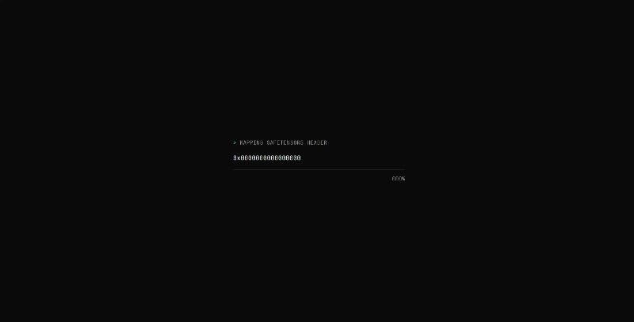
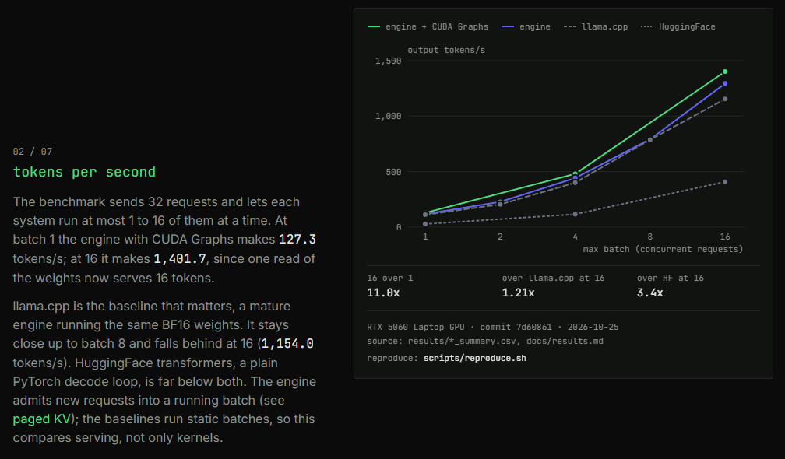
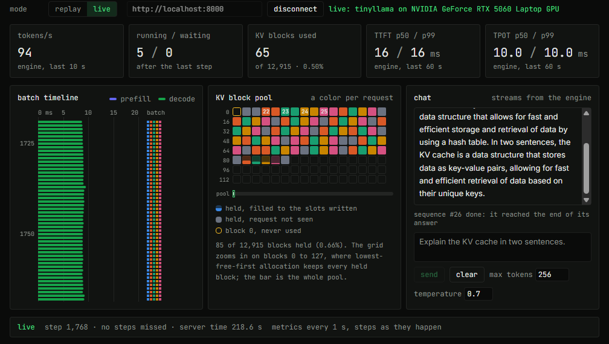

<p align="center">
    </br>
    <em>The site's homepage: decoded tokens rain down one column per sequence in the batch</em>
</p>

<p align="center">


</p>

<p align="center"><a href="#goals">Goals</a> • <a href="#results">Results</a> • <a href="#the-site">Site</a> • <a href="architecture.md">Architecture</a> • <a href="#building">Building</a> • <a href="reproduce.md">Reproducing</a> • <a href="#repository-layout">Layout</a></p>

> A single-GPU LLM inference engine in C++20 and CUDA. It serves [TinyLlama-1.1B-Chat-v1.0](https://huggingface.co/TinyLlama/TinyLlama-1.1B-Chat-v1.0) in BF16 with FP32 accumulation, matches HuggingFace output token for token, and serves many concurrent requests with a paged KV cache, a paged decode attention kernel, continuous batching, custom fused kernels, sampling on the GPU, and CUDA Graphs. The goal is not to beat vLLM. It is a small engine in which every design decision is measured, explained and reproducible: every performance number comes from a script in this repo that anyone can rerun.

## Goals

1. **Correct:** with teacher forcing on 20 fixed prompts, the engine's argmax token matches HuggingFace (BF16, same weights) at 99%+ of positions with a mean absolute logit error under 0.05, and free-running greedy output for the first 64 tokens either matches HF exactly or first differs where HF's own logits for the two tokens are at most 2 BF16 ulps apart, on all 20 prompts (an exact match on most prompts is out of reach in BF16: HF's own full forward pass agrees with its `generate()` on only 14 of the 20).
2. **Fast at batch 1:** decode reaches at least 60% of the GPU's measured DRAM bandwidth.
3. **Fast at batch N:** with 16 concurrent requests, total throughput is at least 5x the batch-1 throughput.
4. **Explained:** every kernel has before and after Nsight Compute numbers, and a results page with plots explains them.
5. **Reproducible:** a build plus one script reproduces every number in this README from a clean clone.

The measured state against these five criteria, with plots and the per-kernel table, is `results.md`; `scripts/reproduce.sh` regenerates it.

Correct comes first: nothing is optimized until the naive engine produces the same text as HuggingFace, and the naive kernels stay in the repo as the oracles the optimized kernels are tested against.

## Results

Measured on the RTX 5060 Laptop GPU on 2026-11-16 (commit eaddcb7, release build): 32 requests of 64 prompt and 64 output tokens, greedy, EOS ignored, all submitted at once, median of 3 runs. Every number here comes from `results.md`, which `scripts/reproduce.sh` regenerates; that page has the per-kernel table, the decode-step profiles and the caveats.

| # | Goal | Measured | |
| --- | --- | --- | --- |
| 1 | Correct | teacher forced: 99.57% argmax over 1,842 positions, mean absolute logit error 0.0285; free running: 15 of 20 prompts exact for 64 tokens, the other 5 first differ at a near tie of at most 2 BF16 ulps in HF's own logits | met |
| 2 | Fast at batch 1 | 302 GB/s of weights per token = 93% of the measured 323.6 GB/s (TPOT 6.86 ms) | met |
| 3 | Fast at batch N | 1,739 tokens/s at 16 concurrent requests against 145 at batch 1 = 12.0x | met |
| 4 | Explained | Nsight Compute before and after for paged attention (v1, v2, split), add + RMSNorm, RoPE and SwiGLU, and Nsight Systems launch gaps before and after CUDA Graphs, in `profiling.md`; `write_kv`, which has one version, is measured once (0.3% of a batch-1 step in Nsight Systems, 3.8 us per launch in Nsight Compute) | met |
| 5 | Reproducible | `scripts/reproduce.sh` rebuilds, tests and re-measures everything on this page | met |

Output tokens per second against the maximum number of concurrent requests:

| system | batch 1 | batch 4 | batch 16 | TPOT at batch 1 |
| --- | --- | --- | --- | --- |
| engine + CUDA Graphs | 144.9 | 549.6 | 1,738.5 | 6.86 ms |
| engine, eager | 128.2 | 490.6 | 1,544.9 | 7.71 ms |
| llama.cpp b11870 (CUDA, same BF16 weights) | 125.8 | 424.6 | 1,483.8 | 7.78 ms |
| HF transformers (BF16, static batches) | 25.5 | 88.8 | 318.2 | 38.85 ms |


With CUDA Graphs the engine is ahead of llama.cpp at every batch size: 1.15x at batch 1, 1.29x at 4 and 1.17x at 16 on the medians; llama.cpp's three batch-16 runs spread from 1,387 to 1,486 tokens/s, so against its best run the margin at 16 is also 1.17x. The baselines run static batches of identical requests, which favors them over the engine's continuous batching; `baselines.md` lists what is and is not comparable.


Decode is bandwidth bound at every batch size here: every point sits left of the 107 FLOP/byte ridge (measured 34.5 TFLOP/s BF16 GEMM peak over 323.6 GB/s). At batch 1 the cuBLAS GEMVs run at 99% to 110% of the bandwidth roof (a measured copy bandwidth, which a kernel that only reads can pass), so they cannot get faster without reading fewer bytes. At batch 16 the same GEMMs take the same time while doing 16 times the FLOPs, which is where the 12x comes from, but attention, whose intensity does not grow with the batch because each sequence reads its own KV cache, rises to 18% of kernel time at only 8% of its roof: the largest remaining target. The whole step with graphs is at 93% of the roof at batch 1 and 80% at batch 16 (llama.cpp 69%, HF 13%).

All numbers are from this one laptop GPU, whose clocks move by 10% to 20% between runs; a cloud GPU run was planned and has not been done.

## The site

[The site](https://llm-inference-engine-jz.vercel.app) (`web/`) is a static Next.js export built from the files in this repo, so its numbers cannot drift from the results above: the build fails if the CSV medians disagree with `results.md`. Run it with `cd web && npm ci && npm run dev`; `web/README.md` covers deploying it on Vercel.

**`/results`** walks through every measurement as a scroll story, with exact values on hover or by keyboard and, on each chart, the GPU, commit, date and command that produced it.



**`/kernels`** has a story page for each kernel and engine technique, including the dead ends, each drawn from recorded data with before and after numbers and links to the source. The paged KV page lets you allocate blocks yourself.


**`/dashboard`** shows the engine serving requests one scheduler step at a time: metric tiles, a batch timeline, the KV block pool and each request's text. By default it replays a recorded run of 24 chat requests, with play, pause, speed and a scrubber.


Its live mode connects to `engine serve` on your own machine and adds a chat playground, whose sequence is highlighted in the timeline and the pool while it streams. Live steps do not carry prompt lengths, so blocks the page cannot yet assign to a request show as gray.



## The model and why decode is memory bound

TinyLlama is a plain Llama: 22 layers, hidden size 2048, 32 query heads and 4 KV heads of width 64 (grouped-query attention with a group size of 8), an MLP of width 5632, a 32,000-token vocabulary and no RoPE scaling. That is about 1.1B parameters, 2.2 GB in BF16.

Decoding one token at batch 1 reads every weight except all but one row of the embedding table, about 2.07 GB, while doing only about two FLOPs per weight. At the measured 323.6 GB/s of this laptop GPU that is a floor of about 6.4 ms per token (about 156 tokens per second), however fast the arithmetic is. Batch-1 decode is therefore a bandwidth problem, and batching is what turns it into a compute problem: the same weight reads serve every sequence in the batch.

## Beyond the MVP

Llama-3.2-1B and other models, FP8 and INT8 Tensor Core GEMMs, prefix caching and copy-on-write blocks and a draft model that makes speculative decoding faster.

## Hardware

Developed on an RTX 5060 Laptop GPU (Blackwell, compute capability 12.0, 8 GB GDDR7, 26 SMs) under WSL2 with Ubuntu 24.04, CUDA 13.3 and GCC 13. Its measured memory bandwidth, 323.6 GB/s (about 84% of the theoretical peak), is the denominator for every "% of peak" figure. All the results above were measured on it; on another GPU, measure its ceilings first (see "Reproducing the results").

## Building

Requires CUDA 12.8 or newer (for `sm_120`), CMake 3.28 or newer, Ninja and a C++20 compiler; GoogleTest, nlohmann/json, CLI11 and cpp-httplib are found on the system or fetched. Download the model and link the directory that holds it into the repo as `models` (gitignored), or set `ENGINE_MODEL_DIR` to the model directory instead:

```bash
hf download TinyLlama/TinyLlama-1.1B-Chat-v1.0 --local-dir ~/models/tinyllama
```

```bash
ln -s ~/models models
```

```bash
cmake --preset release && cmake --build --preset release
```

```bash
ctest --preset release -LE todo_joe
```

The `cpu` preset builds and tests only the pure C++ parts, for machines without CUDA.

## Running and reproducing

[reproduce.md](reproduce.md) has the commands to generate text, run the benchmark and serve over HTTP, and the one script that measures every number in [results.md](results.md) again from a clean clone. The server has no authentication: keep it on loopback ([SECURITY.md](SECURITY.md)).

## Documentation

- [architecture.md](architecture.md): the decode loop and the design decisions
- [reproduce.md](reproduce.md): running the engine and reproducing the results
- [results.md](results.md), [profiling.md](profiling.md), [baselines.md](baselines.md), [hardware.md](hardware.md): what was measured, how, against what and on what
- [ownership.md](ownership.md): who wrote which part
- [docs/api.md](docs/api.md): the HTTP API
- [changelog.md](changelog.md): every change, by branch
- [CODE_OF_CONDUCT.md](CODE_OF_CONDUCT.md), [SECURITY.md](SECURITY.md) and the issue and pull request templates in `.github/`

## Repository layout

```
include/engine/   public headers (bench, core, kernels, loader, model, runtime, kv, sched, sampling, server, tokenizer)
src/              the engine_core (pure C++), engine_kernels (CUDA, cuBLAS), engine_runtime and engine_server libraries, and the CLI
results/          benchmark CSVs, decode-step profiles and plots (results/plots), written by scripts/reproduce.sh
tests/            unit tests, GPU tests, test helpers and generated golden data
scripts/          Python reference and golden scripts, profiling (profiling.md), baselines and plots (baselines.md)
docs/             API contract (api.md), learning exercises and working notes
*.md              architecture, reproduce, results, profiling, baselines, hardware, ownership and the changelog, at the root
web/              the project site (static Next.js export): results, kernel stories and the dashboard
assets/           images used by this README
```

## Ownership

This is Joe Zhuo's project, built with Claude as tutor, reviewer and writer of the supporting code. The core (kernels, paged attention, the KV block manager, the scheduler, CUDA Graph capture and the safetensors parser) is written by hand, apart from a few pieces Claude drafted at his request; `ownership.md` and the part tags in `changelog.md` record who wrote what.
