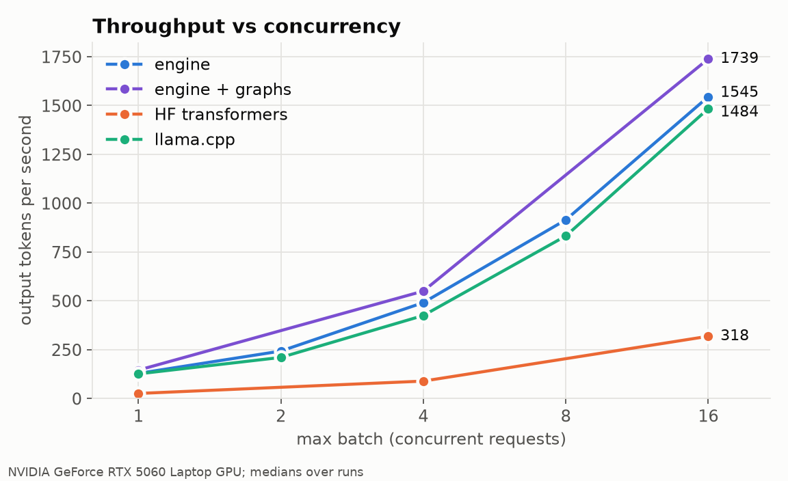
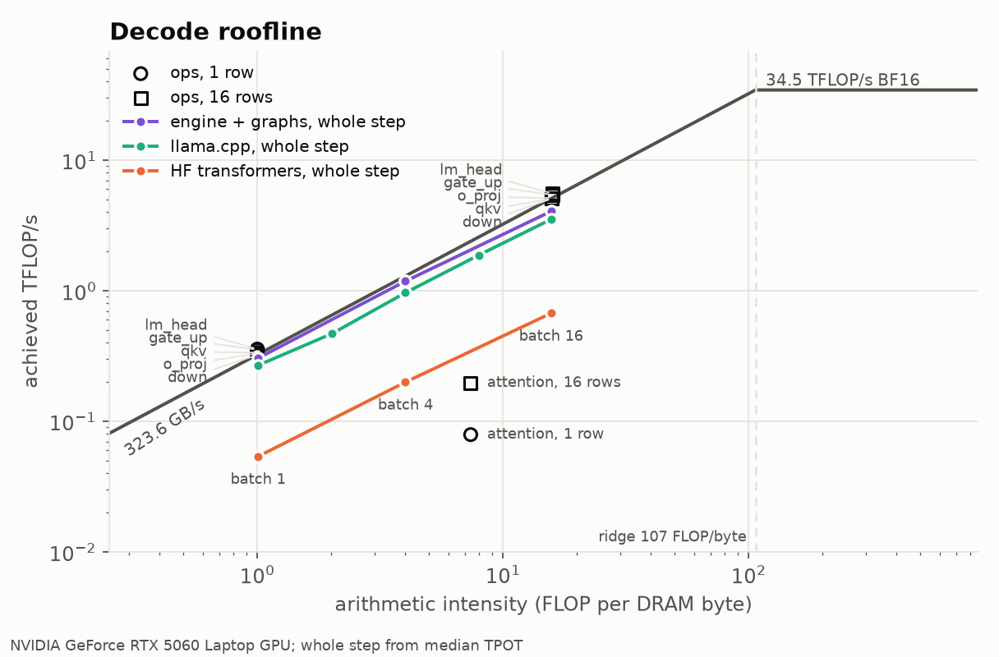
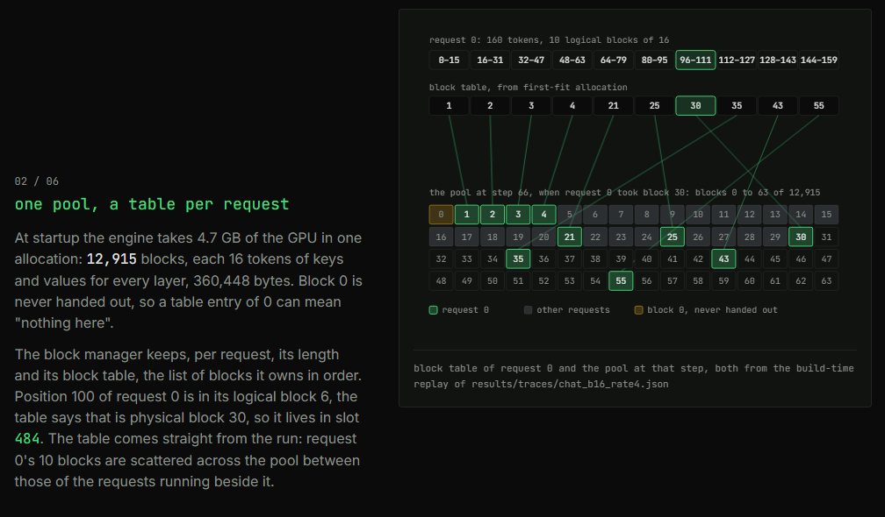
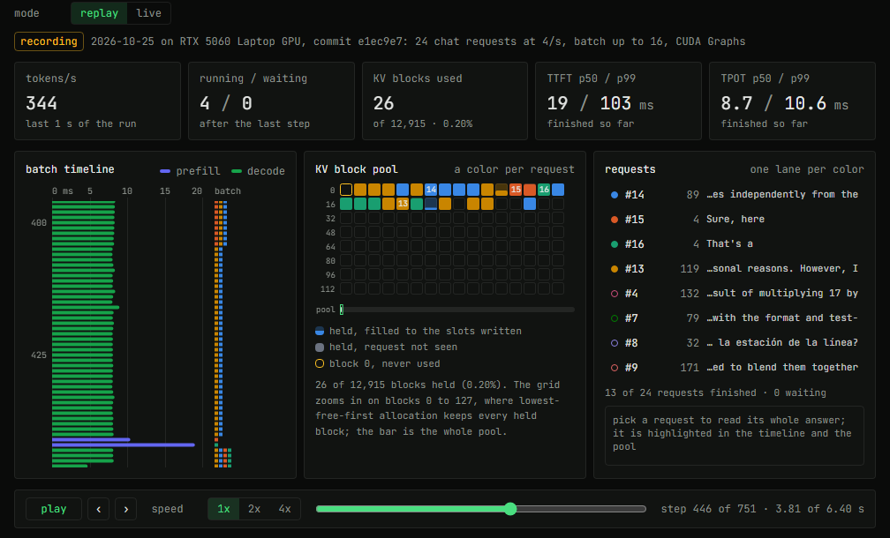

<p align="center">
    </br>
    <em>The site's homepage: decoded tokens rain down one column per sequence in the batch</em>
</p>

<p align="center">


</p>

<p align="center"><a href="#features">Features</a> • <a href="#results">Results</a> • <a href="#the-site">Site</a> • <a href="architecture.md">Architecture</a> • <a href="#building">Building</a> • <a href="reproduce.md">Reproducing</a> • <a href="#repository-layout">Layout</a></p>

> A single-GPU LLM inference engine in C++20 and CUDA. It serves [TinyLlama-1.1B-Chat-v1.0](https://huggingface.co/TinyLlama/TinyLlama-1.1B-Chat-v1.0) in BF16 and matches HuggingFace token for token. The goal is not to beat vLLM: it is a small engine in which every design decision is measured, explained and reproducible, and every number comes from a script in this repo that anyone can rerun.

## Features

Each feature with one measured number and the run it comes from. The plots and the exact values are on [the site's `/results`](https://llm-inference-engine-jz.vercel.app/results) and in [results.md](results.md).

| Feature | Number | Measured |
| --- | --- | --- |
| Matches HuggingFace (BF16, same weights) | 99.57% of argmax tokens over 1,842 positions, teacher forced | commit eaddcb7, Nov 16 |
| Paged KV cache and continuous batching | 1,739 tok/s at 16 concurrent requests, 12.0x batch 1 | commit eaddcb7, Nov 16 |
| CUDA Graphs for the decode step | 7.71 → 6.86 ms per token at batch 1 | commit eaddcb7, Nov 16 |
| Batch-1 decode near the bandwidth roof (fused add + RMSNorm, RoPE and SwiGLU kernels, cuBLAS GEMVs) | 302 GB/s of weights per token at batch 1, 93% of the measured 323.6 | commit eaddcb7, Nov 16 |
| Split decode attention for long contexts | 14.05 → 9.13 ms per token at a 1,984-token prompt, batch 1, graphs | [profiling.md](profiling.md), Oct 23 |
| FlashAttention-style prefill on the tensor cores | 1,508 → 203 ms to the first token of a 2,048-token prompt (llama.cpp: 231) | measured together on Nov 10, median of 5 |
| Chunked prefill (a token budget per step) | longest wait between two tokens 241 → 38 ms when a 1,917-token prompt arrives | commit 1feaba9, Nov 11 |
| Batches past 16 | 3,146 tok/s at max batch 256 | commit 434e99d, Nov 9 |
| Speculative decoding (prompt lookup or a draft model) | 1.92x tokens/s on prompts the answer repeats, batch 1 | commit 2209da5, Nov 12 |
| Prefix caching | 127 → 24 ms to the first token with a shared 1,024-token prefix | commit 23cce91, Nov 22 |
| Tensor parallelism, every rank on this one GPU | 2 ranks give the same greedy tokens, logits within 0.75 (a check, not a speedup: 11.21 against 8.27 ms) | commit 284c886, Nov 14 |
| HTTP server with streaming (`engine serve`) | goodput 4.32 req/s at 6 requests/s, against vLLM 0.32.0's 6.30 | commit 1feaba9, Nov 11 |

The rows on commit eaddcb7 come from one run of `scripts/reproduce.sh`, release build: 32 requests of 64 prompt and 64 output tokens, greedy, EOS ignored, all submitted at once, median of 3 runs. The other rows each name the commit of their own section in `results.md`, which also gives their workloads.

## Results

### Goals

1. **Correct:** with teacher forcing on 20 fixed prompts, the engine's argmax token matches HuggingFace at 99%+ of positions with a mean absolute logit error under 0.05, and free-running greedy output for the first 64 tokens either matches HF exactly or first differs where HF's own logits for the two tokens are at most 2 BF16 ulps apart, on all 20 prompts.
2. **Fast at batch 1:** decode reaches at least 60% of the GPU's measured DRAM bandwidth.
3. **Fast at batch N:** with 16 concurrent requests, total throughput is at least 5x the batch-1 throughput.
4. **Explained:** every kernel has before and after Nsight Compute numbers, and a results page with plots explains them.
5. **Reproducible:** a build plus one script reproduces every number in this README from a clean clone.

Correct came first: nothing was optimized until the naive engine produced the same text as HuggingFace, and the naive kernels stay in the repo as the oracles the fast kernels are tested against.

### Measured

Measured on the RTX 5060 Laptop GPU on 2026-11-16 (commit eaddcb7, release build): 32 requests of 64 prompt and 64 output tokens, greedy, EOS ignored, all submitted at once, median of 3 runs (HuggingFace: one run). `scripts/reproduce.sh` regenerates all of it in `results.md`, with the per-kernel table, the decode-step profiles and the caveats.

| # | Goal | Measured | |
| --- | --- | --- | --- |
| 1 | Correct | teacher forced: 99.57% argmax over 1,842 positions, mean absolute logit error 0.0285; free running: 15 of 20 prompts exact for 64 tokens, the other 5 first differ at a near tie of at most 2 BF16 ulps in HF's own logits | met |
| 2 | Fast at batch 1 | 302 GB/s of weights per token = 93% of the measured 323.6 GB/s (TPOT 6.86 ms) | met |
| 3 | Fast at batch N | 1,739 tokens/s at 16 concurrent requests against 145 at batch 1 = 12.0x | met |
| 4 | Explained | Nsight Compute before and after for paged attention (v1, v2, split), add + RMSNorm, RoPE and SwiGLU, and Nsight Systems launch gaps before and after CUDA Graphs, in `profiling.md` | met |
| 5 | Reproducible | `scripts/reproduce.sh` rebuilds, tests and re-measures everything on this page | met |

Output tokens per second against the maximum number of concurrent requests, all from that one run:

| system | batch 1 | batch 4 | batch 16 | TPOT at batch 1 | runs |
| --- | --- | --- | --- | --- | --- |
| engine + CUDA Graphs | 144.9 | 549.6 | 1,738.5 | 6.86 ms | 3 |
| engine, eager | 128.2 | 490.6 | 1,544.9 | 7.71 ms | 3 |
| llama.cpp b11870 (CUDA, same BF16 weights) | 125.8 | 424.6 | 1,483.8 | 7.78 ms | 3 |
| HF transformers 5.17 (BF16, `sdpa`, static batches) | 25.5 | 88.8 | 318.2 | 38.85 ms | 1 |



With CUDA Graphs the engine is ahead of llama.cpp at every batch size: 1.15x at batch 1, 1.29x at 4 and 1.17x at 16 on the medians; llama.cpp's three batch-16 runs spread from 1,387 to 1,486 tokens/s, so against its best run the margin at 16 is also 1.17x. The baselines run static batches of identical requests, which favors them over the engine's continuous batching; `baselines.md` lists what is and is not comparable. HuggingFace is an eager Python loop that is bound by the CPU, so its runs spread more than the others: it ran once in this run, and over every run of this same workload so far its batch-16 throughput has been 318 to 548 tokens/s (318 is this run, the lowest; 548 is from a rerun on 2026-11-23 on a power-capped GPU that was not committed). Against the engine's 1,738.5 that is 3.2x to 5.5x, so read the HuggingFace column as about 3x to 5x slower, not as an exact ratio.



Decode is bandwidth bound at every batch size here: every point sits left of the 107 FLOP/byte ridge (measured 34.5 TFLOP/s BF16 GEMM peak over 323.6 GB/s). At batch 1, decoding a token reads about 2.07 GB of weights, a floor of 6.4 ms per token at 323.6 GB/s; the engine's 6.86 ms is 93% of that roof because CUDA Graphs leave the GPU almost no idle time between kernels and the cuBLAS GEMVs read at 99% to 110% of the measured copy bandwidth. At batch 16 the same GEMMs take the same time for 16 times the FLOPs, and attention, which reads each sequence's own KV cache, is the largest remaining cost.

Other batch-1 times on the site come from other runs: 8.51 ms is from Oct 17 (commit 6b170a5), before the faster attention and norm kernels, and 8.27 ms is the tensor-parallel baseline, the contiguous `ModelRunner` with the naive kernels and no CUDA Graphs (commit 284c886). The batch sweep reads 1,424 tokens/s at max batch 16 for this same workload: it ran a week earlier (Nov 9, commit 434e99d, before the FlashAttention prefill kernel became the default) with a headless Chrome using about 6 CPU cores, and it has not been rerun on eaddcb7, so the 18% gap has no single measured cause.

All numbers are from this one laptop GPU, whose clocks move by 10% to 20% between runs; a cloud GPU run has not been done.

## The site

[The site](https://llm-inference-engine-jz.vercel.app) (`web/`) is a static Next.js export built from the files in this repo, so its numbers cannot drift from the results above: the build fails if the CSV medians disagree with `results.md`. Run it with `cd web && npm ci && npm run dev`; `web/README.md` covers deploying it on Vercel.

**`/results`** walks through every measurement as a scroll story, with exact values on hover or by keyboard and, on each chart, the GPU, commit, date and command that produced it.


**`/kernels`** has a story page for each kernel and engine technique, including the dead ends, each drawn from recorded data with before and after numbers and links to the source. **`/every-byte`** is the same material as a book you page through, with a review at the end of each chapter, and **`/exercises`** lists the stubs to write yourself against the tests in this repo.



**`/dashboard`** shows the engine serving requests one scheduler step at a time: metric tiles, a batch timeline, the KV block pool and each request's text. By default it replays a recorded run of 24 chat requests; its live mode connects to `engine serve` on your own machine and adds a chat playground.



## The model and why decode is memory bound

TinyLlama is a plain Llama: 22 layers, hidden size 2048, 32 query heads and 4 KV heads of width 64 (grouped-query attention with a group size of 8), an MLP of width 5632, a 32,000-token vocabulary and no RoPE scaling. That is about 1.1B parameters, 2.2 GB in BF16.

Decoding one token at batch 1 reads every weight except all but one row of the embedding table, about 2.07 GB, while doing only about two FLOPs per weight. At the measured 323.6 GB/s that is a floor of about 6.4 ms per token, however fast the arithmetic is. Batch-1 decode is therefore a bandwidth problem, and batching is what turns it into a compute problem: the same weight reads serve every sequence in the batch.

## Next

Each already in the tree as a stub with its spec and tests: decode attention that loads each KV head once for the 8 query heads that share it, and FP8 for the KV cache and the GEMMs. After those: Llama-3.2-1B and other models, and a draft model that makes speculative decoding faster (TinyStories-110M makes it slower).

## Hardware

Developed on an RTX 5060 Laptop GPU (Blackwell, compute capability 12.0, 8 GB GDDR7, 26 SMs) under WSL2 with Ubuntu 24.04, CUDA 13.3 and GCC 13. Its measured memory bandwidth, 323.6 GB/s (about 84% of the theoretical peak), is the denominator for every "% of peak" figure. On another GPU, measure its ceilings first ([reproduce.md](reproduce.md#reproducing-the-results)).

## Building

Requires CUDA 12.8 or newer (for `sm_120`), CMake 3.28 or newer, Ninja and a C++20 compiler; GoogleTest, nlohmann/json, CLI11, cpp-httplib and SentencePiece are found on the system or fetched. Download the model and link the directory that holds it into the repo as `models` (gitignored), or set `ENGINE_MODEL_DIR` to the model directory instead:

```bash
hf download TinyLlama/TinyLlama-1.1B-Chat-v1.0 --local-dir ~/models/tinyllama
```

```bash
ln -s ~/models models
```

```bash
cmake --preset release && cmake --build --preset release
```

```bash
ctest --preset release -LE todo_joe
```

The `cpu` preset builds and tests only the pure C++ parts, for machines without CUDA.

## Running and reproducing

[reproduce.md](reproduce.md) has the commands to generate text, run the benchmark and serve over HTTP, and the one script that measures every number in [results.md](results.md) again from a clean clone. The server has no authentication: keep it on loopback ([SECURITY.md](SECURITY.md)).

## Documentation

- [architecture.md](architecture.md): the decode loop and the design decisions
- [reproduce.md](reproduce.md): running the engine and reproducing the results
- [results.md](results.md), [profiling.md](profiling.md), [baselines.md](baselines.md), [hardware.md](hardware.md): what was measured, how, against what and on what
- [ownership.md](ownership.md): who wrote which part
- [docs/api.md](docs/api.md): the HTTP API
- [changelog.md](changelog.md): every change, by branch
- [LICENSE](LICENSE): MIT
- [CODE_OF_CONDUCT.md](CODE_OF_CONDUCT.md), [SECURITY.md](SECURITY.md) and the issue and pull request templates in `.github/`

## Repository layout

```
include/engine/   public headers (bench, core, kernels, loader, model, runtime, kv, sched, sampling, server, tokenizer)
src/              the engine_core (pure C++), engine_kernels (CUDA, cuBLAS), engine_runtime and engine_server libraries, and the CLI
results/          benchmark CSVs, decode-step profiles and plots (results/plots), written by scripts/reproduce.sh
tests/            unit tests, GPU tests, test helpers and generated golden data
scripts/          Python reference and golden scripts, profiling (profiling.md), baselines and plots (baselines.md)
docs/             API contract (api.md), learning exercises and working notes
*.md              architecture, reproduce, results, profiling, baselines, hardware, ownership and the changelog, at the root
web/              the project site (static Next.js export): results, kernel stories and the dashboard
assets/           images used by this README
graphify-out/     a generated knowledge graph of the repo (GRAPH_REPORT.md)
```

## Ownership

This is Joe Zhuo's project, built with Claude as tutor, reviewer and writer of the supporting code. The core (kernels, paged attention, the KV block manager, the scheduler, CUDA Graph capture and the safetensors parser) is written by hand, apart from a few pieces Claude drafted at his request; `ownership.md` and the part tags in `changelog.md` record who wrote what.
