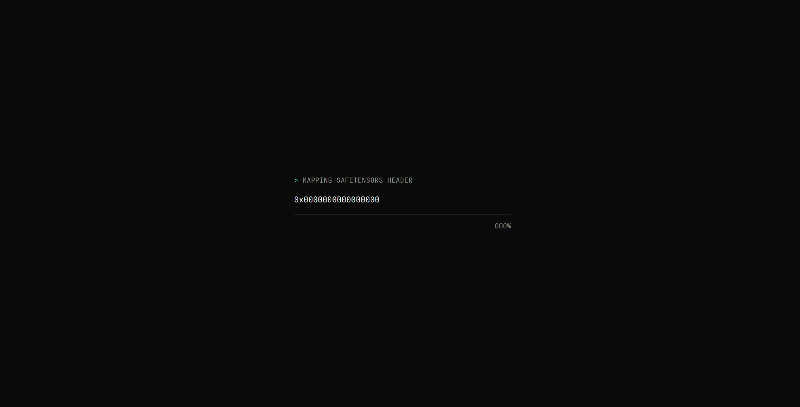

<p align="center">
    </br>
    <em>The site's homepage: decoded tokens rain down one column per sequence in the batch</em>
</p>

<p align="center">


</p>

<p align="center"><a href="#goals">Goals</a> • <a href="#results">Results</a> • <a href="#architecture">Architecture</a> • <a href="#design-decisions">Design decisions</a> • <a href="#building">Building</a> • <a href="#reproducing-the-results">Reproducing</a> • <a href="#repository-layout">Layout</a></p>

> A single-GPU LLM inference engine in C++20 and CUDA. It serves [TinyLlama-1.1B-Chat-v1.0](https://huggingface.?co/TinyLlama/TinyLlama-1.1B-Chat-v1.0) in BF16 with FP32 accumulation, matches HuggingFace output token for token, and serves many concurrent requests with a paged KV cache, a paged decode attention kernel, continuous batching, custom fused kernels, sampling on the GPU, and CUDA Graphs. The goal is not to beat vLLM. It is a small engine in which every design decision is measured, explained and reproducible: every performance number comes from a script in this repo that anyone can rerun.

## Goals

1. **Correct:** with teacher forcing on 20 fixed prompts, the engine's argmax token matches HuggingFace (BF16, same weights) at 99%+ of positions with a mean absolute logit error under 0.05, and free-running greedy output for the first 64 tokens either matches HF exactly or first differs where HF's own logits for the two tokens are at most 2 BF16 ulps apart, on all 20 prompts (an exact match on most prompts is out of reach in BF16: HF's own full forward pass agrees with its `generate()` on only 14 of the 20).
2. **Fast at batch 1:** decode reaches at least 60% of the GPU's measured DRAM bandwidth.
3. **Fast at batch N:** with 16 concurrent requests, total throughput is at least 5x the batch-1 throughput.
4. **Explained:** every kernel has before and after Nsight Compute numbers, and a results page with plots explains them.
5. **Reproducible:** a build plus one script reproduces every number in this README from a clean clone.

The measured state against these five criteria, with plots and the per-kernel table, is `docs/results.md`; `scripts/reproduce.sh` regenerates it.

Correct comes first: nothing is optimized until the naive engine produces the same text as HuggingFace, and the naive kernels stay in the repo as the oracles the optimized kernels are tested against.

## Results

Measured on the RTX 5060 Laptop GPU on 2026-10-25 (commit 7d60861, release build): 32 requests of 64 prompt and 64 output tokens, greedy, EOS ignored, all submitted at once, median of 3 runs. Every number here comes from `docs/results.md`, which `scripts/reproduce.sh` regenerates; that page has the per-kernel table, the decode-step profiles and the caveats.

| # | Goal | Measured | |
| --- | --- | --- | --- |
| 1 | Correct | teacher forced: 99.57% argmax over 1,842 positions, mean absolute logit error 0.0285; free running: 15 of 20 prompts exact for 64 tokens, the other 5 first differ at a near tie of at most 2 BF16 ulps in HF's own logits | met |
| 2 | Fast at batch 1 | 265 GB/s of weights per token = 82% of the measured 323.6 GB/s (TPOT 7.81 ms) | met |
| 3 | Fast at batch N | 1,402 tokens/s at 16 concurrent requests against 127 at batch 1 = 11.0x | met |
| 4 | Explained | Nsight Compute before and after for paged attention (v1, v2, split), add + RMSNorm, RoPE and SwiGLU, and Nsight Systems launch gaps before and after CUDA Graphs, in `docs/profiling.md`; `write_kv`, which has one version, is measured once (0.4% of a batch-1 step in Nsight Systems, 3.8 us per launch in Nsight Compute) | met |
| 5 | Reproducible | `scripts/reproduce.sh` rebuilds, tests and re-measures everything on this page | met |

Output tokens per second against the maximum number of concurrent requests:

| system | batch 1 | batch 4 | batch 16 | TPOT at batch 1 |
| --- | --- | --- | --- | --- |
| engine + CUDA Graphs | 127.3 | 478.4 | 1,401.7 | 7.81 ms |
| engine, eager | 115.8 | 441.4 | 1,293.6 | 8.52 ms |
| llama.cpp b11870 (CUDA, same BF16 weights) | 110.1 | 399.2 | 1,154.0 | 8.89 ms |
| HF transformers (BF16, static batches) | 26.6 | 114.4 | 407.0 | 37.62 ms |


With CUDA Graphs the engine is ahead of llama.cpp at every batch size: 1.16x at batch 1, 1.20x at 4 and 1.21x at 16 on the medians, though llama.cpp's three batch-16 runs spread from 953 to 1,271 tokens/s, so against its best run the margin at 16 is 1.10x. The baselines run static batches of identical requests, which favors them over the engine's continuous batching; `docs/baselines.md` lists what is and is not comparable.


Decode is bandwidth bound at every batch size here: every point sits left of the 107 FLOP/byte ridge (measured 34.5 TFLOP/s BF16 GEMM peak over 323.6 GB/s). At batch 1 the cuBLAS GEMVs run at 91% to 102% of the bandwidth roof, so they cannot get faster without reading fewer bytes. At batch 16 the same GEMMs take the same time while doing 16 times the FLOPs, which is where the 11x comes from, but attention, whose intensity does not grow with the batch because each sequence reads its own KV cache, rises to 19% of kernel time at only 7% of its roof: the largest remaining target. The whole step with graphs is at 82% of the roof at batch 1 and 68% at batch 16 (llama.cpp 54%, HF 17%).

All numbers are from this one laptop GPU, whose clocks move by 10% to 20% between runs; a cloud GPU run was planned and has not been done.

## Architecture

```
CLI / bench harness
      |  requests
      v
  Scheduler  <---------------------------------+
      |  batch for this step                   |
      v                                        |
  KV block manager (free list, block tables)   |
      |                                        |
      v                                        |
  Model runner  -- weights from the loader     |
      |  (graph replay when batch fits)        |
      v                                        |
  Kernels + cuBLAS GEMMs                       |
      |  logits                                |
      v                                        |
  Sampler  ----- one token per sequence -------+
```

Each decode step, the scheduler picks the running sequences, the block manager makes sure each has a free cache slot for its next token, the model runner launches one forward pass for the whole batch (replaying a captured CUDA Graph when the batch size matches a captured bucket), the sampler returns one token per sequence, and the scheduler retires finished sequences and admits waiting ones.

## The model and why decode is memory bound

TinyLlama is a plain Llama: 22 layers, hidden size 2048, 32 query heads and 4 KV heads of width 64 (grouped-query attention with a group size of 8), an MLP of width 5632, a 32,000-token vocabulary and no RoPE scaling. That is about 1.1B parameters, 2.2 GB in BF16.

Decoding one token at batch 1 reads every weight except all but one row of the embedding table, about 2.07 GB, while doing only about two FLOPs per weight. At the measured 323.6 GB/s of this laptop GPU that is a floor of about 6.4 ms per token (about 156 tokens per second), however fast the arithmetic is. Batch-1 decode is therefore a bandwidth problem, and batching is what turns it into a compute problem: the same weight reads serve every sequence in the batch.

## Design decisions

- **Numerics:** BF16 weights and activations with FP32 accumulation, matching HuggingFace's details exactly: rotate_half RoPE (pairing dimension i with i + 32), BF16 rounding of the residual stream before each RMSNorm, and BF16 rounding before each weight multiply.
- **Weight loading:** the safetensors file is `mmap`ed, its header is parsed and validated, and every tensor is copied into one device allocation through two pinned staging buffers, so copying out of the mapping overlaps the PCIe transfer of the previous chunk. It is not "zero-copy": `mmap` pages are not pinned, so copying straight from them would go through a hidden driver copy anyway.
- **Fused weights at load time:** Q, K and V are concatenated into one `[2560, 2048]` matrix and gate and up into one `[11264, 2048]` matrix, turning five GEMMs per layer into two at no runtime cost.
- **GEMMs through cuBLAS:** the weights are row-major `[out, in]` and cuBLAS is column-major, so `y = x W^T` is computed as the column-major product `Y^T = W X^T` in one `cublasGemmEx` call. A hand-written GEMM is a learning kernel benchmarked against cuBLAS, not a replacement for it.
- **Paged KV cache:** blocks of 16 tokens laid out `[num_blocks, kv_heads, 16, 64]` per layer, block 0 reserved as a null block, and 90% of the VRAM left after the weights given to the cache. Sequences get blocks from a free list through per-sequence block tables, so memory is never reserved for tokens that do not exist yet.
- **Paged decode attention:** version 1 keeps the scores in shared memory (context capped at 2,048); version 2 uses an online softmax with one thread block per KV head, so each block reads its K and V once for all 8 query heads that share them. For 1 to 4 sequences at 512 tokens or more, a split version cuts each context across several blocks and merges their partial softmax results, which fills the GPU at batch 1 (2.8x faster attention at 2,048 tokens).
- **Continuous batching:** waiting, running and finished queues, admission by free blocks, and recompute-style preemption when the cache runs out. Each step is all prefill or all decode; the resulting stall is measured so chunked prefill can fix it later.
- **Sampling on the GPU:** greedy, Gumbel-max for temperature sampling, and top-k and top-p through binary-searched thresholds instead of a full sort of the vocabulary.
- **CUDA Graphs:** with `--graphs` decode is captured for batch sizes 1, 2, 4, 8, 16 and so on up to the max batch and replayed from fixed device buffers, which removes per-kernel launch overhead; each batch size that can split its attention also gets one graph per split count, so long contexts replay the split kernel too; prefill runs eagerly.
- **Portable headers:** public headers in `include/engine/` contain no CUDA includes, so the pure C++ parts (config, parser, layout planner, checksums) build and test on machines without a GPU, including macOS.

## Beyond the MVP

Llama-3.2-1B and other models, FP8 and INT8 Tensor Core GEMMs, FlashAttention-style prefill, prefix caching and copy-on-write blocks, chunked prefill and speculative decoding.

## Hardware

Developed on an RTX 5060 Laptop GPU (Blackwell, compute capability 12.0, 8 GB GDDR7, 26 SMs) under WSL2 with Ubuntu 24.04, CUDA 13.3 and GCC 13. Its measured memory bandwidth, 323.6 GB/s (about 84% of the theoretical peak), is the denominator for every "% of peak" figure. All the results above were measured on it; on another GPU, measure its ceilings first (see "Reproducing the results").

## Building

Requires CUDA 12.8 or newer (for `sm_120`), CMake 3.28 or newer, Ninja and a C++20 compiler; GoogleTest, nlohmann/json and CLI11 are found on the system or fetched. Download the model and link the directory that holds it into the repo as `models` (gitignored), or set `ENGINE_MODEL_DIR` to the model directory instead:

```bash
hf download TinyLlama/TinyLlama-1.1B-Chat-v1.0 --local-dir ~/models/tinyllama
```

```bash
ln -s ~/models models
```

```bash
cmake --preset release && cmake --build --preset release
```

```bash
ctest --preset release -LE todo_joe
```

The `cpu` preset builds and tests only the pure C++ parts, for machines without CUDA.

## Running

```bash
./build/release/bin/engine generate --model models/tinyllama --prompt "Write a haiku about GPUs."
```

The answer streams to stdout as it decodes, followed on stderr by the prompt and generated token counts, the time to the first token and the decode rate. `--system` adds a system message and `--max-new-tokens` (default 256) caps the answer. Decoding is greedy by default; `--temperature 0.7` samples from `softmax(logits / 0.7)` on the GPU with the Gumbel-max trick, `--top-k K` and `--top-p P` then restrict each draw to the K most likely tokens or to the most likely tokens whose probability reaches P (applied in that order after the temperature, as in Hugging Face), and `--seed N` makes the answer repeatable (without it the seed is random and printed on stderr). `generate` serves one request through the contiguous `ModelRunner`, the naive-kernel engine the correctness tests use as their oracle, not through the paged runner and fast kernels that `bench --max-batch` serves: 125 to 135 tokens/s on the RTX 5060, greedy or sampled, with or without top-k and top-p.

```bash
./build/release/bin/engine bench --model models/tinyllama --num-requests 64 --prompt-len 128 --output-len 256 --out results/laptop_b1.csv
```

`bench` serves a synthetic workload and writes two CSVs: one row per request (`--out`: prompt and output tokens, preemptions, arrival time, TTFT, TPOT and latency in seconds) and one summary row (`results/laptop_b1_summary.csv`, or `--summary`) with the run's settings, the GPU, the build type, throughput, the mean, p50, p90 and p99 of TTFT, TPOT and latency, and the achieved bandwidth (the 2.07 GB of weights a decode step reads, divided by the median TPOT). Prompts are random token ids after BOS, or with `--prompts scripts/prompts.json` the chat prompts of that file in turn (rendered with the chat template; `--prompt-len` is then ignored); `--prompt-len` and `--output-len` take a length `N` or a range `MIN:MAX` drawn per request, `--seed` fixes the prompts, and `--request-rate R` spreads arrivals as a Poisson process at R requests per second instead of submitting all of them at once. Every request generates its full output length unless `--stop-at-eos` is given, and `--warmup` (default 3) untimed requests run first. `--max-batch N` serves through the paged runner with up to N concurrent sequences and `--graphs` (with `--max-batch`) replays CUDA Graphs for the decode steps. Sampling takes the same `--temperature`, `--top-k` and `--top-p` as `generate`, with seed `seed + i` for request `i`. Without `--max-batch` requests run one at a time through the contiguous `ModelRunner`. With every request submitted at once, the TTFT includes the time a request waits behind the earlier ones, which is why the batch-1 TTFT in the results is several seconds. Benchmark only the `release` preset (the command warns otherwise), plugged in and in maximum performance mode. The laptop's clocks move by 10% to 20% between runs, which is why every summary records its date and settings and `scripts/reproduce.sh` reports the median of several runs.

```bash
./build/release/bin/engine serve --model models/tinyllama --graphs
curl -N localhost:8000/v1/chat/completions -H 'Content-Type: application/json' -d '{"messages":[{"role":"user","content":"Write a haiku about GPUs."}],"max_tokens":64,"stream":true}'
```

`serve` loads the model and answers on `127.0.0.1:8000` (`--host`, `--port`): an OpenAI-compatible `POST /v1/chat/completions`, streamed or not, `GET /health`, `GET /metrics`, and `GET /v1/steps`, a Server-Sent Events stream of every scheduler step in the format of the trace files. One engine thread runs the scheduler while HTTP threads add requests between steps. `--max-batch` (default 16) and `--graphs` are those of `bench`; `--temperature`, `--top-k`, `--top-p` and `--max-tokens` are the defaults for requests that do not set them; `--cors-origin`, repeatable, lists the browser origins allowed to call it (default `http://localhost:3000`), which is what the site's dashboard needs in live mode. `docs/api.md` is the contract.

**Security:** the server has no authentication and no rate limit. It binds to loopback by default for that reason: never expose it publicly, forward its port or tunnel it, since anyone who can reach it can use the GPU and read every prompt's answers through `/v1/steps`. A client that disconnects stops receiving tokens, but until `Scheduler::cancel` is implemented (a Part C stub with `todo_joe` tests) its sequence decodes to its limit before its blocks come back.

## Reproducing the results

From a clean clone, after the build above. The Python scripts (golden data, the HuggingFace baseline, plots) need the pinned packages in a virtual environment, which `scripts/reproduce.sh` looks for at `~/.venvs/llmie` (or set `PYTHON`):

```bash
python3 -m venv ~/.venvs/llmie && ~/.venvs/llmie/bin/pip install -r scripts/requirements.txt
```

The golden data the correctness tests compare against is generated from the model, not committed (`tests/golden/` is gitignored):

```bash
~/.venvs/llmie/bin/python scripts/checksum.py --model models/tinyllama --out tests/golden/checksums.json
```

```bash
~/.venvs/llmie/bin/python scripts/tokenizer_golden.py --model models/tinyllama --out tests/golden/tokenizer.json
```

```bash
~/.venvs/llmie/bin/python scripts/dump_reference.py --model models/tinyllama --out tests/golden/reference
```

The llama.cpp baseline is a pinned release (b11870) built outside the repo, plus a BF16 GGUF of the same weights; without it `reproduce.sh` skips the llama.cpp rows. On a GPU other than the RTX 5060 set `LLAMA_CUDA_ARCH` (89 for an L4 or an RTX 4090):

```bash
scripts/setup_llamacpp.sh
```

Then one script rebuilds the release preset, runs the tests and the HF comparison, benchmarks the engine (eager at max batch 1, 2, 4, 8, 16 and with CUDA Graphs at 1, 4, 16), HuggingFace and llama.cpp, profiles batch-1 and batch-16 decode steps with Nsight Systems when `nsys` is installed, draws the plots and the roofline, and rewrites the measured blocks of `docs/results.md`. Plug the laptop in, use maximum performance mode and close other GPU programs first. A full run takes about 10 minutes; `--quick` is a smoke run, and `--skip-tests`, `--skip-hf` and `--skip-llamacpp` leave those parts out:

```bash
scripts/reproduce.sh
```

The "% of peak" figures and the roofline use measured ceilings, not datasheet ones: 323.6 GB/s and 34.5 TFLOP/s on the laptop (`docs/hardware.md`). On another GPU measure both and pass them as `PEAK_GB_S` and `PEAK_TFLOPS`:

```bash
nvcc -O3 -arch=native src/practice/bandwith_test.cu -o /tmp/bandwidth_test && /tmp/bandwidth_test
```

```bash
nvcc -std=c++20 -arch=native scripts/gemm_peak.cu -lcublas -o /tmp/gemm_peak && /tmp/gemm_peak
```

The `results/` files and `docs/results.md` are committed right after the code they measured, and `results/environment.txt` records the commit, GPU, driver, CUDA version and date of the run.

## Repository layout

```
include/engine/   public headers (bench, core, kernels, loader, model, runtime, kv, sched, sampling, server, tokenizer)
src/              the engine_core (pure C++), engine_kernels (CUDA, cuBLAS), engine_runtime and engine_server libraries, and the CLI
results/          benchmark CSVs, decode-step profiles and plots (results/plots), written by scripts/reproduce.sh
tests/            unit tests, GPU tests, test helpers and generated golden data
scripts/          Python reference and golden scripts, profiling (docs/profiling.md), baselines and plots (docs/baselines.md)
docs/             results, profiling, baselines, hardware notes, ownership, and learning exercises
```

## Ownership

This is Joe Zhuo's project, built with Claude as tutor, reviewer and writer of the supporting code. The core (kernels, paged attention, the KV block manager, the scheduler, CUDA Graph capture and the safetensors parser) is written by hand; `docs/ownership.md` records who wrote each component.
