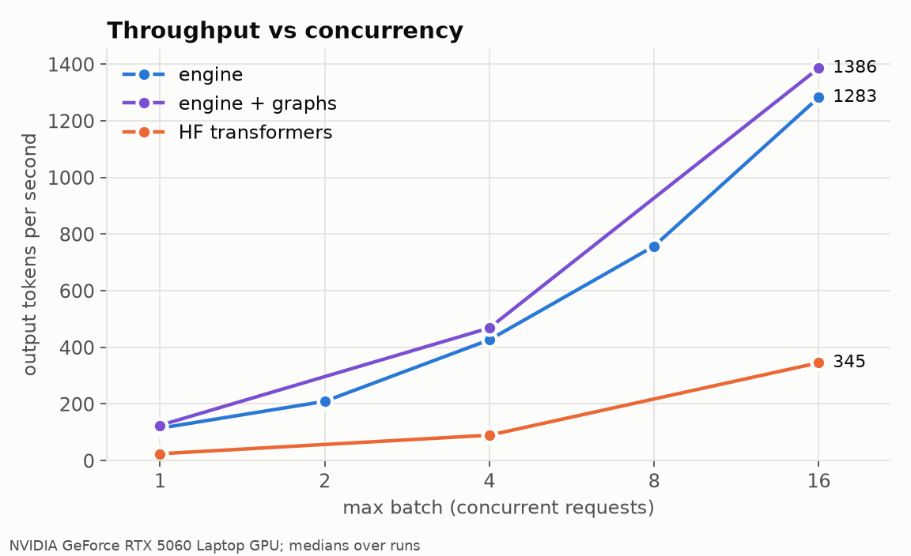
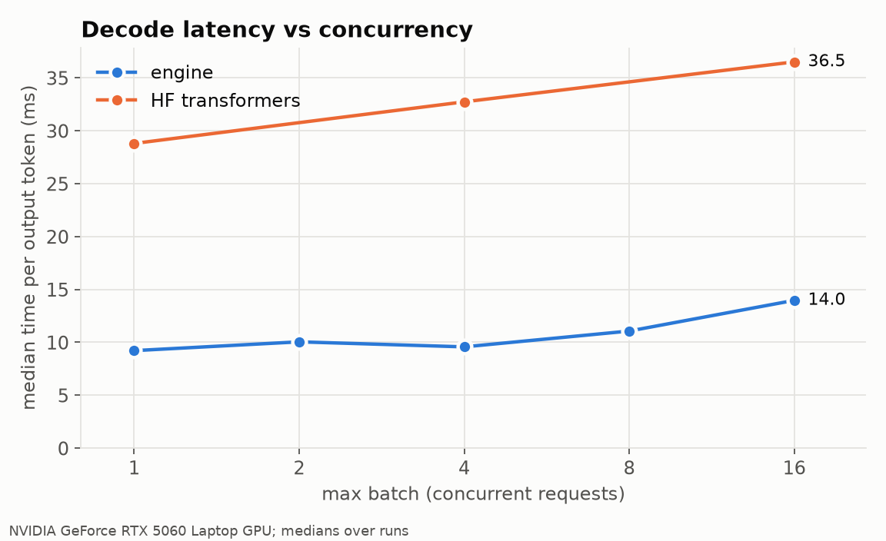
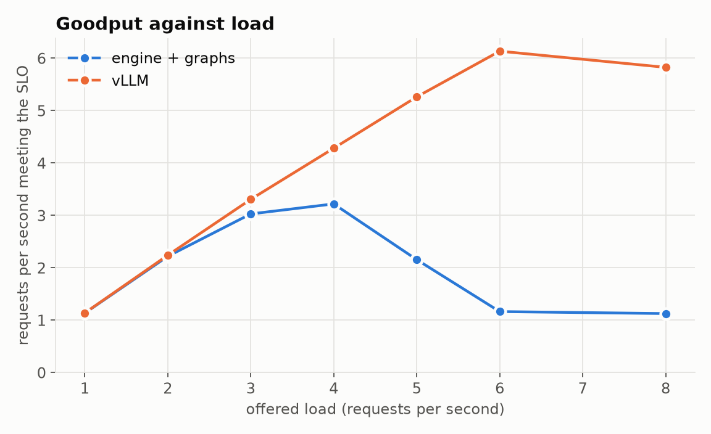
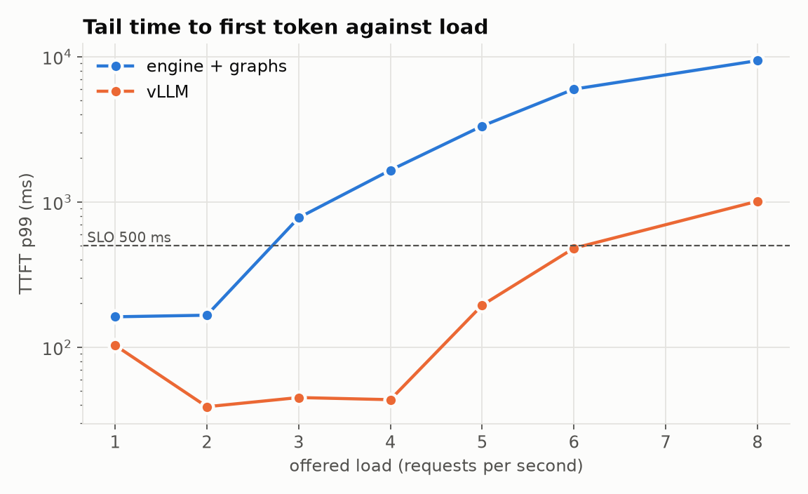
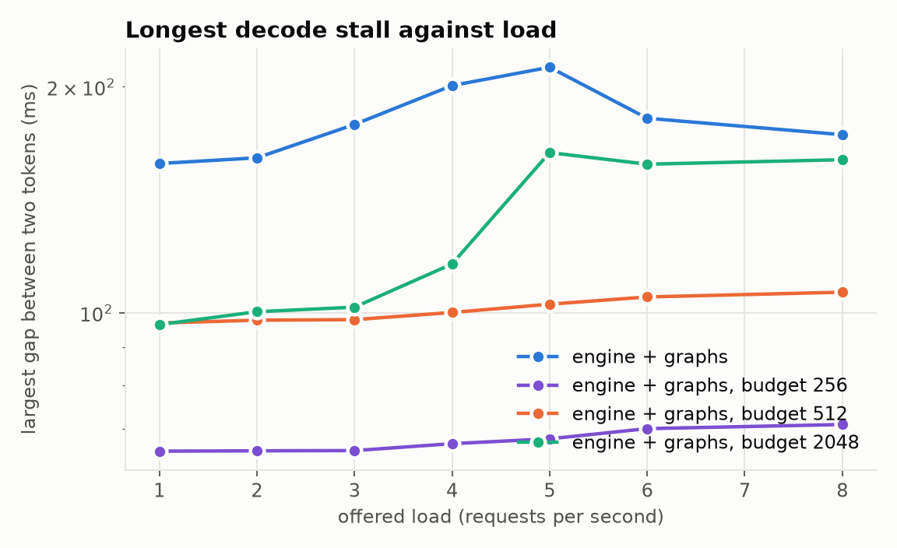
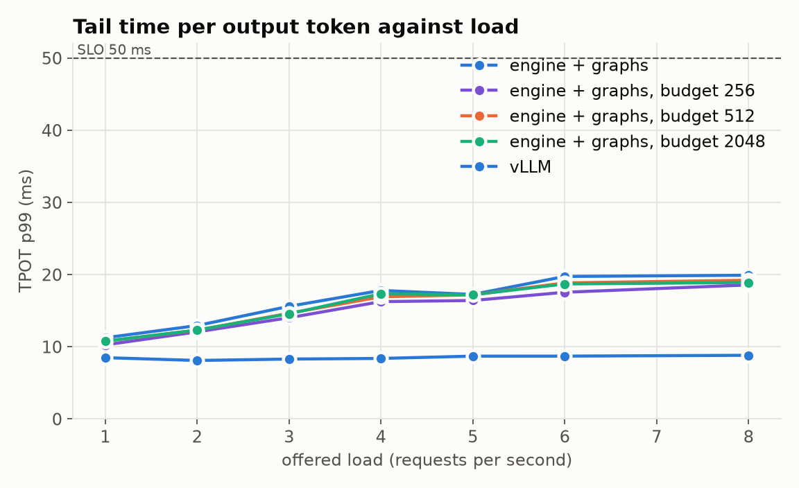
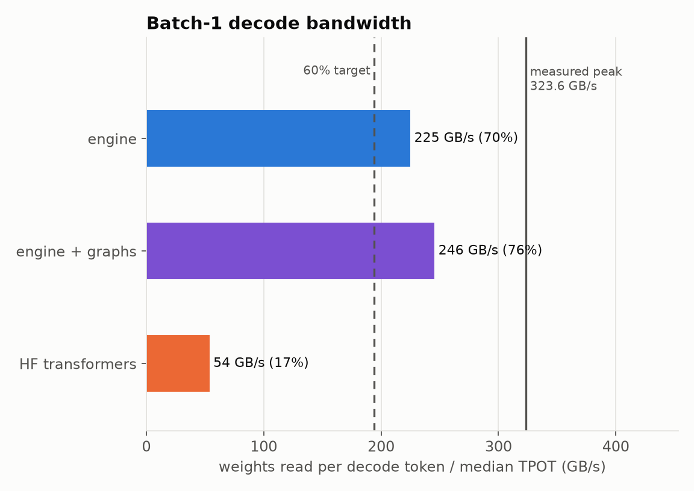
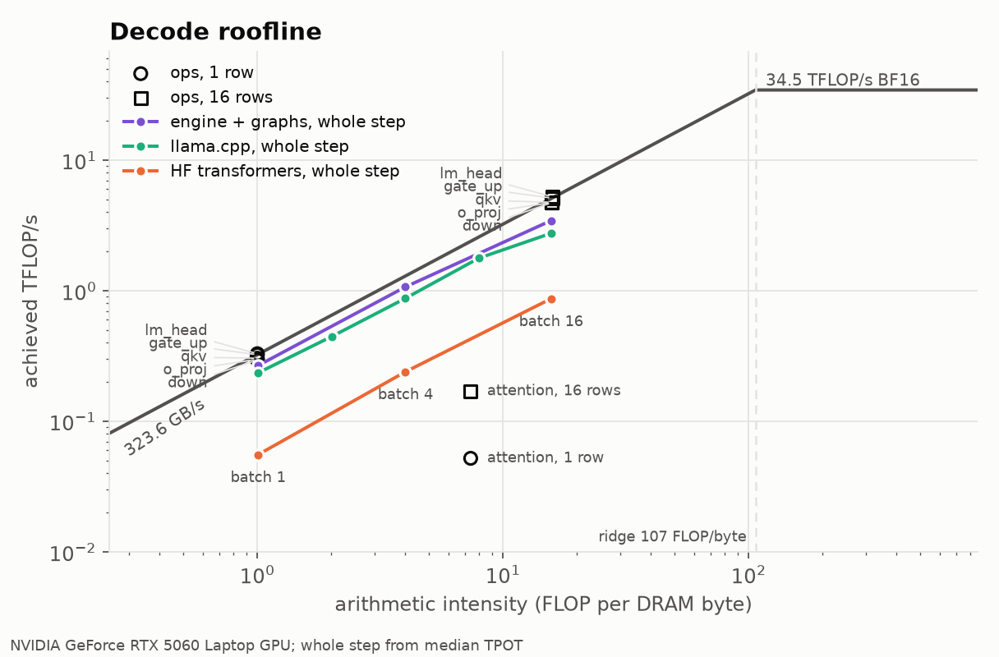
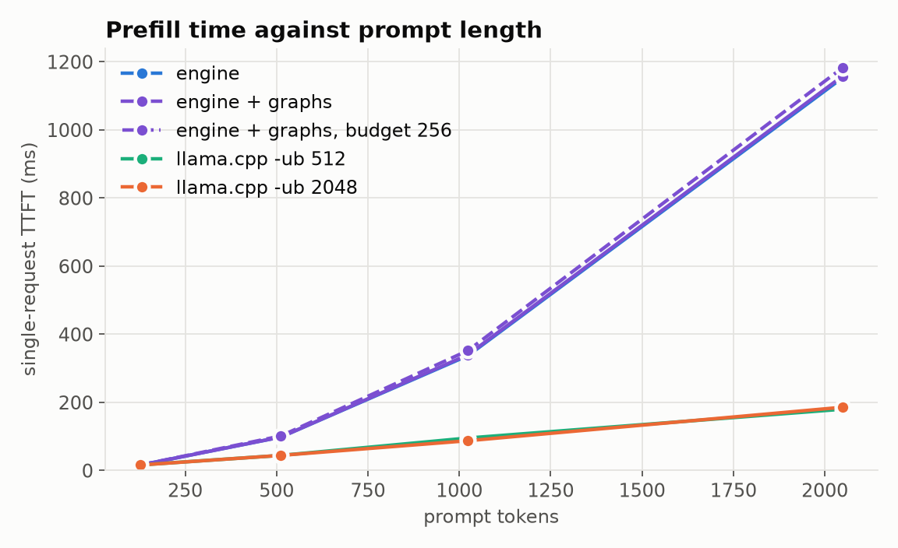

# Results

What the engine measures against the five MVP criteria, against HuggingFace transformers and llama.cpp, and where a decode step spends its time. The blocks between `auto` markers are written by `scripts/make_results.py` from the files `scripts/reproduce.sh` produces in `results/`; everything else is hand-written and has to be revisited when a kernel lands (see the checklist at the end).

Regenerate everything with one command, plugged in and with no other GPU program running:

```bash
scripts/reproduce.sh            # about 10 minutes; --quick for a smoke run
```

## Environment

The commit is the code the numbers were measured on; the `results/` files and this page are committed right after it.

<!-- auto:environment -->
- Date: 2026-10-25T11:52:26Z
- Commit: 7d60861
- GPU: NVIDIA GeForce RTX 5060 Laptop GPU
- Driver: 617.42
- CUDA: 13.3
- Build: Release
- Measured DRAM bandwidth (GB/s): 323.6
- Measured BF16 GEMM peak (TFLOP/s): 34.5
- Workload: 32 requests, 64 prompt tokens, 64 output tokens, greedy, seed 0, median of 3 run(s)
<!-- /auto:environment -->

## MVP scoreboard

<!-- auto:scoreboard -->
| # | Criterion | Target | Measured | |
|---|---|---|---|---|
| 1a | Teacher-forced vs HuggingFace | at least 99% argmax, error under 0.05 | 99.57% argmax over 1842 positions, mean abs logit error 0.0285 | met |
| 1b | Free-running greedy, first 64 tokens | exact, or diverging where HF's two logits are at most 2 BF16 ulps apart, on all 20 | exact on 15 of 20; the other 5 diverge at a near tie (at most 2 BF16 ulps apart in HF's logits) | met |
| 2 | Batch-1 decode bandwidth | at least 60% of 323.6 GB/s | 265 GB/s = 82% | met |
| 3 | Throughput at 16 concurrent requests | at least 5x batch 1 | 1402 vs 127 tokens/s = 11.0x | met |
<!-- /auto:scoreboard -->

Criterion 4 (each kernel has a before and after Nsight Compute number) and criterion 5 (reproducible from a clean clone) are tracked by the kernel table and `scripts/reproduce.sh` below rather than computed.

## Throughput and latency





<!-- auto:table -->
| system | max batch | output tok/s | TPOT p50 ms | TTFT p50 ms | weights GB/s | runs |
|---|---|---|---|---|---|---|
| engine | 1 | 115.8 | 8.52 | 8475.1 | 242.8 | 3 |
| engine | 2 | 226.2 | 8.66 | 4142.6 |  | 3 |
| engine | 4 | 441.4 | 8.63 | 2097.4 |  | 3 |
| engine | 8 | 791.2 | 9.12 | 1063.2 |  | 3 |
| engine | 16 | 1293.6 | 10.69 | 526.8 |  | 3 |
| engine + graphs | 1 | 127.3 | 7.81 | 7757.4 | 264.8 | 3 |
| engine + graphs | 4 | 478.4 | 7.81 | 1936.7 |  | 3 |
| engine + graphs | 16 | 1401.7 | 9.69 | 498.0 |  | 3 |
| HF transformers | 1 | 26.6 | 37.62 | 37715.2 | 55.0 | 1 |
| HF transformers | 4 | 114.4 | 34.89 | 7811.5 |  | 1 |
| HF transformers | 16 | 407.0 | 38.43 | 1388.5 |  | 1 |
| llama.cpp | 1 | 110.1 | 8.89 | 9029.5 | 232.8 | 3 |
| llama.cpp | 2 | 203.3 | 9.35 | 4765.7 |  | 3 |
| llama.cpp | 4 | 399.2 | 9.55 | 2284.0 |  | 3 |
| llama.cpp | 8 | 786.2 | 9.42 | 1034.8 |  | 3 |
| llama.cpp | 16 | 1154.0 | 12.12 | 567.3 |  | 3 |
<!-- /auto:table -->

The engine batches continuously (new requests join a running batch at any step, preemption on a full cache); the HuggingFace and llama.cpp baselines use static batches that run to the longest request, so the curves differ in more than kernel speed. `docs/baselines.md` lists what is and is not comparable.

llama.cpp (release b11870, CUDA, the same BF16 weights as a GGUF, flash attention on `auto`, built and converted by `scripts/setup_llamacpp.sh`) is the serious baseline: a mature engine whose batch-1 decode is also bandwidth bound. Its rows come from `llama-batched-bench`, one static batch per size replayed over the 32 requests (`docs/baselines.md`). In this run the engine with CUDA Graphs is ahead at every size: TPOT 7.8 against 8.9 ms at batch 1 (265 against 233 GB/s of weights, 1.16x the tokens/s), 1.20x at batch 4 and 1.21x at batch 16 on the medians, but llama.cpp's three batch-16 runs spread from 953 to 1271 tokens/s (1156 to 1315 in the previous run), so the batch-16 margin is 1.10x against its best run. Eager, without graphs, the engine is ahead up to batch 4, level at batch 8 (791 against 786 tokens/s) and ahead of the median at 16 (1294 against 1154), level with llama.cpp's best batch-16 run. The workload favors static batching (every request has the same length), and llama.cpp never runs a sampler in this tool while the engine samples on the GPU, so neither difference flatters the engine.

## Under load









From `scripts/load_sweep.sh` and `scripts/load_report.py`: `engine bench --max-batch 16 --graphs` with 120 requests arriving as a Poisson process at each rate, prompts of 16 to 512 tokens and outputs of 16 to 256 drawn uniformly, greedy, EOS ignored, seed 0, median of 3 runs, once with whole-prompt prefill steps and once each with `--token-budget` 256, 512 and 2,048 (chunked prefill, #101). The four configurations were interleaved run by run (run 1 of each, then run 2 of each), so drift on the machine hits them alike, and every run wrote a step trace, from which `load_report.py --traces` takes the gap between every two consecutive tokens of a request. Measured on 2026-11-05 on the RTX 5060 Laptop GPU, release build, at commit 1693c46 (the engine code is that of main at 2eb2f91). The 1-minute load average stayed between 1.0 and 4.8 as the median over a run (median of runs 1.6, highest sample 5.3, including about 0.7 from the engine itself), no other GPU program ran, and every run agreed with its repeats: no TPOT p50 differed from the median of its three runs by more than 3.5%, so none was redone. `results/load/` holds the per-request and summary CSVs and `token_gaps.csv`; the traces themselves are not committed. The offline runs above submit identical requests at once, which never shows queueing.

These files supersede the 2026-11-03 sweep under the same names. That sweep measured the same scheduler path 35% slower: the 2fec1f3 binary it used, rerun today at 4 and 6 QPS, gives TPOT p50 12.3 and 15.3 ms, the same as the new build (12.4 and 15.3 ms) and far from its 18.5 and 19.6 ms of 2026-11-03, so the machine, not the code, was slower then (the GPU clock was not logged, so the cause is not known). vLLM was therefore rerun on the same day as the engine, with the same setup as before (`docs/baselines.md`); its TPOT p50 at 4 QPS moved from 10.4 to 8.1 ms. Load average during the vLLM runs: median 1.3, highest 2.8; its repeats agree within 1% on TPOT p50.

<!-- auto:load -->
Engine runs measured 2026-11-05 at commit 1693c46 on NVIDIA GeForce RTX 5060 Laptop GPU; vLLM runs measured 2026-11-05 (vllm 0.32.0, torch 2.13.0).

SLO: TTFT at most 500 ms and TPOT at most 50 ms; goodput is the requests per second that meet both.

| system | QPS | output tok/s | TTFT p50 ms | TTFT p99 ms | TPOT p50 ms | TPOT p99 ms | SLO met | goodput req/s | preemptions | runs |
|---|---|---|---|---|---|---|---|---|---|---|
| engine + graphs | 1 | 168 | 46 | 102 | 8.4 | 11.2 | 100% | 1.14 | 0 | 3 |
| engine + graphs | 2 | 330 | 46 | 115 | 9.4 | 12.9 | 100% | 2.24 | 0 | 3 |
| engine + graphs | 3 | 486 | 48 | 123 | 10.7 | 15.6 | 100% | 3.30 | 0 | 3 |
| engine + graphs | 4 | 635 | 64 | 605 | 12.3 | 17.8 | 98% | 4.21 | 0 | 3 |
| engine + graphs | 5 | 765 | 80 | 1192 | 14.1 | 17.2 | 85% | 4.42 | 0 | 3 |
| engine + graphs | 6 | 839 | 240 | 1991 | 15.3 | 19.7 | 64% | 3.66 | 0 | 3 |
| engine + graphs | 8 | 885 | 1415 | 5007 | 15.5 | 19.9 | 25% | 1.50 | 0 | 3 |
| engine + graphs, budget 256 | 1 | 168 | 52 | 121 | 8.3 | 10.3 | 100% | 1.14 | 0 | 3 |
| engine + graphs, budget 256 | 2 | 330 | 56 | 136 | 9.2 | 12.1 | 100% | 2.24 | 0 | 3 |
| engine + graphs, budget 256 | 3 | 486 | 57 | 146 | 10.2 | 14.0 | 100% | 3.30 | 0 | 3 |
| engine + graphs, budget 256 | 4 | 635 | 70 | 413 | 11.5 | 16.2 | 99% | 4.28 | 0 | 3 |
| engine + graphs, budget 256 | 5 | 776 | 80 | 1033 | 13.2 | 16.4 | 87% | 4.57 | 0 | 3 |
| engine + graphs, budget 256 | 6 | 862 | 116 | 1642 | 14.2 | 17.5 | 69% | 4.05 | 0 | 3 |
| engine + graphs, budget 256 | 8 | 919 | 1117 | 4316 | 14.6 | 18.6 | 26% | 1.61 | 0 | 3 |
| engine + graphs, budget 512 | 1 | 168 | 46 | 107 | 8.3 | 10.8 | 100% | 1.14 | 0 | 3 |
| engine + graphs, budget 512 | 2 | 330 | 48 | 117 | 9.2 | 12.3 | 100% | 2.24 | 0 | 3 |
| engine + graphs, budget 512 | 3 | 486 | 52 | 138 | 10.3 | 14.6 | 100% | 3.30 | 0 | 3 |
| engine + graphs, budget 512 | 4 | 635 | 67 | 477 | 11.7 | 16.9 | 99% | 4.28 | 0 | 3 |
| engine + graphs, budget 512 | 5 | 772 | 74 | 1087 | 13.6 | 17.2 | 86% | 4.50 | 0 | 3 |
| engine + graphs, budget 512 | 6 | 854 | 119 | 1755 | 14.5 | 18.8 | 68% | 3.97 | 0 | 3 |
| engine + graphs, budget 512 | 8 | 912 | 1147 | 4466 | 14.8 | 19.2 | 26% | 1.60 | 0 | 3 |
| engine + graphs, budget 2048 | 1 | 168 | 46 | 106 | 8.4 | 10.8 | 100% | 1.14 | 0 | 3 |
| engine + graphs, budget 2048 | 2 | 330 | 48 | 120 | 9.2 | 12.3 | 100% | 2.24 | 0 | 3 |
| engine + graphs, budget 2048 | 3 | 486 | 51 | 130 | 10.4 | 14.6 | 100% | 3.30 | 0 | 3 |
| engine + graphs, budget 2048 | 4 | 635 | 65 | 506 | 11.8 | 17.3 | 98% | 4.25 | 0 | 3 |
| engine + graphs, budget 2048 | 5 | 769 | 80 | 1105 | 13.6 | 17.2 | 85% | 4.44 | 0 | 3 |
| engine + graphs, budget 2048 | 6 | 853 | 139 | 1761 | 14.5 | 18.7 | 68% | 3.96 | 0 | 3 |
| engine + graphs, budget 2048 | 8 | 916 | 1153 | 4397 | 14.9 | 18.9 | 26% | 1.61 | 0 | 3 |
| vLLM | 1 | 168 | 42 | 68 | 7.6 | 8.5 | 100% | 1.14 | 0 | 3 |
| vLLM | 2 | 331 | 28 | 48 | 7.5 | 8.1 | 100% | 2.25 | 0 | 3 |
| vLLM | 3 | 489 | 29 | 39 | 7.6 | 8.3 | 100% | 3.33 | 0 | 3 |
| vLLM | 4 | 641 | 30 | 41 | 8.1 | 8.4 | 100% | 4.36 | 0 | 3 |
| vLLM | 5 | 789 | 31 | 55 | 8.2 | 8.7 | 100% | 5.36 | 0 | 3 |
| vLLM | 6 | 933 | 31 | 90 | 8.3 | 8.7 | 100% | 6.34 | 0 | 3 |
| vLLM | 8 | 1208 | 34 | 507 | 8.5 | 8.8 | 98% | 8.07 | 0 | 3 |

Gaps between consecutive output tokens of one request, from the engine's step traces: every token of every request, medians of the runs' p50, p99 and largest gap.

| system | QPS | gap p50 ms | gap p99 ms | largest gap ms | runs |
|---|---|---|---|---|---|
| engine + graphs | 1 | 8.0 | 9.6 | 158 | 3 |
| engine + graphs | 2 | 8.5 | 51.1 | 161 | 3 |
| engine + graphs | 3 | 9.1 | 75.8 | 178 | 3 |
| engine + graphs | 4 | 9.9 | 86.8 | 201 | 3 |
| engine + graphs | 5 | 11.0 | 96.5 | 212 | 3 |
| engine + graphs | 6 | 11.4 | 99.3 | 182 | 3 |
| engine + graphs | 8 | 11.5 | 101.7 | 173 | 3 |
| engine + graphs, budget 256 | 1 | 8.0 | 26.4 | 65 | 3 |
| engine + graphs, budget 256 | 2 | 8.5 | 36.4 | 65 | 3 |
| engine + graphs, budget 256 | 3 | 9.1 | 39.8 | 66 | 3 |
| engine + graphs, budget 256 | 4 | 9.8 | 44.9 | 67 | 3 |
| engine + graphs, budget 256 | 5 | 10.8 | 49.9 | 68 | 3 |
| engine + graphs, budget 256 | 6 | 11.3 | 54.4 | 70 | 3 |
| engine + graphs, budget 256 | 8 | 11.5 | 59.0 | 71 | 3 |
| engine + graphs, budget 512 | 1 | 8.0 | 10.8 | 97 | 3 |
| engine + graphs, budget 512 | 2 | 8.5 | 44.7 | 98 | 3 |
| engine + graphs, budget 512 | 3 | 9.1 | 67.8 | 98 | 3 |
| engine + graphs, budget 512 | 4 | 9.8 | 76.8 | 100 | 3 |
| engine + graphs, budget 512 | 5 | 10.9 | 81.8 | 103 | 3 |
| engine + graphs, budget 512 | 6 | 11.4 | 84.8 | 105 | 3 |
| engine + graphs, budget 512 | 8 | 11.5 | 86.9 | 106 | 3 |
| engine + graphs, budget 2048 | 1 | 8.1 | 10.9 | 96 | 3 |
| engine + graphs, budget 2048 | 2 | 8.5 | 44.9 | 100 | 3 |
| engine + graphs, budget 2048 | 3 | 9.1 | 68.8 | 102 | 3 |
| engine + graphs, budget 2048 | 4 | 9.9 | 78.4 | 116 | 3 |
| engine + graphs, budget 2048 | 5 | 10.9 | 85.6 | 163 | 3 |
| engine + graphs, budget 2048 | 6 | 11.4 | 91.1 | 158 | 3 |
| engine + graphs, budget 2048 | 8 | 11.5 | 92.5 | 160 | 3 |
<!-- /auto:load -->

Chunked prefill does what it is for: it shortens the stalls. With whole-prompt steps, every prompt is one step and every running sequence waits for it, so the longest gap between two tokens of a request is 158 to 212 ms at every rate, against a median gap of 8 to 12 ms. A budget of 256 caps that at 65 to 71 ms, 512 at about 100 ms, and 2,048 at 96 to 163 ms (at 2,048 several prompts still fit in one step). The gap p99 falls with it at 4 QPS and above, from 87 to 45 ms at 4 QPS with a budget of 256. The TTFT tail improves too, because a waiting prompt no longer queues behind a whole prefill step: TTFT p99 at 4 QPS falls from 605 ms to 413 (256), 477 (512) and 506 ms (2,048).

The gain in goodput is small. The engine's peak moves from 4.42 to 4.57 requests per second (budget 256; 4.50 at 512, 4.44 at 2,048), both at an offered 5, and past the peak the budgets hold up better (4.05 against 3.66 at an offered 6) but the queue still grows. vLLM, rerun on the same day with the same token ids, arrival times and limit of 16 sequences, reaches 6.34 at an offered 6 and 8.07 at 8, still meeting the SLO for 98% of requests, about 1.8x the engine's best. TPOT p99 hides all of this: it is the per-request mean of the gaps, so a 200 ms stall spread over a 200-token answer adds 1 ms, and it stays under 20 ms for every engine configuration.

What chunking does not change is how much work there is. In the whole-prompt run at 8 QPS (run 1, from its trace), 114 prefill steps take 5.3 of the 19.7 seconds, 0.17 ms per prompt token, and the 1,374 decode steps average 10.5 ms, close to vLLM's whole TPOT of 8.5 ms with its prefill included. A budget only moves the prefill rows into mixed steps (that run takes 18.8 seconds), and every one of those rows still runs through the paged decode attention kernel, the same cost the prefill curve below shows growing with the square of the prompt. So the remaining gap to vLLM is kernel speed, mostly prefill ([#103](https://github.com/joezhuo2/LLM-Inference-Engine/issues/103)), not scheduling. Mixed steps also run eager, since `DecodeGraphs` only covers pure decode.

Small budgets have a cost at low load. At 1 to 3 QPS a budget of 256 adds 6 to 10 ms to the TTFT p50 (52 to 57 against 46 to 48 ms), since a prompt longer than what is left of the budget after the decode rows takes two or three steps, and the gap p99 at 1 QPS rises from 9.6 to 26.4 ms, because more decode steps share a step with a chunk instead of replaying a graph alone. 512 costs almost nothing there and keeps most of the tail benefit, which makes it the better default for this workload; 256 gives the shortest stalls.

Limits of these numbers. The lengths are uniform, not a real chat distribution such as ShareGPT, and the tokens are random. There is no HTTP in the engine's path, since `engine bench` calls the scheduler directly, while vLLM's times include its Python server and HTTP. With 120 requests a run ends before an overloaded queue reaches any steady state, so TTFT past saturation depends on the run length: read those points as "overloaded", not as stable values. Goodput at 1 and 2 QPS is above the offered rate because this seed's 120 arrivals span about 104 and 52 seconds rather than 120 and 60. The KV cache was never the limit: 0 preemptions at every rate and budget.

### A long prompt among running requests

From `scripts/stall_probe.py`: 15 short chat prompts from `scripts/prompts.json` and then one long prompt (a sentence repeated, 1,917 tokens with the chat template) arrive as Poisson arrivals at 16 per second, each asking for 128 tokens, through `engine bench --max-batch 16 --graphs --prompts --trace`, 3 runs per budget. In every run the long prompt arrived while all 15 short ones were decoding, and the table shows what that costs them and what it costs the prompt.

<!-- auto:stall -->
Measured 2026-11-05T07:05:42Z at commit 1693c46: a 1917-token prompt arrives among short requests, medians of the runs.

| token budget | long prompt tokens | decoding when it arrives | TTFT of the long prompt ms | gap p99 ms | largest gap ms | runs |
|---|---|---|---|---|---|---|
| none | 1917 | 15 | 1030 | 76 | 1043 | 3 |
| 256 | 1917 | 15 | 1081 | 207 | 223 | 3 |
| 512 | 1917 | 15 | 1055 | 344 | 388 | 3 |
| 2048 | 1917 | 15 | 1040 | 14 | 1033 | 3 |
<!-- /auto:stall -->

With whole-prompt steps the 15 decoding requests wait 1,043 ms for the long prompt, one step as long as the prompt's own TTFT. A budget of 256 cuts the longest wait to 223 ms and 512 to 388 ms, while the long prompt's first token comes only 25 to 51 ms later (1,081 and 1,055 against 1,030 ms). A budget of 2,048 changes nothing here: the prompt fits in one step, so it is one mixed step instead of one prefill step. The waits do not shrink in proportion to the budget. A chunk of 241 rows (256 minus the 15 decode rows) late in the prompt still takes over 200 ms, because each of its rows runs the decode attention kernel over up to 1,917 tokens of context, so the cost of a chunk grows with its position as well as its size. The gap p99 rises with the small budgets (207 and 344 ms against 76 ms with no budget) for the same reason the gaps above do: the long prompt now spreads over 8 or 4 slow steps instead of one, so more tokens of the short requests wait behind a chunk, each for less time.

## Batch-1 decode bandwidth



Decoding one token reads every weight except all but one row of the embedding table, 2.07 GB, so the time per token cannot go below `2.07 GB / peak`. The peak used here is the DRAM bandwidth measured by `src/practice/bandwith_test.cu` on this GPU (323.6 GB/s, about 84% of the datasheet figure).

## Where a decode step goes

From `scripts/profile.sh nsys` on a batch-1 run (see `docs/profiling.md` for how to read it):

<!-- auto:profile -->
### Launch gaps per forward step

- decode: 252 steps, 224 kernels, median span 8069 us, median busy 6909 us, median idle 11.5% of the span, 17 gaps over 5 us per step
- prefill: 4 steps, 224 kernels, median span 11187 us, median busy 10093 us, median idle 8.1% of the span, 40 gaps over 5 us per step

### GPU time per op in a decode step

| op | kernels/step | GPU us/step | % of kernel time |
| --- | --- | --- | --- |
| gate_up | 22.0 | 3138.8 | 43.7 |
| down | 22.0 | 1724.2 | 24.0 |
| qkv | 22.0 | 759.2 | 10.6 |
| o_proj | 22.0 | 619.1 | 8.6 |
| lm_head | 1.0 | 398.3 | 5.6 |
| attention | 22.0 | 332.8 | 4.6 |
| rope | 22.0 | 61.7 | 0.9 |
| add1_norm2 | 22.0 | 38.5 | 0.5 |
| add2_norm1 | 21.0 | 34.9 | 0.5 |
| write_kv | 22.0 | 32.0 | 0.4 |
| swiglu | 22.0 | 25.2 | 0.4 |
| norm1 | 1.0 | 3.3 | 0.0 |
| final_norm | 1.0 | 3.3 | 0.0 |
| embedding | 1.0 | 3.3 | 0.0 |
| add2 | 1.0 | 0.9 | 0.0 |

### Top 12 kernels

| kernel | count | total ms | avg us | % |
| --- | --- | --- | --- | --- |
| std::enable_if<!T7, void>::type internal::gemvx::kernel<int, int, __nv_bfloat... | 22432 | 1674.8 | 74.7 | 90.4 |
| engine::paged_attention_decode_v2_kernel(__nv_bfloat16 *, const __nv_bfloat16... | 5632 | 94.5 | 16.8 | 5.1 |
| void cutlass::Kernel2<cutlass_80_tensorop_bf16_s16816gemm_relu_bf16_64x64_32x... | 176 | 21.2 | 120.4 | 1.1 |
| engine::fast::add_rmsnorm_vec_kernel(__nv_bfloat16 *, __nv_bfloat16 *, const ... | 11008 | 18.9 | 1.7 | 1.0 |
| engine::fast::rope_kernel(__nv_bfloat16 *, const int *, int, int, int, engine... | 5632 | 15.8 | 2.8 | 0.9 |
| engine::write_kv_kernel(const __nv_bfloat16 *, const int *, __nv_bfloat16 *, ... | 5632 | 8.2 | 1.5 | 0.4 |
| engine::fast::swiglu_kernel(__nv_bfloat16 *, const __nv_bfloat16 *, long, long) | 5544 | 6.3 | 1.1 | 0.3 |
| nvjet_sm120_tst_mma_80x64x64_5_80x8x64_tmaAB_alignCD4_bz_TNNN | 88 | 3.5 | 39.5 | 0.2 |
| nvjet_sm120_tst_mma_112x64x64_4_112x8x64_tmaAB_alignCD4_bz_TNNN | 88 | 3.4 | 38.1 | 0.2 |
| engine::<unnamed>::sample_kernel(int *, const __nv_bfloat16 *, int, const eng... | 256 | 2.7 | 10.6 | 0.1 |
| engine::naive::<unnamed>::rmsnorm_kernel(__nv_bfloat16 *, const __nv_bfloat16... | 512 | 1.7 | 3.3 | 0.1 |
| engine::naive::<unnamed>::embedding_kernel(__nv_bfloat16 *, const int *, cons... | 256 | 0.8 | 3.3 | 0.0 |

### Decode bandwidth

- max_batch 1, median TPOT 8.85 ms
- weights read per token / TPOT: 233.7 GB/s = 72.2% of the 323.6 GB/s peak (target 60%)
- GPU kernel busy time in a decode step: 6.91 ms (78% of TPOT)
- weights / kernel busy time: 299.4 GB/s (what the kernels would reach with no launch gaps)
<!-- /auto:profile -->

The same step replayed from a CUDA Graph (`engine bench --graphs`, one graph per power-of-two batch size, kernels unchanged):

<!-- auto:profile_graphs -->
### Launch gaps per forward step

- decode: 252 steps, 224 kernels, median span 6973 us, median busy 6917 us, median idle 0.8% of the span, 0 gaps over 5 us per step
- prefill: 4 steps, 224 kernels, median span 12109 us, median busy 10323 us, median idle 10.4% of the span, 44 gaps over 5 us per step

### GPU time per op in a decode step

| op | kernels/step | GPU us/step | % of kernel time |
| --- | --- | --- | --- |
| forward_decode | 224.0 | 7275.1 | 100.0 |

### Top 12 kernels

| kernel | count | total ms | avg us | % |
| --- | --- | --- | --- | --- |
| std::enable_if<!T7, void>::type internal::gemvx::kernel<int, int, __nv_bfloat... | 22432 | 1694.7 | 75.5 | 89.8 |
| engine::paged_attention_decode_v2_kernel(__nv_bfloat16 *, const __nv_bfloat16... | 5632 | 104.4 | 18.5 | 5.5 |
| void cutlass::Kernel2<cutlass_80_tensorop_bf16_s16816gemm_relu_bf16_64x64_32x... | 176 | 25.5 | 144.7 | 1.3 |
| engine::fast::add_rmsnorm_vec_kernel(__nv_bfloat16 *, __nv_bfloat16 *, const ... | 11008 | 19.1 | 1.7 | 1.0 |
| engine::fast::rope_kernel(__nv_bfloat16 *, const int *, int, int, int, engine... | 5632 | 15.3 | 2.7 | 0.8 |
| engine::write_kv_kernel(const __nv_bfloat16 *, const int *, __nv_bfloat16 *, ... | 5632 | 8.3 | 1.5 | 0.4 |
| engine::fast::swiglu_kernel(__nv_bfloat16 *, const __nv_bfloat16 *, long, long) | 5544 | 5.6 | 1.0 | 0.3 |
| nvjet_sm120_tst_mma_80x64x64_5_80x8x64_tmaAB_alignCD4_bz_TNNN | 88 | 4.3 | 49.4 | 0.2 |
| nvjet_sm120_tst_mma_112x64x64_4_112x8x64_tmaAB_alignCD4_bz_TNNN | 88 | 4.2 | 47.4 | 0.2 |
| engine::<unnamed>::sample_kernel(int *, const __nv_bfloat16 *, int, const eng... | 256 | 2.9 | 11.5 | 0.2 |
| engine::naive::<unnamed>::rmsnorm_kernel(__nv_bfloat16 *, const __nv_bfloat16... | 512 | 1.8 | 3.5 | 0.1 |
| engine::naive::<unnamed>::embedding_kernel(__nv_bfloat16 *, const int *, cons... | 256 | 0.9 | 3.3 | 0.0 |

### Decode bandwidth

- max_batch 1, median TPOT 7.79 ms
- weights read per token / TPOT: 265.7 GB/s = 82.1% of the 323.6 GB/s peak (target 60%)
- GPU kernel busy time in a decode step: 6.92 ms (89% of TPOT)
- weights / kernel busy time: 299.1 GB/s (what the kernels would reach with no launch gaps)
<!-- /auto:profile_graphs -->

The launch gaps are gone (idle share of a decode step from 11.5% to 0.8%, gaps over 5 us from 17 per step to 0) and the kernels take the same time, so the saving is the gap the GPU leaves before each kernel when kernels are launched one by one: in the two profiles above the median gap over the 223 kernel boundaries of a decode step is 3.1 us eager and 0.24 us replayed. It is not the GPU waiting for the host, since the eager launch calls run about 1.7 ms ahead of their kernels (`docs/profiling.md`, "Decode CUDA Graphs"). In the two profiled runs a batch-1 token takes about 1.1 ms less (8.85 to 7.79 ms; 8.52 to 7.81 ms in the bench table above) and the weights bandwidth rises from 234 to 266 GB/s, 72% to 82% of the measured peak. What is left is the kernels themselves: the cuBLAS GEMV for gate/up and down owns about 68% of the step and runs at about 310 GB/s, and `paged_attention_decode_v2` owns 4.6% (v1 owned 11.5% in the profile before v2 was wired in).

## Roofline



From `scripts/roofline.py`: FLOPs and DRAM bytes of each GEMM and of attention are counted from `config.json` (weights, activations and the KV cache read once, nothing for caches), the op times come from the batch-1 profile above and a batch-16 profile (`results/decode_step_b16.md`), the whole-step points from the median TPOT of the table above. The ceilings are the measured DRAM bandwidth and the measured BF16 GEMM peak (`scripts/gemm_peak.cu`, `docs/hardware.md`).

<!-- auto:roofline -->
Ceilings: 323.6 GB/s and 34.5 TFLOP/s (BF16), ridge point 107 FLOP/byte; mean attended context 96 tokens.

| op | rows | FLOP/byte | us/step | TFLOP/s | GB/s | % of roof |
|---|---|---|---|---|---|---|
| qkv | 1 | 1.0 | 759.2 | 0.30 | 304 | 94 |
| o_proj | 1 | 1.0 | 619.1 | 0.30 | 298 | 92 |
| gate_up | 1 | 1.0 | 3138.8 | 0.32 | 324 | 100 |
| down | 1 | 1.0 | 1724.2 | 0.29 | 295 | 91 |
| lm_head | 1 | 1.0 | 398.3 | 0.33 | 329 | 102 |
| attention | 1 | 7.4 | 332.8 | 0.05 | 7 | 2 |
| qkv | 16 | 15.8 | 775.1 | 4.76 | 302 | 93 |
| o_proj | 16 | 15.8 | 623.6 | 4.74 | 301 | 93 |
| gate_up | 16 | 15.9 | 3172.5 | 5.12 | 323 | 100 |
| down | 16 | 15.8 | 1715.6 | 4.73 | 299 | 92 |
| lm_head | 16 | 15.9 | 400.1 | 5.24 | 330 | 102 |
| attention | 16 | 7.4 | 1631.2 | 0.17 | 23 | 7 |

| whole decode step | rows | FLOP/byte | TPOT us | TFLOP/s | GB/s | % of roof |
|---|---|---|---|---|---|---|
| engine + graphs | 1 | 1.0 | 7813 | 0.27 | 265 | 82 |
| engine + graphs | 4 | 4.0 | 7806 | 1.07 | 267 | 82 |
| engine + graphs | 16 | 15.7 | 9692 | 3.44 | 220 | 68 |
| engine | 1 | 1.0 | 8521 | 0.24 | 243 | 75 |
| engine | 2 | 2.0 | 8656 | 0.48 | 240 | 74 |
| engine | 4 | 4.0 | 8631 | 0.97 | 241 | 75 |
| engine | 8 | 8.0 | 9118 | 1.83 | 230 | 71 |
| engine | 16 | 15.7 | 10687 | 3.12 | 199 | 62 |
| llama.cpp | 1 | 1.0 | 8889 | 0.23 | 233 | 72 |
| llama.cpp | 2 | 2.0 | 9350 | 0.45 | 222 | 69 |
| llama.cpp | 4 | 4.0 | 9548 | 0.87 | 218 | 67 |
| llama.cpp | 8 | 8.0 | 9418 | 1.77 | 223 | 69 |
| llama.cpp | 16 | 15.7 | 12123 | 2.75 | 176 | 54 |
| HF transformers | 1 | 1.0 | 37620 | 0.06 | 55 | 17 |
| HF transformers | 4 | 4.0 | 34895 | 0.24 | 60 | 18 |
| HF transformers | 16 | 15.7 | 38433 | 0.87 | 55 | 17 |
<!-- /auto:roofline -->

Every point sits on the bandwidth slope, far left of the 107 FLOP/byte ridge, so nothing in decode is compute bound on this GPU. At batch 1 the five cuBLAS GEMVs run at 91% to 102% of the roof at 1 FLOP/byte (the roof is a measured copy bandwidth, not a hard limit, so 102% reads as "at the roof"): they cannot get faster without moving fewer bytes. The whole step with graphs reaches 82% of the roof; the rest is attention, the elementwise ops and what little host time graphs leave.

At batch 16 the GEMMs move right to 16 FLOP/byte and take the same time as at batch 1 (4,888 us against 4,863 for gate/up and down together) while doing 16 times the FLOPs, up to 5.2 TFLOP/s: every weight byte is read once for 16 tokens, which is where the 11x throughput comes from. Attention does not move: each row reads its own K and V, so its intensity stays at 7.4 FLOP/byte at any batch size. Its time grows from 333 to 1,631 us per step (19% of kernel time) at 7% of its roof, which makes it the op with the most headroom at batch 16; the split kernel does not run there (5 rows or more keep v2). The whole step at batch 16 falls to 68% of the roof with graphs, against 54% for llama.cpp and 17% for HuggingFace.

## On-chip memory

The roofline above uses one memory ceiling, DRAM. What sits between DRAM and the threads is measured by `scripts/onchip_bench.cu`, which `scripts/onchip_report.py` runs several times (`results/onchip/onchip.csv` and `onchip.md`). Bandwidths are reads by one full wave of blocks (the occupancy limit on every SM), timed with CUDA events after a warm-up launch: L2 from an 8 MB buffer read with `__ldcg` (cached in L2, not in L1) by 128-bit loads, shared memory from 256-thread blocks reading their own arrays with conflict-free 32-bit or 128-bit loads. Latencies are one thread following a pointer chain in a random single cycle (Sattolo's algorithm), one load at a time: through shared memory, through 4 MB of L2 after a warm-up pass, and through 256 MB of DRAM with 128-byte spacing and no warm-up, so every load misses L2. The FMA latency is one thread's chain of dependent `fmaf` calls. Each kernel reads `clock64()` and `%globaltimer` at its start and end, so cycles, nanoseconds and the SM clock come from the same kernel; the register file is `regsPerMultiprocessor` from `cudaGetDeviceProperties`. The SASS (`cuobjdump -sass`) was checked: the chase loops are bare chains of dependent `LDS` or `LDG.E.64.STRONG.GPU` loads, the FMA loop is 128 dependent `FFMA`s per branch, and the bandwidth loops keep their `LDS`, `LDS.128` and `LDG.E.128` loads.

<!-- auto:onchip -->
Measured 2026-11-05T04:40:03Z at commit e608146 on the NVIDIA GeForce RTX 5060 Laptop GPU: 5 runs of `scripts/onchip_bench.cu`, median (min to max). The SM clock is measured inside each kernel (`clock64()` against `%globaltimer`).

| tier | measure | unit | median | min to max | SM clock MHz |
|---|---|---|---|---|---|
| registers | register file | KB/SM | 256 | 256 to 256 |  |
| registers | register file | KB | 6,656 | 6,656 to 6,656 |  |
| shared memory | size | KB/SM | 100 | 100 to 100 |  |
| L2 | size | KB | 32,768 | 32,768 to 32,768 |  |
| shared memory | read bandwidth, 32-bit loads | GB/s | 4,644 | 4,644 to 4,645 | 2,804 |
| shared memory | read bandwidth, 32-bit loads | GB/s/SM | 179 | 179 to 179 | 2,804 |
| shared memory | read bandwidth, 32-bit loads | B/clk/SM | 63.7 | 63.7 to 63.7 | 2,804 |
| shared memory | read bandwidth, 128-bit loads | GB/s | 9,107 | 9,097 to 9,115 | 2,800 |
| shared memory | read bandwidth, 128-bit loads | GB/s/SM | 350 | 350 to 351 | 2,800 |
| shared memory | read bandwidth, 128-bit loads | B/clk/SM | 125 | 125 to 125 | 2,800 |
| L2 | read bandwidth, 8 MB working set | GB/s | 1,911 | 1,905 to 1,913 | 2,790 |
| L2 | read bandwidth, 8 MB working set | B/clk/SM | 26.3 | 26.3 to 26.4 | 2,790 |
| registers | dependent FMA latency | cycles | 4.05 | 4.05 to 4.05 | 2,812 |
| registers | dependent FMA latency | ns | 1.44 | 1.44 to 1.44 | 2,812 |
| shared memory | load latency, pointer chase | cycles | 28.0 | 28.0 to 28.0 | 2,812 |
| shared memory | load latency, pointer chase | ns | 9.96 | 9.96 to 9.96 | 2,812 |
| L2 | hit latency, pointer chase in 4 MB | cycles | 318 | 318 to 318 | 2,812 |
| L2 | hit latency, pointer chase in 4 MB | ns | 113 | 113 to 113 | 2,812 |
| DRAM | load latency, pointer chase in 256 MB | cycles | 867 | 866 to 915 | 2,809 |
| DRAM | load latency, pointer chase in 256 MB | ns | 309 | 308 to 326 | 2,809 |
<!-- /auto:onchip -->

Reading it. Every kernel ran at 2,790 to 2,812 MHz (the boost clock under load; the laptop idles at 1,687), so the cycle counts are the numbers to compare across machines and the nanoseconds hold at this clock. Each step closer to the thread is several times faster: a dependent load takes 867 cycles from DRAM, 318 from L2 and 28 from shared memory, and a dependent FMA 4. L2 delivers about 1.9 TB/s, about six times the 323.6 GB/s DRAM ceiling; that ceiling is a copy, and an exploratory run of the same read kernel (not in the table) reached 359 and 372 GB/s over 64 and 256 MB and 1.80 to 1.92 TB/s anywhere from 4 to 28 MB, so 8 MB sits on the L2 plateau and L2 reads are about five times DRAM reads. None of that helps a decode step, which streams 2.07 GB of weights through a 32 MB L2 once per token. Shared memory with 128-bit loads moves 125 bytes per clock per SM, close to 32 banks of 4 bytes, 9.1 TB/s over the 26 SMs; with 32-bit loads it moves exactly half, 63.7, and neither 8 nor 16 loads per loop iteration nor 128-thread blocks changed that, so it is not the loop. It is consistent with the shared memory pipe taking two cycles for a warp-wide 32-bit load, but NVIDIA does not document that rate for this architecture, so the reason is an inference; the measured point is that wide loads pay off on the chip as well as in DRAM. The register file is 256 KB per SM, 6.5 MB in all, more than the 2.5 MB of shared memory. There is no register bandwidth in the table: registers are read as instruction operands, so the honest numbers are the file size and the 4-cycle FMA dependency. Caveats: the DRAM chase covers 256 MB, so it may include address translation misses, and one run of five took 915 cycles instead of about 867, which looks like where the buffer landed in that process; B/clk/SM counts SM cycles although L2 runs in its own clock domain; one GPU, one session (an earlier session at a higher CPU load gave the same numbers within 2%, except the DRAM latency, 864 to 915 cycles).

## Prefill against prompt length



From `scripts/prefill_ttft.py`: one request per run at each prompt length, output length 1, with warmup requests of the same length first, so TTFT is the prefill of a warm process. The published throughput runs use 64-token prompts, which hides this curve.

<!-- auto:prefill -->
Measured 2026-11-05T07:07:06Z at commit 1693c46: one request per run, median of 5 runs.

TTFT in ms against prompt tokens, median (min to max):

| system | 128 | 512 | 1,024 | 2,048 |
|---|---|---|---|---|
| engine | 15.7 (15.7 to 15.8) | 97.8 (97.3 to 98.2) | 337.0 (334.8 to 338.2) | 1152.2 (1150.5 to 1161.9) |
| engine + graphs | 15.7 (15.6 to 15.7) | 97.8 (97.3 to 98.4) | 339.6 (338.1 to 342.0) | 1157.2 (1152.7 to 1184.1) |
| engine + graphs, budget 256 | 15.7 (15.6 to 15.9) | 101.1 (100.8 to 102.5) | 351.9 (351.3 to 353.5) | 1181.6 (1178.6 to 1195.6) |
| llama.cpp -ub 512 | 16.1 (14.9 to 17.1) | 44.0 (43.7 to 45.5) | 95.0 (94.8 to 95.7) | 179.5 (177.0 to 182.1) |
| llama.cpp -ub 2048 | 15.8 (15.4 to 17.7) | 44.0 (43.7 to 46.7) | 87.0 (86.0 to 87.5) | 185.3 (184.4 to 186.6) |

Median TTFT in ms per prompt token:

| system | 128 | 512 | 1,024 | 2,048 |
|---|---|---|---|---|
| engine | 0.123 | 0.191 | 0.329 | 0.563 |
| engine + graphs | 0.123 | 0.191 | 0.332 | 0.565 |
| engine + graphs, budget 256 | 0.123 | 0.197 | 0.344 | 0.577 |
| llama.cpp -ub 512 | 0.126 | 0.086 | 0.093 | 0.088 |
| llama.cpp -ub 2048 | 0.124 | 0.086 | 0.085 | 0.090 |
<!-- /auto:prefill -->

The engine's curve bends and llama.cpp's does not. At 128 tokens the two are level (15.7 ms against 15.8 and 16.1 ms). From 128 to 2,048 tokens, 16 times the tokens, the engine's TTFT grows 73 times, from 15.7 to 1,152.2 ms, and its cost per token grows from 0.123 to 0.563 ms, while llama.cpp stays between 0.085 and 0.126 ms per token at either micro-batch size. At 2,048 tokens the engine takes about 6 times as long as llama.cpp (1,152.2 against 179.5 and 185.3 ms). This fits how prefill runs: `build_paged_batch` makes one row per prompt token, each with a full copy of the block table, and each row runs the paged decode attention over its own context, so the KV reads grow with the square of the length. These runs do not separate that cost from the rest of the step, so the profile for [#103](https://github.com/joezhuo2/LLM-Inference-Engine/issues/103) still has to confirm it.

Graphs make no difference here: `DecodeGraphs::covers` refuses prefill batches, so both engine series run the same eager path and differ only by noise. What differs between the systems: the engine's TTFT includes sampling the first token and its host work, while llama.cpp's is `t_pp` from `llama-batched-bench`, the time of the prompt's decode calls with no sampler. llama.cpp feeds its own tokens rather than the engine's workload, runs at its default flash attention setting (`auto`) and keeps its KV cache in F16, with a context of the prompt plus one token, which at 2,048 is one over the model's position limit. Longer prompts cannot be measured on this model, since the bench refuses more than TinyLlama's 2,048 positions. All of it is from this one laptop GPU, whose clocks move between runs, so the table shows the spread of the runs as well as the median. This run (2026-11-05, the same session as the sweep above) is faster for every system than the 2026-11-03 run it replaces, by 28% for the engine and 32% for llama.cpp at 2,048 tokens, with a spread under 3% of the median for the engine, so the ratios hold while the absolute times moved with the machine.

The `engine + graphs, budget 256` row is the same prompt alone under `--token-budget 256`, so a 2,048-token prompt runs as 8 chunks in 8 steps. It costs 2.1% more at 2,048 tokens (1,181.6 against 1,157.2 ms) and 3% to 4% more at 512 and 1,024: the extra steps add host work and smaller GEMMs, but the attention work is the same, since every chunk row still reads its whole context so far. Chunking spreads prefill out; it does not make it cheaper.

## Kernels

Every kernel exists twice, a naive one that is obviously correct (the test oracle and the "before" number) and an optimized one tested against it. "In the forward pass" says whether `PagedRunner` calls the fast one; the end-to-end numbers above include only the kernels marked yes.

| Kernel | Optimized version | Tests | Nsight Compute before and after | In the forward pass |
| --- | --- | --- | --- | --- |
| cuBLAS GEMMs (QKV, output, gate/up, down, LM head) | none, cuBLAS as is | `tests/gpu/test_gemm.cpp` | batch-1 GEMVs run at about 310 GB/s in the profile above | yes |
| `paged_attention_decode` | v1 (one block per head and row, scores in shared memory) is the oracle and the "before" number; `paged_attention_decode_v2` (online softmax, 8 lanes per key, value sum spread over all threads, no context cap) is called by the forward pass | `tests/gpu/test_paged_attention.cpp`, `tests/gpu/test_paged_attention_v2.cpp`, `tests/gpu/test_paged_attention_split.cpp` | v2 is 1.4x to 3.6x faster than v1 per launch (1 row, context 2,048: 600 to 165 us; 16 rows, context 512: 565 to 193 us) and runs a context of 8,192 that v1 cannot; Nsight Compute: 1,310 to 383 us at 1 row and context 2,048, details in `docs/profiling.md`, "Paged attention v2"; in the decode profile (32 prompt and 32 output tokens) attention went from 883 to 272 us per step (11.5% to 3.8% of kernel time) once v2 was wired in, `docs/profiling.md`, "Paged attention v2 in the forward pass"; `paged_attention_decode_split` (the context of a row cut across blocks, partials merged in split order) is 2.8x faster than v2 at 1 row and 2,048 tokens and takes the batch-1 TPOT at a 1,984-token prompt from 14.7 to 10.2 ms eager and from 14.0 to 9.1 ms with graphs, `docs/profiling.md`, "Split-context attention", "Split attention in the forward pass" and "Split attention in CUDA Graphs" | yes, v2, and split for 1 to 4 rows at 512 tokens or more (eager and graph replays) |
| `write_kv` | one thread per element (the only version) | `tests/gpu/test_write_kv.cpp` | measured once, no before and after: 3.8 us per launch at 1 to 16 rows, 9.3 us at 512 rows, 0.4% of a batch-1 step in Nsight Systems; `docs/profiling.md`, "write_kv" | yes |
| add + RMSNorm | `fast::add_rmsnorm` (fused; 128-bit loads, row kept in registers) | `tests/gpu/test_add_rmsnorm.cpp` | `docs/profiling.md`, "Fused add_rmsnorm" and "Tuning add_rmsnorm" (10.9 to 4.0 us at 1 token, 11.1 to 5.3 us at 64; 105 us less per decode step) | yes, fused with the residual add |
| RoPE | `fast::rope` | `tests/gpu/test_rope_fast.cpp` | `docs/profiling.md`, "Fast RoPE" | yes |
| SwiGLU | `fast::swiglu` (vectorized, scalar below 5 tokens) | `tests/gpu/test_swiglu_fast.cpp` | `docs/profiling.md`, "Fast SwiGLU" and "Small batches" | yes |
| CUDA Graph decode | `DecodeGraphs` (one graph per power-of-two batch size up to the max batch and, where attention splits, per split count: 11 graphs at a 2,048-token max context; padded rows write nothing) | `tests/gpu/test_decode_graphs.cpp`, `tests/gpu/test_serve.cpp` | `docs/profiling.md`, "Decode CUDA Graphs"; launch gaps in the profile above | yes, `engine bench --graphs` |

## Reading these numbers

- "engine + graphs" is the same engine with `--graphs`; the scoreboard scores criteria 2 and 3 on the better of the two series, which is the graph one. HF and llama.cpp are never helped by it.
- The laptop GPU's clocks move between runs by 10 to 20%, so each configuration is run several times and the table shows the median of the runs.
- At batch 1 the engine's time per token is the sum of its kernels plus launch gaps and host work; the profile block above separates them.
- Both systems ignore EOS and generate exactly the requested number of tokens with greedy sampling, so the work per request is identical.
- The "Teacher-forced vs HuggingFace" and free-running rows run the contiguous `ModelRunner`, which keeps the naive kernels as the oracle. The paged runner that serves requests runs the fast kernels; its own HF check (`PagedRunnerTest.ConcurrentSequencesMatchHuggingFaceTeacherForced`, up to 16 sequences at once) reads 1168 of 1171 argmax matches (99.74%) with a mean absolute logit error of 0.0248 (release build, main at df5324c, 2026-10-26, the same on two runs).
- Free-running exact match is stricter than teacher forcing: a single BF16 near tie flips a token and the continuations then differ. The accepted rule (decided with the correctness suite) is that an unmatched prompt must diverge at a position where HuggingFace's own two logits are within 2 BF16 ulps.

## When a kernel lands

1. Wire it into `PagedRunner` (keep the naive kernel as the oracle in the tests).
2. Run `scripts/reproduce.sh` and read the scoreboard and the profile block.
3. Update its row in the Kernels table above and add its Nsight Compute before/after to `docs/profiling.md`.
4. Commit `results/` and `docs/results.md` together with the change, with the date, commit and GPU the script recorded.
