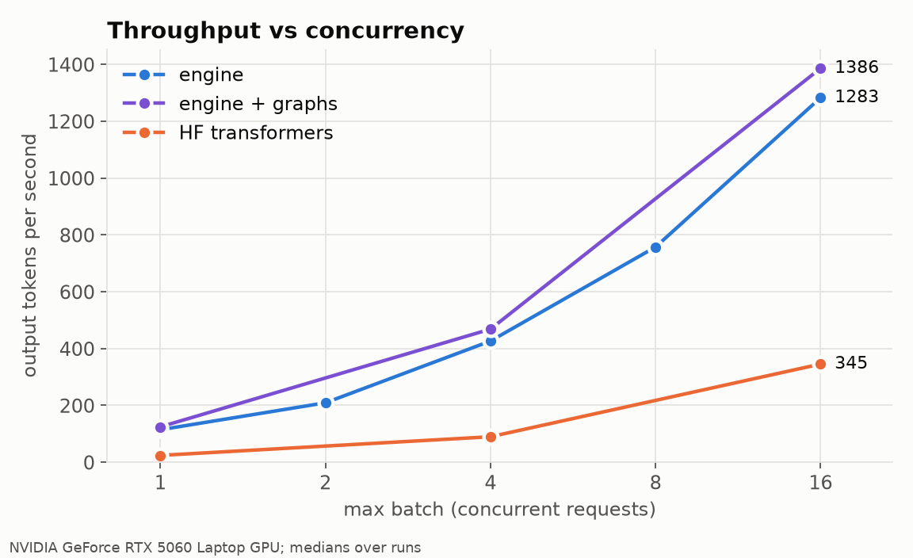
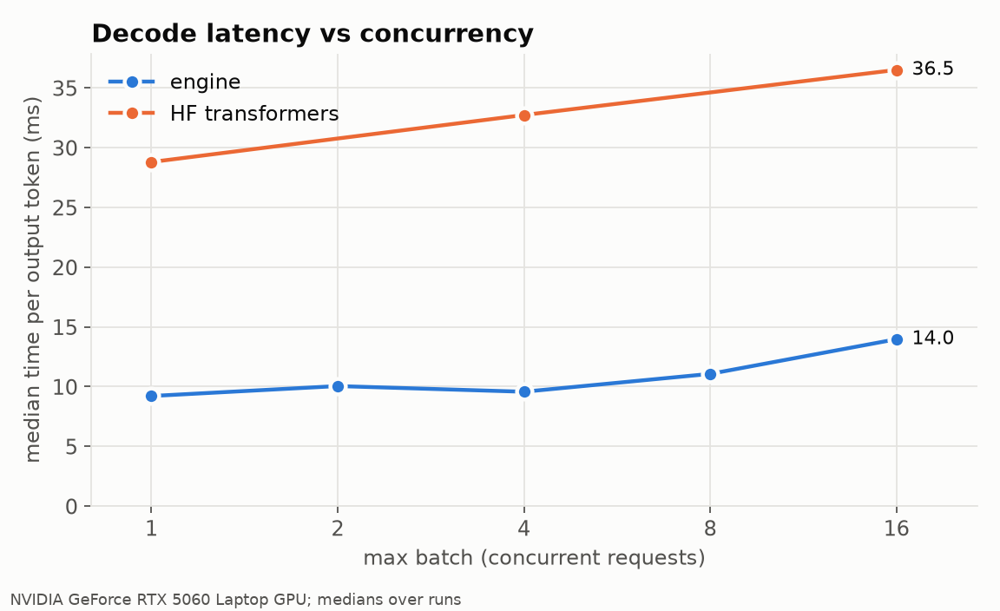
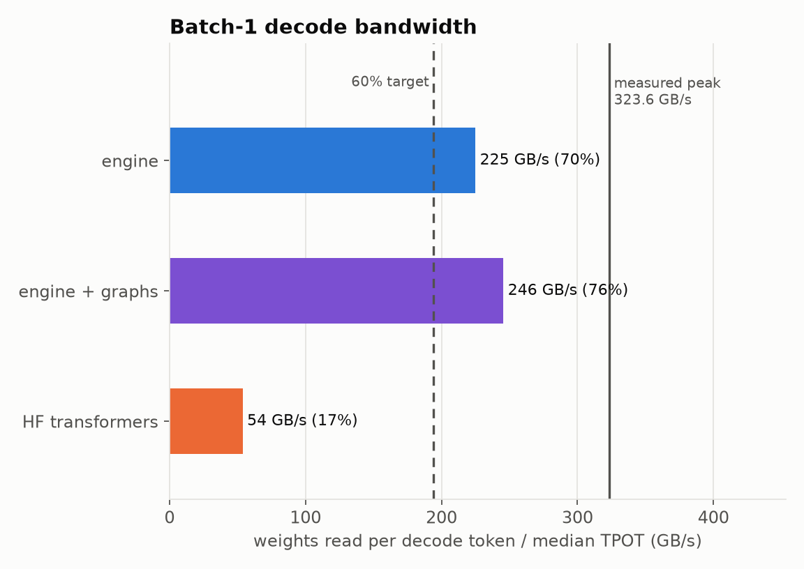
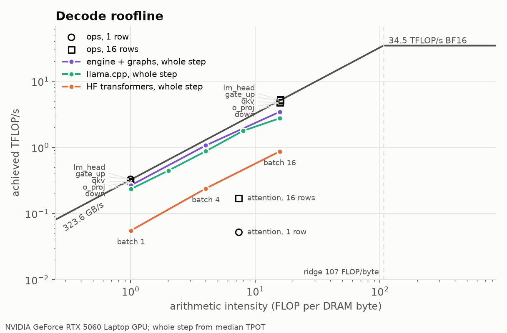

# Results

What the engine measures against the five MVP criteria, against HuggingFace transformers and llama.cpp, and where a decode step spends its time. The blocks between `auto` markers are written by `scripts/make_results.py` from the files `scripts/reproduce.sh` produces in `results/`; everything else is hand-written and has to be revisited when a kernel lands (see the checklist at the end).

Regenerate everything with one command, plugged in and with no other GPU program running:

```bash
scripts/reproduce.sh            # about 10 minutes; --quick for a smoke run
```

## Environment

The commit is the code the numbers were measured on; the `results/` files and this page are committed right after it.

<!-- auto:environment -->
- Date: 2026-10-25T11:52:26Z
- Commit: 7d60861
- GPU: NVIDIA GeForce RTX 5060 Laptop GPU
- Driver: 617.42
- CUDA: 13.3
- Build: Release
- Measured DRAM bandwidth (GB/s): 323.6
- Measured BF16 GEMM peak (TFLOP/s): 34.5
- Workload: 32 requests, 64 prompt tokens, 64 output tokens, greedy, seed 0, median of 3 run(s)
<!-- /auto:environment -->

## MVP scoreboard

<!-- auto:scoreboard -->
| # | Criterion | Target | Measured | |
|---|---|---|---|---|
| 1a | Teacher-forced vs HuggingFace | at least 99% argmax, error under 0.05 | 99.57% argmax over 1842 positions, mean abs logit error 0.0285 | met |
| 1b | Free-running greedy, first 64 tokens | exact, or diverging where HF's two logits are at most 2 BF16 ulps apart, on all 20 | exact on 15 of 20; the other 5 diverge at a near tie (at most 2 BF16 ulps apart in HF's logits) | met |
| 2 | Batch-1 decode bandwidth | at least 60% of 323.6 GB/s | 265 GB/s = 82% | met |
| 3 | Throughput at 16 concurrent requests | at least 5x batch 1 | 1402 vs 127 tokens/s = 11.0x | met |
<!-- /auto:scoreboard -->

Criterion 4 (each kernel has a before and after Nsight Compute number) and criterion 5 (reproducible from a clean clone) are tracked by the kernel table and `scripts/reproduce.sh` below rather than computed.

## Throughput and latency





<!-- auto:table -->
| system | max batch | output tok/s | TPOT p50 ms | TTFT p50 ms | weights GB/s | runs |
|---|---|---|---|---|---|---|
| engine | 1 | 115.8 | 8.52 | 8475.1 | 242.8 | 3 |
| engine | 2 | 226.2 | 8.66 | 4142.6 |  | 3 |
| engine | 4 | 441.4 | 8.63 | 2097.4 |  | 3 |
| engine | 8 | 791.2 | 9.12 | 1063.2 |  | 3 |
| engine | 16 | 1293.6 | 10.69 | 526.8 |  | 3 |
| engine + graphs | 1 | 127.3 | 7.81 | 7757.4 | 264.8 | 3 |
| engine + graphs | 4 | 478.4 | 7.81 | 1936.7 |  | 3 |
| engine + graphs | 16 | 1401.7 | 9.69 | 498.0 |  | 3 |
| HF transformers | 1 | 26.6 | 37.62 | 37715.2 | 55.0 | 1 |
| HF transformers | 4 | 114.4 | 34.89 | 7811.5 |  | 1 |
| HF transformers | 16 | 407.0 | 38.43 | 1388.5 |  | 1 |
| llama.cpp | 1 | 110.1 | 8.89 | 9029.5 | 232.8 | 3 |
| llama.cpp | 2 | 203.3 | 9.35 | 4765.7 |  | 3 |
| llama.cpp | 4 | 399.2 | 9.55 | 2284.0 |  | 3 |
| llama.cpp | 8 | 786.2 | 9.42 | 1034.8 |  | 3 |
| llama.cpp | 16 | 1154.0 | 12.12 | 567.3 |  | 3 |
<!-- /auto:table -->

The engine batches continuously (new requests join a running batch at any step, preemption on a full cache); the HuggingFace and llama.cpp baselines use static batches that run to the longest request, so the curves differ in more than kernel speed. `docs/baselines.md` lists what is and is not comparable.

llama.cpp (release b11870, CUDA, the same BF16 weights as a GGUF, flash attention on `auto`, built and converted by `scripts/setup_llamacpp.sh`) is the serious baseline: a mature engine whose batch-1 decode is also bandwidth bound. Its rows come from `llama-batched-bench`, one static batch per size replayed over the 32 requests (`docs/baselines.md`). In this run the engine with CUDA Graphs is ahead at every size: TPOT 7.8 against 8.9 ms at batch 1 (265 against 233 GB/s of weights, 1.16x the tokens/s), 1.20x at batch 4 and 1.21x at batch 16 on the medians, but llama.cpp's three batch-16 runs spread from 953 to 1271 tokens/s (1156 to 1315 in the previous run), so the batch-16 margin is 1.10x against its best run. Eager, without graphs, the engine is ahead up to batch 4, level at batch 8 (791 against 786 tokens/s) and ahead of the median at 16 (1294 against 1154), level with llama.cpp's best batch-16 run. The workload favors static batching (every request has the same length), and llama.cpp never runs a sampler in this tool while the engine samples on the GPU, so neither difference flatters the engine.

## Batch-1 decode bandwidth



Decoding one token reads every weight except all but one row of the embedding table, 2.07 GB, so the time per token cannot go below `2.07 GB / peak`. The peak used here is the DRAM bandwidth measured by `src/practice/bandwith_test.cu` on this GPU (323.6 GB/s, about 84% of the datasheet figure).

## Where a decode step goes

From `scripts/profile.sh nsys` on a batch-1 run (see `docs/profiling.md` for how to read it):

<!-- auto:profile -->
### Launch gaps per forward step

- decode: 252 steps, 224 kernels, median span 8069 us, median busy 6909 us, median idle 11.5% of the span, 17 gaps over 5 us per step
- prefill: 4 steps, 224 kernels, median span 11187 us, median busy 10093 us, median idle 8.1% of the span, 40 gaps over 5 us per step

### GPU time per op in a decode step

| op | kernels/step | GPU us/step | % of kernel time |
| --- | --- | --- | --- |
| gate_up | 22.0 | 3138.8 | 43.7 |
| down | 22.0 | 1724.2 | 24.0 |
| qkv | 22.0 | 759.2 | 10.6 |
| o_proj | 22.0 | 619.1 | 8.6 |
| lm_head | 1.0 | 398.3 | 5.6 |
| attention | 22.0 | 332.8 | 4.6 |
| rope | 22.0 | 61.7 | 0.9 |
| add1_norm2 | 22.0 | 38.5 | 0.5 |
| add2_norm1 | 21.0 | 34.9 | 0.5 |
| write_kv | 22.0 | 32.0 | 0.4 |
| swiglu | 22.0 | 25.2 | 0.4 |
| norm1 | 1.0 | 3.3 | 0.0 |
| final_norm | 1.0 | 3.3 | 0.0 |
| embedding | 1.0 | 3.3 | 0.0 |
| add2 | 1.0 | 0.9 | 0.0 |

### Top 12 kernels

| kernel | count | total ms | avg us | % |
| --- | --- | --- | --- | --- |
| std::enable_if<!T7, void>::type internal::gemvx::kernel<int, int, __nv_bfloat... | 22432 | 1674.8 | 74.7 | 90.4 |
| engine::paged_attention_decode_v2_kernel(__nv_bfloat16 *, const __nv_bfloat16... | 5632 | 94.5 | 16.8 | 5.1 |
| void cutlass::Kernel2<cutlass_80_tensorop_bf16_s16816gemm_relu_bf16_64x64_32x... | 176 | 21.2 | 120.4 | 1.1 |
| engine::fast::add_rmsnorm_vec_kernel(__nv_bfloat16 *, __nv_bfloat16 *, const ... | 11008 | 18.9 | 1.7 | 1.0 |
| engine::fast::rope_kernel(__nv_bfloat16 *, const int *, int, int, int, engine... | 5632 | 15.8 | 2.8 | 0.9 |
| engine::write_kv_kernel(const __nv_bfloat16 *, const int *, __nv_bfloat16 *, ... | 5632 | 8.2 | 1.5 | 0.4 |
| engine::fast::swiglu_kernel(__nv_bfloat16 *, const __nv_bfloat16 *, long, long) | 5544 | 6.3 | 1.1 | 0.3 |
| nvjet_sm120_tst_mma_80x64x64_5_80x8x64_tmaAB_alignCD4_bz_TNNN | 88 | 3.5 | 39.5 | 0.2 |
| nvjet_sm120_tst_mma_112x64x64_4_112x8x64_tmaAB_alignCD4_bz_TNNN | 88 | 3.4 | 38.1 | 0.2 |
| engine::<unnamed>::sample_kernel(int *, const __nv_bfloat16 *, int, const eng... | 256 | 2.7 | 10.6 | 0.1 |
| engine::naive::<unnamed>::rmsnorm_kernel(__nv_bfloat16 *, const __nv_bfloat16... | 512 | 1.7 | 3.3 | 0.1 |
| engine::naive::<unnamed>::embedding_kernel(__nv_bfloat16 *, const int *, cons... | 256 | 0.8 | 3.3 | 0.0 |

### Decode bandwidth

- max_batch 1, median TPOT 8.85 ms
- weights read per token / TPOT: 233.7 GB/s = 72.2% of the 323.6 GB/s peak (target 60%)
- GPU kernel busy time in a decode step: 6.91 ms (78% of TPOT)
- weights / kernel busy time: 299.4 GB/s (what the kernels would reach with no launch gaps)
<!-- /auto:profile -->

The same step replayed from a CUDA Graph (`engine bench --graphs`, one graph per power-of-two batch size, kernels unchanged):

<!-- auto:profile_graphs -->
### Launch gaps per forward step

- decode: 252 steps, 224 kernels, median span 6973 us, median busy 6917 us, median idle 0.8% of the span, 0 gaps over 5 us per step
- prefill: 4 steps, 224 kernels, median span 12109 us, median busy 10323 us, median idle 10.4% of the span, 44 gaps over 5 us per step

### GPU time per op in a decode step

| op | kernels/step | GPU us/step | % of kernel time |
| --- | --- | --- | --- |
| forward_decode | 224.0 | 7275.1 | 100.0 |

### Top 12 kernels

| kernel | count | total ms | avg us | % |
| --- | --- | --- | --- | --- |
| std::enable_if<!T7, void>::type internal::gemvx::kernel<int, int, __nv_bfloat... | 22432 | 1694.7 | 75.5 | 89.8 |
| engine::paged_attention_decode_v2_kernel(__nv_bfloat16 *, const __nv_bfloat16... | 5632 | 104.4 | 18.5 | 5.5 |
| void cutlass::Kernel2<cutlass_80_tensorop_bf16_s16816gemm_relu_bf16_64x64_32x... | 176 | 25.5 | 144.7 | 1.3 |
| engine::fast::add_rmsnorm_vec_kernel(__nv_bfloat16 *, __nv_bfloat16 *, const ... | 11008 | 19.1 | 1.7 | 1.0 |
| engine::fast::rope_kernel(__nv_bfloat16 *, const int *, int, int, int, engine... | 5632 | 15.3 | 2.7 | 0.8 |
| engine::write_kv_kernel(const __nv_bfloat16 *, const int *, __nv_bfloat16 *, ... | 5632 | 8.3 | 1.5 | 0.4 |
| engine::fast::swiglu_kernel(__nv_bfloat16 *, const __nv_bfloat16 *, long, long) | 5544 | 5.6 | 1.0 | 0.3 |
| nvjet_sm120_tst_mma_80x64x64_5_80x8x64_tmaAB_alignCD4_bz_TNNN | 88 | 4.3 | 49.4 | 0.2 |
| nvjet_sm120_tst_mma_112x64x64_4_112x8x64_tmaAB_alignCD4_bz_TNNN | 88 | 4.2 | 47.4 | 0.2 |
| engine::<unnamed>::sample_kernel(int *, const __nv_bfloat16 *, int, const eng... | 256 | 2.9 | 11.5 | 0.2 |
| engine::naive::<unnamed>::rmsnorm_kernel(__nv_bfloat16 *, const __nv_bfloat16... | 512 | 1.8 | 3.5 | 0.1 |
| engine::naive::<unnamed>::embedding_kernel(__nv_bfloat16 *, const int *, cons... | 256 | 0.9 | 3.3 | 0.0 |

### Decode bandwidth

- max_batch 1, median TPOT 7.79 ms
- weights read per token / TPOT: 265.7 GB/s = 82.1% of the 323.6 GB/s peak (target 60%)
- GPU kernel busy time in a decode step: 6.92 ms (89% of TPOT)
- weights / kernel busy time: 299.1 GB/s (what the kernels would reach with no launch gaps)
<!-- /auto:profile_graphs -->

The launch gaps are gone (idle share of a decode step from 11.5% to 0.8%, gaps over 5 us from 17 per step to 0) and the kernels take the same time, so the saving is the gap the GPU leaves before each kernel when kernels are launched one by one: in the two profiles above the median gap over the 223 kernel boundaries of a decode step is 3.1 us eager and 0.24 us replayed. It is not the GPU waiting for the host, since the eager launch calls run about 1.7 ms ahead of their kernels (`docs/profiling.md`, "Decode CUDA Graphs"). In the two profiled runs a batch-1 token takes about 1.1 ms less (8.85 to 7.79 ms; 8.52 to 7.81 ms in the bench table above) and the weights bandwidth rises from 234 to 266 GB/s, 72% to 82% of the measured peak. What is left is the kernels themselves: the cuBLAS GEMV for gate/up and down owns about 68% of the step and runs at about 310 GB/s, and `paged_attention_decode_v2` owns 4.6% (v1 owned 11.5% in the profile before v2 was wired in).

## Roofline



From `scripts/roofline.py`: FLOPs and DRAM bytes of each GEMM and of attention are counted from `config.json` (weights, activations and the KV cache read once, nothing for caches), the op times come from the batch-1 profile above and a batch-16 profile (`results/decode_step_b16.md`), the whole-step points from the median TPOT of the table above. The ceilings are the measured DRAM bandwidth and the measured BF16 GEMM peak (`scripts/gemm_peak.cu`, `docs/hardware.md`).

<!-- auto:roofline -->
Ceilings: 323.6 GB/s and 34.5 TFLOP/s (BF16), ridge point 107 FLOP/byte; mean attended context 96 tokens.

| op | rows | FLOP/byte | us/step | TFLOP/s | GB/s | % of roof |
|---|---|---|---|---|---|---|
| qkv | 1 | 1.0 | 759.2 | 0.30 | 304 | 94 |
| o_proj | 1 | 1.0 | 619.1 | 0.30 | 298 | 92 |
| gate_up | 1 | 1.0 | 3138.8 | 0.32 | 324 | 100 |
| down | 1 | 1.0 | 1724.2 | 0.29 | 295 | 91 |
| lm_head | 1 | 1.0 | 398.3 | 0.33 | 329 | 102 |
| attention | 1 | 7.4 | 332.8 | 0.05 | 7 | 2 |
| qkv | 16 | 15.8 | 775.1 | 4.76 | 302 | 93 |
| o_proj | 16 | 15.8 | 623.6 | 4.74 | 301 | 93 |
| gate_up | 16 | 15.9 | 3172.5 | 5.12 | 323 | 100 |
| down | 16 | 15.8 | 1715.6 | 4.73 | 299 | 92 |
| lm_head | 16 | 15.9 | 400.1 | 5.24 | 330 | 102 |
| attention | 16 | 7.4 | 1631.2 | 0.17 | 23 | 7 |

| whole decode step | rows | FLOP/byte | TPOT us | TFLOP/s | GB/s | % of roof |
|---|---|---|---|---|---|---|
| engine + graphs | 1 | 1.0 | 7813 | 0.27 | 265 | 82 |
| engine + graphs | 4 | 4.0 | 7806 | 1.07 | 267 | 82 |
| engine + graphs | 16 | 15.7 | 9692 | 3.44 | 220 | 68 |
| engine | 1 | 1.0 | 8521 | 0.24 | 243 | 75 |
| engine | 2 | 2.0 | 8656 | 0.48 | 240 | 74 |
| engine | 4 | 4.0 | 8631 | 0.97 | 241 | 75 |
| engine | 8 | 8.0 | 9118 | 1.83 | 230 | 71 |
| engine | 16 | 15.7 | 10687 | 3.12 | 199 | 62 |
| llama.cpp | 1 | 1.0 | 8889 | 0.23 | 233 | 72 |
| llama.cpp | 2 | 2.0 | 9350 | 0.45 | 222 | 69 |
| llama.cpp | 4 | 4.0 | 9548 | 0.87 | 218 | 67 |
| llama.cpp | 8 | 8.0 | 9418 | 1.77 | 223 | 69 |
| llama.cpp | 16 | 15.7 | 12123 | 2.75 | 176 | 54 |
| HF transformers | 1 | 1.0 | 37620 | 0.06 | 55 | 17 |
| HF transformers | 4 | 4.0 | 34895 | 0.24 | 60 | 18 |
| HF transformers | 16 | 15.7 | 38433 | 0.87 | 55 | 17 |
<!-- /auto:roofline -->

Every point sits on the bandwidth slope, far left of the 107 FLOP/byte ridge, so nothing in decode is compute bound on this GPU. At batch 1 the five cuBLAS GEMVs run at 91% to 102% of the roof at 1 FLOP/byte (the roof is a measured copy bandwidth, not a hard limit, so 102% reads as "at the roof"): they cannot get faster without moving fewer bytes. The whole step with graphs reaches 82% of the roof; the rest is attention, the elementwise ops and what little host time graphs leave.

At batch 16 the GEMMs move right to 16 FLOP/byte and take the same time as at batch 1 (4,888 us against 4,863 for gate/up and down together) while doing 16 times the FLOPs, up to 5.2 TFLOP/s: every weight byte is read once for 16 tokens, which is where the 11x throughput comes from. Attention does not move: each row reads its own K and V, so its intensity stays at 7.4 FLOP/byte at any batch size. Its time grows from 333 to 1,631 us per step (19% of kernel time) at 7% of its roof, which makes it the op with the most headroom at batch 16; the split kernel does not run there (5 rows or more keep v2). The whole step at batch 16 falls to 68% of the roof with graphs, against 54% for llama.cpp and 17% for HuggingFace.

## Kernels

Every kernel exists twice, a naive one that is obviously correct (the test oracle and the "before" number) and an optimized one tested against it. "In the forward pass" says whether `PagedRunner` calls the fast one; the end-to-end numbers above include only the kernels marked yes.

| Kernel | Optimized version | Tests | Nsight Compute before and after | In the forward pass |
| --- | --- | --- | --- | --- |
| cuBLAS GEMMs (QKV, output, gate/up, down, LM head) | none, cuBLAS as is | `tests/gpu/test_gemm.cpp` | batch-1 GEMVs run at about 310 GB/s in the profile above | yes |
| `paged_attention_decode` | v1 (one block per head and row, scores in shared memory) is the oracle and the "before" number; `paged_attention_decode_v2` (online softmax, 8 lanes per key, value sum spread over all threads, no context cap) is called by the forward pass | `tests/gpu/test_paged_attention.cpp`, `tests/gpu/test_paged_attention_v2.cpp`, `tests/gpu/test_paged_attention_split.cpp` | v2 is 1.4x to 3.6x faster than v1 per launch (1 row, context 2,048: 600 to 165 us; 16 rows, context 512: 565 to 193 us) and runs a context of 8,192 that v1 cannot; Nsight Compute: 1,310 to 383 us at 1 row and context 2,048, details in `docs/profiling.md`, "Paged attention v2"; in the decode profile (32 prompt and 32 output tokens) attention went from 883 to 272 us per step (11.5% to 3.8% of kernel time) once v2 was wired in, `docs/profiling.md`, "Paged attention v2 in the forward pass"; `paged_attention_decode_split` (the context of a row cut across blocks, partials merged in split order) is 2.8x faster than v2 at 1 row and 2,048 tokens and takes the batch-1 TPOT at a 1,984-token prompt from 14.7 to 10.2 ms eager and from 14.0 to 9.1 ms with graphs, `docs/profiling.md`, "Split-context attention", "Split attention in the forward pass" and "Split attention in CUDA Graphs" | yes, v2, and split for 1 to 4 rows at 512 tokens or more (eager and graph replays) |
| `write_kv` | one thread per element | `tests/gpu/test_write_kv.cpp` | not recorded | yes |
| add + RMSNorm | `fast::add_rmsnorm` (fused; 128-bit loads, row kept in registers) | `tests/gpu/test_add_rmsnorm.cpp` | `docs/profiling.md`, "Fused add_rmsnorm" and "Tuning add_rmsnorm" (10.9 to 4.0 us at 1 token, 11.1 to 5.3 us at 64; 105 us less per decode step) | yes, fused with the residual add |
| RoPE | `fast::rope` | `tests/gpu/test_rope_fast.cpp` | `docs/profiling.md`, "Fast RoPE" | yes |
| SwiGLU | `fast::swiglu` (vectorized, scalar below 5 tokens) | `tests/gpu/test_swiglu_fast.cpp` | `docs/profiling.md`, "Fast SwiGLU" and "Small batches" | yes |
| CUDA Graph decode | `DecodeGraphs` (one graph per power-of-two batch size up to the max batch, padded rows write nothing) | `tests/gpu/test_decode_graphs.cpp`, `tests/gpu/test_serve.cpp` | `docs/profiling.md`, "Decode CUDA Graphs"; launch gaps in the profile above | yes, `engine bench --graphs` |

## Reading these numbers

- "engine + graphs" is the same engine with `--graphs`; the scoreboard scores criteria 2 and 3 on the better of the two series, which is the graph one. HF and llama.cpp are never helped by it.
- The laptop GPU's clocks move between runs by 10 to 20%, so each configuration is run several times and the table shows the median of the runs.
- At batch 1 the engine's time per token is the sum of its kernels plus launch gaps and host work; the profile block above separates them.
- Both systems ignore EOS and generate exactly the requested number of tokens with greedy sampling, so the work per request is identical.
- The "Teacher-forced vs HuggingFace" and free-running rows run the contiguous `ModelRunner`, which keeps the naive kernels as the oracle. The paged runner that serves requests runs the fast kernels; its own HF check (`PagedRunnerTest.ConcurrentSequencesMatchHuggingFaceTeacherForced`, up to 16 sequences at once) reads 1166 of 1171 argmax matches (99.57%) with a mean absolute logit error of 0.0247.
- Free-running exact match is stricter than teacher forcing: a single BF16 near tie flips a token and the continuations then differ. The accepted rule (decided with the correctness suite) is that an unmatched prompt must diverge at a position where HuggingFace's own two logits are within 2 BF16 ulps.

## When a kernel lands

1. Wire it into `PagedRunner` (keep the naive kernel as the oracle in the tests).
2. Run `scripts/reproduce.sh` and read the scoreboard and the profile block.
3. Update its row in the Kernels table above and add its Nsight Compute before/after to `docs/profiling.md`.
4. Commit `results/` and `docs/results.md` together with the change, with the date, commit and GPU the script recorded.
