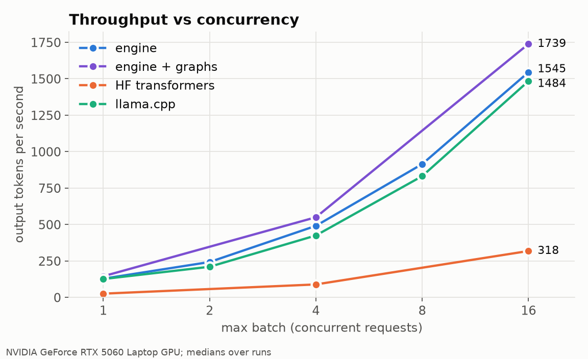
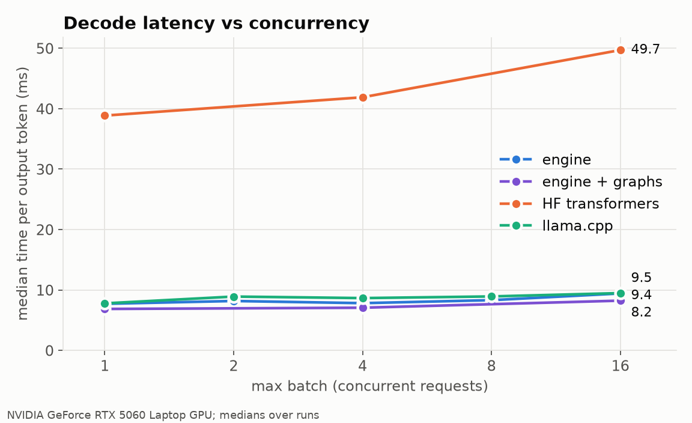
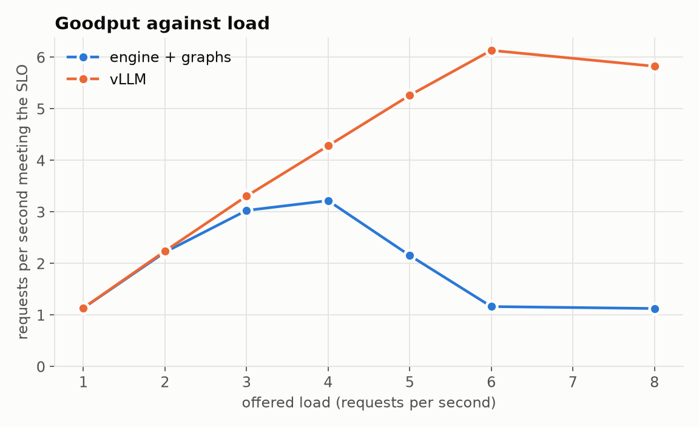
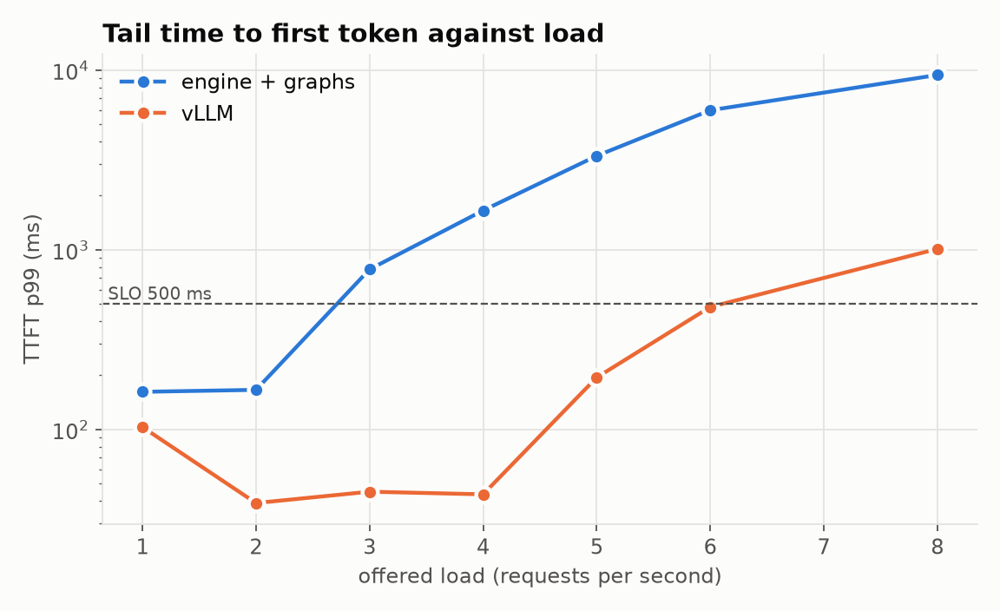
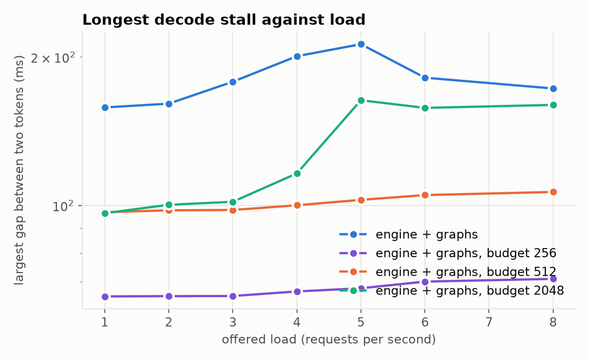
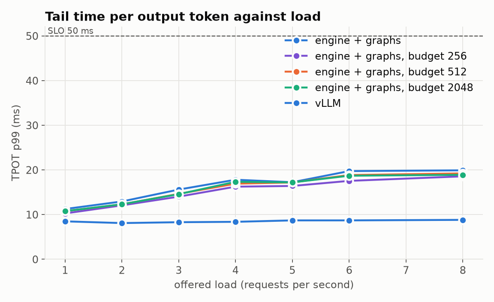
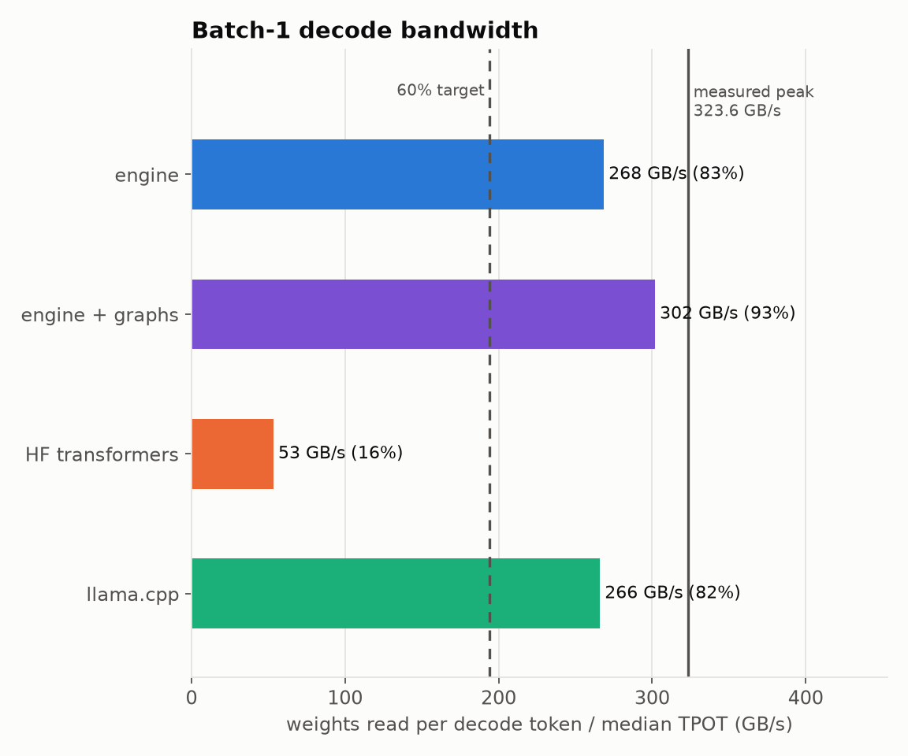
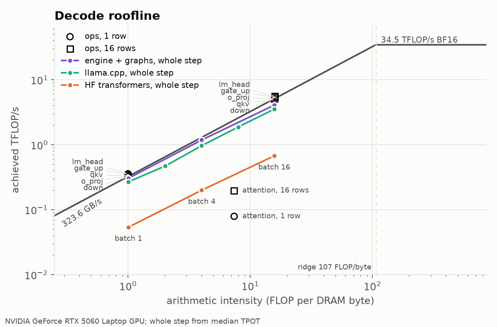
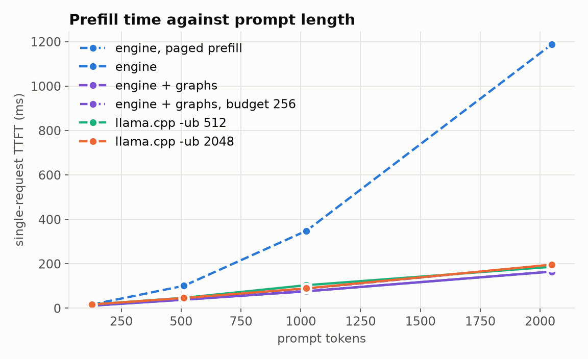

# Results

What the engine measures against the five MVP criteria, against HuggingFace transformers and llama.cpp, and where a decode step spends its time. The blocks between `auto` markers are written by `scripts/make_results.py` from the files `scripts/reproduce.sh` produces in `results/`; everything else is hand-written and has to be revisited when a kernel lands (see the checklist at the end).

Regenerate everything with one command, plugged in and with no other GPU program running:

```bash
scripts/reproduce.sh            # about 10 minutes; --quick for a smoke run
```

## Environment

The commit is the code the numbers were measured on; the `results/` files and this page are committed right after it.

<!-- auto:environment -->
- Date: 2026-11-16T20:12:50Z
- Commit: eaddcb7
- GPU: NVIDIA GeForce RTX 5060 Laptop GPU
- Driver: 591.84
- CUDA: 13.3
- Build: Release
- Measured DRAM bandwidth (GB/s): 323.6
- Measured BF16 GEMM peak (TFLOP/s): 34.5
- Workload: 32 requests, 64 prompt tokens, 64 output tokens, greedy, seed 0, median of 3 run(s)
<!-- /auto:environment -->

## MVP scoreboard

<!-- auto:scoreboard -->
| # | Criterion | Target | Measured | |
|---|---|---|---|---|
| 1a | Teacher-forced vs HuggingFace | at least 99% argmax, error under 0.05 | 99.57% argmax over 1842 positions, mean abs logit error 0.0285 | met |
| 1b | Free-running greedy, first 64 tokens | exact, or diverging where HF's two logits are at most 2 BF16 ulps apart, on all 20 | exact on 15 of 20; the other 5 diverge at a near tie (at most 2 BF16 ulps apart in HF's logits) | met |
| 2 | Batch-1 decode bandwidth | at least 60% of 323.6 GB/s | 302 GB/s = 93% | met |
| 3 | Throughput at 16 concurrent requests | at least 5x batch 1 | 1739 vs 145 tokens/s = 12.0x | met |
<!-- /auto:scoreboard -->

Criterion 4 (each kernel has a before and after Nsight Compute number) and criterion 5 (reproducible from a clean clone) are tracked by the kernel table and `scripts/reproduce.sh` below rather than computed.

## Throughput and latency





<!-- auto:table -->
| system | max batch | output tok/s | TPOT p50 ms | TTFT p50 ms | weights GB/s | runs |
|---|---|---|---|---|---|---|
| engine | 1 | 128.2 | 7.71 | 7921.7 | 268.4 | 3 |
| engine | 2 | 242.6 | 8.17 | 3845.1 |  | 3 |
| engine | 4 | 490.6 | 7.81 | 1843.2 |  | 3 |
| engine | 8 | 914.5 | 8.31 | 883.4 |  | 3 |
| engine | 16 | 1544.9 | 9.42 | 409.9 |  | 3 |
| engine + graphs | 1 | 144.9 | 6.86 | 6858.3 | 301.7 | 3 |
| engine + graphs | 4 | 549.6 | 7.06 | 1647.9 |  | 3 |
| engine + graphs | 16 | 1738.5 | 8.23 | 363.7 |  | 3 |
| HF transformers | 1 | 25.5 | 38.85 | 39595.7 | 53.3 | 1 |
| HF transformers | 4 | 88.8 | 41.89 | 9141.9 |  | 1 |
| HF transformers | 16 | 318.2 | 49.70 | 1499.1 |  | 1 |
| llama.cpp | 1 | 125.8 | 7.78 | 7902.7 | 265.9 | 3 |
| llama.cpp | 2 | 210.0 | 8.91 | 4620.7 |  | 3 |
| llama.cpp | 4 | 424.6 | 8.65 | 2167.7 |  | 3 |
| llama.cpp | 8 | 831.8 | 8.93 | 976.3 |  | 3 |
| llama.cpp | 16 | 1483.8 | 9.48 | 437.8 |  | 3 |
<!-- /auto:table -->

The engine batches continuously (new requests join a running batch at any step, preemption on a full cache); the HuggingFace and llama.cpp baselines use static batches that run to the longest request, so the curves differ in more than kernel speed. `baselines.md` lists what is and is not comparable.

llama.cpp (release b11870, CUDA, the same BF16 weights as a GGUF, flash attention on `auto`, built and converted by `scripts/setup_llamacpp.sh`) is the serious baseline: a mature engine whose batch-1 decode is also bandwidth bound. Its rows come from `llama-batched-bench`, one static batch per size replayed over the 32 requests (`baselines.md`). In this run the engine with CUDA Graphs is ahead at every size: TPOT 6.9 against 7.8 ms at batch 1 (302 against 266 GB/s of weights, 1.15x the tokens/s), 1.29x at batch 4 and 1.17x at batch 16 on the medians; llama.cpp's three batch-16 runs spread from 1387 to 1486 tokens/s, so the batch-16 margin is also 1.17x against its best run. Eager, without graphs, the engine is level at batch 1 (128 against 126 tokens/s), ahead from batch 2 to 8 (914 against 832 tokens/s at 8) and ahead of llama.cpp's best batch-16 run (1545 against 1486). Every system that did not change is faster than in the run of 2026-10-25 this replaces (llama.cpp 126 against 110 tokens/s at batch 1, on driver 591.84 against 617.42), while the measured DRAM bandwidth is the same 323 GB/s, so compare rows of this table with each other and not with older sections. The workload favors static batching (every request has the same length), and llama.cpp never runs a sampler in this tool while the engine samples on the GPU, so neither difference flatters the engine.

## Under load









From `scripts/load_sweep.sh` and `scripts/load_report.py`: `engine bench --max-batch 16 --graphs` with 120 requests arriving as a Poisson process at each rate, prompts of 16 to 512 tokens and outputs of 16 to 256 drawn uniformly, greedy, EOS ignored, seed 0, median of 3 runs, once with whole-prompt prefill steps and once each with `--token-budget` 256, 512 and 2,048 (chunked prefill, #101). The four configurations were interleaved run by run (run 1 of each, then run 2 of each), so drift on the machine hits them alike, and every run wrote a step trace, from which `load_report.py --traces` takes the gap between every two consecutive tokens of a request. Measured on 2026-11-11 (UTC) on the RTX 5060 Laptop GPU, release build, at commit 1feaba9, with the defaults of that commit: the FlashAttention prefill kernel (`flash_attention_prefill`, #103) and two graph buckets per power of two. vLLM, the long-prompt probe below and the engine sweep ran one after another in the same boot, on wall power, with no other GPU program. The 1-minute load average at the start of an engine run was between 0.6 and 1.5 (median 1.1). Three of the 84 engine runs had a TPOT p50 more than 4% from the median of their three repeats (5.0% at most) and were kept, since the table takes the median. `results/load/` holds the per-request and summary CSVs and `token_gaps.csv`; the traces themselves are not committed. The offline runs above submit identical requests at once, which never shows queueing.

These files supersede the 2026-11-05 sweep under the same names, which ran prefill through the paged decode attention kernel. Do not compare times across the two dates: the machine was slower in this boot. vLLM, whose code did not change, has a TPOT p50 of 8.9 ms at 4 QPS here against 8.1 ms then, and a first pass of the engine sweep, in an earlier boot of the same evening, had a TPOT p50 of 8.95 ms at 1 QPS where this one has 9.5. That pass was discarded and the whole engine sweep repeated in the boot that measured vLLM, so the rows of this table compare with each other. vLLM's repeats were less steady than on 2026-11-05: at 3 and 4 QPS one run's TPOT p50 is 9.6% and 10.6% from the median of its three, and elsewhere they agree within 4%.

<!-- auto:load -->
Engine runs measured 2026-11-11 at commit 1feaba9 on NVIDIA GeForce RTX 5060 Laptop GPU; vLLM runs measured 2026-11-11 (vllm 0.32.0, torch 2.13.0).

SLO: TTFT at most 500 ms and TPOT at most 50 ms; goodput is the requests per second that meet both.

| system | QPS | output tok/s | TTFT p50 ms | TTFT p99 ms | TPOT p50 ms | TPOT p99 ms | SLO met | goodput req/s | preemptions | runs |
|---|---|---|---|---|---|---|---|---|---|---|
| engine + graphs | 1 | 167 | 35 | 103 | 9.5 | 11.4 | 100% | 1.14 | 0 | 3 |
| engine + graphs | 2 | 329 | 34 | 67 | 10.1 | 12.6 | 100% | 2.23 | 0 | 3 |
| engine + graphs | 3 | 480 | 35 | 67 | 11.5 | 14.7 | 100% | 3.26 | 0 | 3 |
| engine + graphs | 4 | 632 | 38 | 467 | 12.6 | 16.5 | 99% | 4.26 | 0 | 3 |
| engine + graphs | 5 | 763 | 45 | 1094 | 14.4 | 16.8 | 86% | 4.45 | 0 | 3 |
| engine + graphs | 6 | 845 | 93 | 1669 | 15.3 | 17.4 | 67% | 3.83 | 0 | 3 |
| engine + graphs | 8 | 898 | 1304 | 4592 | 15.4 | 17.6 | 25% | 1.53 | 0 | 3 |
| engine + graphs, budget 256 | 1 | 167 | 43 | 94 | 9.3 | 10.9 | 100% | 1.14 | 0 | 3 |
| engine + graphs, budget 256 | 2 | 327 | 42 | 85 | 9.8 | 12.1 | 100% | 2.23 | 0 | 3 |
| engine + graphs, budget 256 | 3 | 484 | 45 | 99 | 10.7 | 13.7 | 100% | 3.29 | 0 | 3 |
| engine + graphs, budget 256 | 4 | 626 | 48 | 289 | 12.0 | 15.2 | 100% | 4.25 | 0 | 3 |
| engine + graphs, budget 256 | 5 | 771 | 55 | 921 | 13.5 | 15.2 | 87% | 4.54 | 0 | 3 |
| engine + graphs, budget 256 | 6 | 858 | 70 | 1447 | 14.3 | 15.9 | 74% | 4.32 | 0 | 3 |
| engine + graphs, budget 256 | 8 | 924 | 1077 | 4062 | 14.8 | 16.7 | 26% | 1.62 | 0 | 3 |
| engine + graphs, budget 512 | 1 | 167 | 36 | 101 | 9.3 | 10.9 | 100% | 1.14 | 0 | 3 |
| engine + graphs, budget 512 | 2 | 329 | 36 | 69 | 10.0 | 12.2 | 100% | 2.23 | 0 | 3 |
| engine + graphs, budget 512 | 3 | 481 | 38 | 82 | 11.1 | 14.1 | 100% | 3.27 | 0 | 3 |
| engine + graphs, budget 512 | 4 | 632 | 41 | 295 | 11.9 | 15.4 | 100% | 4.30 | 0 | 3 |
| engine + graphs, budget 512 | 5 | 771 | 46 | 941 | 13.6 | 15.4 | 87% | 4.54 | 0 | 3 |
| engine + graphs, budget 512 | 6 | 855 | 58 | 1463 | 14.5 | 16.1 | 74% | 4.31 | 0 | 3 |
| engine + graphs, budget 512 | 8 | 920 | 1098 | 4143 | 14.9 | 17.0 | 26% | 1.62 | 0 | 3 |
| engine + graphs, budget 2048 | 1 | 167 | 35 | 89 | 9.3 | 11.3 | 100% | 1.14 | 0 | 3 |
| engine + graphs, budget 2048 | 2 | 329 | 36 | 69 | 9.8 | 12.2 | 100% | 2.24 | 0 | 3 |
| engine + graphs, budget 2048 | 3 | 484 | 38 | 75 | 10.9 | 14.1 | 100% | 3.29 | 0 | 3 |
| engine + graphs, budget 2048 | 4 | 626 | 42 | 298 | 12.2 | 15.5 | 100% | 4.25 | 0 | 3 |
| engine + graphs, budget 2048 | 5 | 771 | 46 | 947 | 13.6 | 15.4 | 87% | 4.54 | 0 | 3 |
| engine + graphs, budget 2048 | 6 | 856 | 58 | 1462 | 14.4 | 16.1 | 74% | 4.32 | 0 | 3 |
| engine + graphs, budget 2048 | 8 | 917 | 1099 | 4211 | 14.9 | 17.0 | 26% | 1.61 | 0 | 3 |
| vLLM | 1 | 167 | 60 | 121 | 8.8 | 11.5 | 100% | 1.14 | 0 | 3 |
| vLLM | 2 | 330 | 32 | 53 | 8.5 | 9.1 | 100% | 2.24 | 0 | 3 |
| vLLM | 3 | 482 | 45 | 122 | 9.6 | 14.3 | 100% | 3.28 | 0 | 3 |
| vLLM | 4 | 638 | 36 | 72 | 8.9 | 12.1 | 100% | 4.34 | 0 | 3 |
| vLLM | 5 | 785 | 34 | 63 | 8.8 | 9.5 | 100% | 5.34 | 0 | 3 |
| vLLM | 6 | 927 | 36 | 313 | 9.0 | 10.6 | 100% | 6.30 | 0 | 3 |
| vLLM | 8 | 1192 | 38 | 644 | 9.2 | 9.5 | 92% | 7.49 | 0 | 3 |

Gaps between consecutive output tokens of one request, from the engine's step traces: every token of every request, medians of the runs' p50, p99 and largest gap.

| system | QPS | gap p50 ms | gap p99 ms | largest gap ms | runs |
|---|---|---|---|---|---|
| engine + graphs | 1 | 9.1 | 18.7 | 110 | 3 |
| engine + graphs | 2 | 9.5 | 39.4 | 93 | 3 |
| engine + graphs | 3 | 10.2 | 50.1 | 101 | 3 |
| engine + graphs | 4 | 11.0 | 54.9 | 108 | 3 |
| engine + graphs | 5 | 12.4 | 55.8 | 113 | 3 |
| engine + graphs | 6 | 12.8 | 57.9 | 120 | 3 |
| engine + graphs | 8 | 12.9 | 59.6 | 86 | 3 |
| engine + graphs, budget 256 | 1 | 9.0 | 21.4 | 41 | 3 |
| engine + graphs, budget 256 | 2 | 9.4 | 26.0 | 42 | 3 |
| engine + graphs, budget 256 | 3 | 10.1 | 29.1 | 41 | 3 |
| engine + graphs, budget 256 | 4 | 11.1 | 30.7 | 41 | 3 |
| engine + graphs, budget 256 | 5 | 12.1 | 31.2 | 41 | 3 |
| engine + graphs, budget 256 | 6 | 12.7 | 32.1 | 47 | 3 |
| engine + graphs, budget 256 | 8 | 13.0 | 32.7 | 42 | 3 |
| engine + graphs, budget 512 | 1 | 9.1 | 13.8 | 67 | 3 |
| engine + graphs, budget 512 | 2 | 9.5 | 34.2 | 53 | 3 |
| engine + graphs, budget 512 | 3 | 10.1 | 41.9 | 54 | 3 |
| engine + graphs, budget 512 | 4 | 10.9 | 45.8 | 56 | 3 |
| engine + graphs, budget 512 | 5 | 12.1 | 47.9 | 63 | 3 |
| engine + graphs, budget 512 | 6 | 12.7 | 48.5 | 59 | 3 |
| engine + graphs, budget 512 | 8 | 13.0 | 50.9 | 58 | 3 |
| engine + graphs, budget 2048 | 1 | 9.0 | 13.1 | 54 | 3 |
| engine + graphs, budget 2048 | 2 | 9.3 | 34.1 | 66 | 3 |
| engine + graphs, budget 2048 | 3 | 10.1 | 41.5 | 68 | 3 |
| engine + graphs, budget 2048 | 4 | 11.1 | 46.1 | 65 | 3 |
| engine + graphs, budget 2048 | 5 | 12.1 | 48.3 | 72 | 3 |
| engine + graphs, budget 2048 | 6 | 12.7 | 48.9 | 73 | 3 |
| engine + graphs, budget 2048 | 8 | 13.0 | 51.4 | 77 | 3 |
<!-- /auto:load -->

The stalls are about half as long as on 2026-11-05, with or without a budget, because a prefill step is that much cheaper with the FlashAttention kernel. With whole-prompt steps, every prompt is one step and every running sequence waits for it, so the longest gap between two tokens of a request is 86 to 120 ms across the rates (158 to 212 ms before), against a median gap of 9 to 13 ms. Chunked prefill still shortens them: a budget of 256 caps the longest gap at 41 to 47 ms, 512 at 53 to 67 ms, and 2,048 at 54 to 77 ms. The gap p99 falls with it at 2 QPS and above, from 55 to 31 ms at 4 QPS with a budget of 256. The TTFT tail improves too, because a waiting prompt no longer queues behind a whole prefill step: TTFT p99 at 4 QPS falls from 467 ms to 289 (256), 295 (512) and 298 ms (2,048).

Goodput did not move with the new prefill kernel. The engine's peak is 4.45 requests per second with whole-prompt steps and 4.54 with any of the three budgets, both at an offered 5 (4.42 and 4.57 on 2026-11-05), and past the peak the budgets hold up better (4.32 against 3.83 at an offered 6) but the queue still grows. vLLM, measured in the same boot with the same token ids, arrival times and limit of 16 sequences, reaches 6.30 at an offered 6 and 7.49 at 8, where it still meets the SLO for 92% of requests, about 1.65x the engine's best. TPOT p99 hides the stalls: it is the per-request mean of the gaps, so a 100 ms stall spread over a 200-token answer adds 0.5 ms, and it stays under 18 ms for every engine configuration.

The traces say why a faster prefill did not buy goodput: prefill is no longer where the time goes. In the whole-prompt run at 8 QPS (run 1, from its trace), 113 prefill steps take 3.4 of the 19.6 seconds, 0.11 ms per prompt token, and the 1,362 decode steps average 11.9 ms, the other 16.2 seconds (on 2026-11-05 prefill took 5.3 of 19.7 seconds, 0.17 ms per prompt token). vLLM's whole TPOT at that rate is 9.2 ms with its prefill included. So even with prefill at no cost the engine would spend more per token than vLLM does, and the remaining gap is the decode step at a batch of 16, not prefill and not scheduling. A budget only moves the prefill rows into mixed steps (the budget 256 run takes 19.1 seconds), and mixed steps run eager, since `DecodeGraphs` only covers pure decode.

Small budgets have a cost at low load. At 1 to 3 QPS a budget of 256 adds 8 to 10 ms to the TTFT p50 (42 to 45 against 34 to 35 ms), since a prompt longer than what is left of the budget after the decode rows takes two or three steps, and the gap p99 at 1 QPS rises from 18.7 to 21.4 ms, because more decode steps share a step with a chunk instead of replaying a graph alone. 512 costs 1 to 3 ms there and keeps most of the tail benefit, which makes it the better default for this workload; 256 gives the shortest stalls.

Limits of these numbers. The lengths are uniform, not a real chat distribution such as ShareGPT, and the tokens are random. There is no HTTP in the engine's path, since `engine bench` calls the scheduler directly, while vLLM's times include its Python server and HTTP. With 120 requests a run ends before an overloaded queue reaches any steady state, so TTFT past saturation depends on the run length: read those points as "overloaded", not as stable values. Goodput at 1 and 2 QPS is above the offered rate because this seed's 120 arrivals span about 104 and 52 seconds rather than 120 and 60. The KV cache was never the limit: 0 preemptions at every rate and budget.

### A long prompt among running requests

From `scripts/stall_probe.py`: 15 short chat prompts from `scripts/prompts.json` and then one long prompt (a sentence repeated, 1,917 tokens with the chat template) arrive as Poisson arrivals at 16 per second, each asking for 128 tokens, through `engine bench --max-batch 16 --graphs --prompts --trace`, 3 runs per budget. In every run the long prompt arrived while all 15 short ones were decoding, and the table shows what that costs them and what it costs the prompt.

<!-- auto:stall -->
Measured 2026-11-11T03:55:32Z at commit 1feaba9: a 1917-token prompt arrives among short requests, medians of the runs.

| token budget | long prompt tokens | decoding when it arrives | TTFT of the long prompt ms | gap p99 ms | largest gap ms | runs |
|---|---|---|---|---|---|---|
| none | 1917 | 15 | 230 | 60 | 241 | 3 |
| 256 | 1917 | 15 | 297 | 37 | 38 | 3 |
| 512 | 1917 | 15 | 267 | 66 | 67 | 3 |
| 2048 | 1917 | 15 | 234 | 18 | 229 | 3 |
<!-- /auto:stall -->

With whole-prompt steps the 15 decoding requests wait 241 ms for the long prompt, one step as long as the prompt's own TTFT of 230 ms (1,043 and 1,030 ms on 2026-11-05, before the FlashAttention prefill kernel). A budget of 256 cuts the longest wait to 38 ms and 512 to 67 ms, while the long prompt's first token comes 67 and 37 ms later (297 and 267 against 230 ms). A budget of 2,048 changes nothing here: the prompt fits in one step, so it is one mixed step instead of one prefill step. The waits now shrink almost in proportion to the budget, which they did not with the paged kernel, where a late chunk of 241 rows still took over 200 ms. With budgets of 256 and 512 the gap p99 is the length of a chunk step (37 and 66 ms), because the prompt spreads over 8 or 4 steps and more than 1% of the short requests' tokens wait behind one. With no budget and with 2,048 the one long step holds about 0.8% of the gaps, just under the 99th percentile, so the gap p99 there (60 and 18 ms) depends on the few gaps next to it and should not be read as a difference between the two.

## Batch size past 16

From `scripts/batch_sweep.sh` and `scripts/batch_report.py` (#121): `engine bench` with twice as many requests as the max batch, all submitted at once, 64 prompt and 64 output tokens, greedy, seed 0, median of 3 runs, eager and with `--graphs`. Measured on 2026-11-09 on the RTX 5060 Laptop GPU, release build, at commit 434e99d, driver 591.84. An unrelated headless Chrome used about 6 CPU cores during the runs (1-minute load average 5 to 11); the GPU was otherwise idle. Most cells agree with their repeats within 3%, except one graph run at max batch 128 (40.9 against 32.4 and 32.9 ms), which the median leaves out. `results/batch/` holds the CSVs and `summary.md`.

| max batch | eager TPOT p50 (ms) | graphs TPOT p50 (ms) | eager tokens/s | graphs tokens/s | peak KV blocks |
|---:|---:|---:|---:|---:|---:|
| 16 | 10.43 | 9.53 | 1323 | 1424 | 129 |
| 32 | 13.62 | 12.86 | 1866 | 1949 | 257 |
| 64 | 19.54 | 16.93 | 2545 | 2773 | 513 |
| 128 | 37.40 | 32.90 | 2705 | 2990 | 1025 |
| 256 | 69.56 | 64.18 | 2959 | 3146 | 2049 |

Throughput keeps rising up to 64 (1,424 to 2,773 tokens/s with graphs, 1.95x for 4x the rows) and then nearly stops: 128 adds 8% and 256 another 5%, because from 64 on the step time doubles with the rows. The KV cache is not the limit: 256 sequences peak at 2,049 of 12,915 blocks. Graphs still save 0.8 to 5.4 ms per step at every size. With every request submitted at once the TTFT grows with the batch (3.9 s at 256), which is the offline workload, not a serving result.

Where the step goes, from `scripts/profile.sh nsys batch_b<N> --max-batch N --num-requests N --prompt-len 64 --output-len 64 --warmup 1` (eager, so the NVTX ranges show; GPU µs per decode step, median over the run; the GEMM column adds qkv, o_proj, gate_up, down and lm_head):

| max batch | attention µs | GEMMs µs | attention share | gate_up µs | busy µs |
|---:|---:|---:|---:|---:|---:|
| 32 | 2,750 | 8,076 | 25% | 4,117 | 11,065 |
| 64 | 5,941 | 7,398 | 44% | 3,458 | 13,434 |
| 128 | 11,201 | 10,884 | 50% | 5,124 | 21,904 |
| 256 | 23,626 | 22,901 | 50% | 10,883 | 47,873 |

Reading it. Attention grows in proportion to the rows (2.2x, 1.9x, 2.1x per doubling), as #126 expected from a kernel at 7% of its bandwidth roof: each row reads its own K and V and the 8 query heads of a group read them again (#94). The GEMMs stay near the weight-read floor (2.07 GB at 323.6 GB/s, 6.4 ms) up to 64 rows and pass it at 128, which matches a ridge of about 107 FLOP per byte, since a BF16 GEMM with M rows does about M FLOPs per weight byte. So the curve bends at 64 for two reasons at once: the GEMMs turn compute bound and attention, already half the step, keeps doubling. One oddity: gate_up takes longer at 32 rows (4.1 ms, cuBLAS picks an `nvjet` 192x80 tile) than at 64 (3.5 ms, a CUTLASS 64x64 tile), so cuBLAS's choice at M = 32 costs about 0.7 ms per step; not investigated further.

Padding. 17 requests at max batch 32 decode 17 rows; with `--graph-steps 1` they replay the 32 graph, with 2 the 24 graph, with 4 the 20 graph and with 8 the 18 graph (256 output tokens, median of 5 runs):

| graph steps | bucket for 17 rows | TPOT p50 (ms) | tokens/s |
|---:|---:|---:|---:|
| 1 | 32 | 14.13 | 1165 |
| 2 | 24 | 12.38 | 1319 |
| 4 | 20 | 12.41 | 1313 |
| 8 | 18 | 13.27 | 1235 |

Padding 17 rows to 32 costs about 1.7 ms per step (14%) against 24 or 20. These runs are short and were the noisiest of the sweep (`--graph-steps 1` ranged from 12.9 to 18.0 ms over its 5 runs), so the difference is real but its size is rough. Finer than two buckets per power of two gained nothing, and 8 was slower than 4 in 4 of 5 runs; why (a different cuBLAS kernel at M = 18 is the first suspect) was not profiled. Decision: two buckets per power of two are worth it and more are not. The default became 2 after this sweep (#121); every graph result above and below that was measured before 2026-11-09 used power-of-two buckets, which at max batch 1, 4 and 16 give the same graphs as 2 buckets except for 3 at max batch 4 and 3, 6 and 12 at max batch 16. The extra graphs (10 instead of 6 buckets at max batch 32, each times its split counts) cost capture time and device memory, neither measured.

Limits. One workload shape (64 and 64 tokens, offline), one GPU, outside CPU load during the runs, and no profile with graphs at these sizes (the nsys spans above are eager and include launch gaps of 14% to 37%).

## Speculative decoding

From `scripts/speculative_sweep.sh` and `scripts/speculative_report.py` (#102): `engine bench --max-batch 16 --graphs --num-requests 1 --stop-at-eos --speculate K`, one request at a time, so the other 15 rows of a step are free for guesses, greedy, to the end of the answer or 256 tokens, 3 runs per prompt and draft length. "repeat" is the four prompts of `scripts/prompts_repeat.json`, whose answers repeat their prompt (fix the spelling of a paragraph, repeat a paragraph, add a docstring to a function, rename a variable in it); "chat" is the first six prompts of `scripts/prompts.json`. The guess is prompt lookup with patterns of up to 3 tokens. Measured on 2026-11-12 on the RTX 5060 Laptop GPU, release build, at commit 2209da5; the 1-minute load average was 1.1 at the end. `results/speculative/` holds the CSVs; the traces of the first runs are not committed.

Draft tokens are the guessed tokens the steps carried as extra rows, accepted the ones that became output. ms per token is the time per output token after the first, summed over the prompts of the set, median of the 3 runs. "same output" counts the prompts whose first run wrote exactly the tokens of the run without drafts.

| prompts | max draft | output tokens | steps | draft tokens | accepted | accepted % | tokens per step | ms per token | speedup | same output | runs |
|---|---:|---:|---:|---:|---:|---:|---:|---:|---:|---|---:|
| repeat | 0 | 441 | 441 | 0 | 0 | 0.0 | 1.00 | 7.90 | 1.00 | 4 of 4 | 3 |
| repeat | 2 | 431 | 264 | 362 | 167 | 46.1 | 1.63 | 4.81 | 1.64 | 2 of 4 | 3 |
| repeat | 4 | 431 | 233 | 592 | 198 | 33.4 | 1.85 | 4.39 | 1.80 | 2 of 4 | 3 |
| repeat | 8 | 431 | 212 | 985 | 219 | 22.2 | 2.03 | 4.12 | 1.92 | 2 of 4 | 3 |
| repeat | 15 | 431 | 204 | 1622 | 227 | 14.0 | 2.11 | 4.14 | 1.91 | 2 of 4 | 3 |
| chat | 0 | 966 | 966 | 0 | 0 | 0.0 | 1.00 | 7.71 | 1.00 | 6 of 6 | 3 |
| chat | 2 | 899 | 690 | 752 | 209 | 27.8 | 1.30 | 6.03 | 1.28 | 4 of 6 | 3 |
| chat | 4 | 899 | 661 | 1367 | 238 | 17.4 | 1.36 | 5.93 | 1.30 | 4 of 6 | 3 |
| chat | 8 | 899 | 650 | 2481 | 249 | 10.0 | 1.38 | 6.01 | 1.28 | 4 of 6 | 3 |
| chat | 15 | 899 | 645 | 4163 | 254 | 6.1 | 1.39 | 6.22 | 1.24 | 4 of 6 | 3 |

Every prompt with up to 8 draft tokens per step:

| prompts | prompt | output tokens | steps | draft tokens | accepted | ms per token, no drafts | ms per token, up to 8 | speedup |
|---|---|---:|---:|---:|---:|---:|---:|---:|
| repeat | add_docstring | 122 | 70 | 308 | 52 | 7.57 | 5.00 | 1.51 |
| repeat | fix_typos | 76 | 26 | 117 | 50 | 8.36 | 2.68 | 3.12 |
| repeat | rename_variable | 163 | 107 | 496 | 56 | 7.72 | 5.47 | 1.41 |
| repeat | repeat_paragraph | 70 | 9 | 64 | 61 | 8.44 | 0.97 | 8.72 |
| chat | arithmetic | 166 | 103 | 414 | 63 | 7.79 | 5.14 | 1.52 |
| chat | capital | 9 | 7 | 16 | 2 | 7.13 | 5.45 | 1.31 |
| chat | fibonacci | 185 | 118 | 416 | 67 | 7.66 | 5.13 | 1.49 |
| chat | haiku | 27 | 24 | 46 | 3 | 7.20 | 6.47 | 1.11 |
| chat | kv_cache | 256 | 187 | 779 | 69 | 7.70 | 6.16 | 1.25 |
| chat | photosynthesis | 256 | 211 | 810 | 45 | 7.74 | 7.01 | 1.10 |

What a step costs by its rows, from the 4,916 decode steps of the traced runs (wall time of the step, scheduling and sampling included; a step with drafts replays the graph of the next bucket, so 9 rows run the 12-row graph):

| rows in the step | steps | median ms |
|---:|---:|---:|
| 1 | 2933 | 7.60 |
| 3 | 569 | 7.84 |
| 5 | 516 | 8.31 |
| 9 | 402 | 8.74 |
| 16 | 320 | 9.57 |

Reading it. On the repeat prompts a step writes 2.03 tokens with up to 8 drafts and the time per token falls from 7.90 to 4.12 ms, 1.92x. Fifteen drafts are no better (4.14 ms): they add 637 draft tokens and 8 accepted ones, and a 16-row step costs 0.8 ms more than a 9-row one. Two drafts already give 1.64x, because the first guesses after a match are the ones most often right (46% accepted, against 22% at 8). The prompts differ widely: repeating a paragraph takes 9 steps for 70 tokens (61 of 64 guesses accepted, 8.7x), fixing its spelling 3.1x, and the two code edits 1.4x and 1.5x, because the model wraps the function in new text and adds an example that is not in the prompt.

The chat prompts gain too, 1.28x to 1.30x with 2 to 8 drafts, although only 10% of the guesses are accepted at 8. Chat answers repeat themselves (list items, code, words of the question), and a wrong guess is cheap: 8 extra rows add 1.1 ms to a 7.6 ms step, so a step with 8 drafts pays for itself when it keeps 0.15 guesses on average, about one in fifty. With 15 drafts the gain shrinks to 1.24x. The answers without repetition gain least (photosynthesis 1.10x, the haiku 1.11x). No prompt got slower at 8.

The output. A kept token is the one the model sampled for that position from the right context, and the sampler is keyed by seed and position, so speculation does not change what is sampled from given logits. The logits themselves come from a step with more rows, and BF16 rounding depends slightly on the row count, as it does when the batch size changes. 6 of the 10 prompts wrote identical tokens with and without drafts at every draft length. The other 4 (rename_variable, add_docstring, arithmetic, haiku) differ from the same token on at every draft length, and `scripts/speculative_ties.py` shows a near tie at each of those tokens: HuggingFace's BF16 logits of the two candidates are 0 or 1 BF16 steps apart (output token 16 of rename_variable: 14.75 against 14.8125), and its FP32 logits 0.09 to 1.38 steps. After such a token the two runs write different, equally likely answers, which is why the token counts of the rows with drafts differ from the rows without (431 against 441, 899 against 966). The GPU tests compare the two up to such ties (`tests/gpu/test_serve.cpp`).

Limits of the tables above. One request at a time, greedy, a fixed draft length, and prompt lookup only. The tables below measure the other cases.

More cases, from `scripts/speculative_more.sh` and `scripts/speculative_more_report.py`: the same `engine bench --max-batch 16 --graphs --stop-at-eos` runs, with no guesses, with up to 8 guesses per step ("fixed") and with `--speculate-adaptive` ("adaptive": a sequence starts at 8 guesses, halves its limit when a guess is rejected and doubles it back, up to 8, when a whole draft is accepted). 3 runs each, medians. Measured on 2026-11-12 on the RTX 5060 Laptop GPU, release build, at commit 19e069b; the 1-minute load average was 1.1 at the end. WSL was restarted during the third round of runs and the sweep picked up at the run it had reached; one run before that (12 repeat requests, fixed) never ended and was killed, and the same command then ended 60 times out of 60. `results/speculative_more/` holds the CSVs.

Several requests decoding at once. N requests arrive together and share the 16 rows of a step, so each sequence gets fewer rows for guesses as N grows; the requests cycle through the prompts of the set. tokens/s is all output tokens over the wall time of the run.

| prompts | requests | guesses | output tokens | steps | draft tokens | accepted | accepted % | tokens/s | against none | runs |
|---|---:|---:|---:|---:|---:|---:|---:|---:|---:|---:|
| repeat | 1 | none | 76 | 76 | 0 | 0 | 0.0 | 117 | 1.00 | 3 |
| repeat | 1 | fixed | 76 | 26 | 117 | 50 | 42.7 | 356 | 3.04 | 3 |
| repeat | 1 | adaptive | 76 | 34 | 82 | 42 | 51.2 | 283 | 2.41 | 3 |
| repeat | 2 | none | 146 | 76 | 0 | 0 | 0.0 | 231 | 1.00 | 3 |
| repeat | 2 | fixed | 146 | 26 | 181 | 110 | 60.8 | 630 | 2.72 | 3 |
| repeat | 2 | adaptive | 146 | 34 | 150 | 102 | 68.0 | 509 | 2.20 | 3 |
| repeat | 4 | none | 441 | 175 | 0 | 0 | 0.0 | 306 | 1.00 | 3 |
| repeat | 4 | fixed | 441 | 80 | 737 | 258 | 35.0 | 571 | 1.87 | 3 |
| repeat | 4 | adaptive | 441 | 91 | 416 | 237 | 57.0 | 539 | 1.76 | 3 |
| repeat | 8 | none | 882 | 175 | 0 | 0 | 0.0 | 582 | 1.00 | 3 |
| repeat | 8 | fixed | 882 | 106 | 1029 | 398 | 38.7 | 814 | 1.40 | 3 |
| repeat | 8 | adaptive | 882 | 96 | 723 | 422 | 58.4 | 920 | 1.58 | 3 |
| repeat | 12 | none | 1323 | 175 | 0 | 0 | 0.0 | 819 | 1.00 | 3 |
| repeat | 12 | fixed | 1323 | 125 | 929 | 364 | 39.2 | 1015 | 1.24 | 3 |
| repeat | 12 | adaptive | 1323 | 122 | 755 | 446 | 59.1 | 1061 | 1.30 | 3 |
| repeat | 16 | none | 1764 | 175 | 0 | 0 | 0.0 | 1028 | 1.00 | 3 |
| repeat | 16 | fixed | 1764 | 141 | 634 | 229 | 36.1 | 1178 | 1.15 | 3 |
| repeat | 16 | adaptive | 1764 | 134 | 490 | 266 | 54.3 | 1238 | 1.20 | 3 |
| chat | 1 | none | 256 | 256 | 0 | 0 | 0.0 | 130 | 1.00 | 3 |
| chat | 1 | fixed | 256 | 187 | 779 | 69 | 8.9 | 162 | 1.25 | 3 |
| chat | 1 | adaptive | 256 | 200 | 184 | 56 | 30.4 | 161 | 1.24 | 3 |
| chat | 2 | none | 235 | 226 | 0 | 0 | 0.0 | 136 | 1.00 | 3 |
| chat | 2 | fixed | 265 | 187 | 791 | 71 | 9.0 | 166 | 1.22 | 3 |
| chat | 2 | adaptive | 265 | 200 | 194 | 58 | 29.9 | 165 | 1.22 | 3 |
| chat | 4 | none | 476 | 256 | 0 | 0 | 0.0 | 238 | 1.00 | 3 |
| chat | 4 | fixed | 476 | 187 | 1210 | 139 | 11.5 | 287 | 1.21 | 3 |
| chat | 4 | adaptive | 476 | 200 | 355 | 115 | 32.4 | 292 | 1.23 | 3 |
| chat | 8 | none | 1222 | 256 | 0 | 0 | 0.0 | 575 | 1.00 | 3 |
| chat | 8 | fixed | 1222 | 220 | 2218 | 311 | 14.0 | 565 | 0.98 | 3 |
| chat | 8 | adaptive | 1222 | 219 | 897 | 296 | 33.0 | 628 | 1.09 | 3 |
| chat | 12 | none | 2010 | 256 | 0 | 0 | 0.0 | 877 | 1.00 | 3 |
| chat | 12 | fixed | 2010 | 245 | 2021 | 315 | 15.6 | 807 | 0.92 | 3 |
| chat | 12 | adaptive | 2010 | 232 | 1327 | 463 | 34.9 | 902 | 1.03 | 3 |
| chat | 16 | none | 2503 | 256 | 0 | 0 | 0.0 | 1053 | 1.00 | 3 |
| chat | 16 | fixed | 2503 | 249 | 1625 | 271 | 16.7 | 986 | 0.94 | 3 |
| chat | 16 | adaptive | 2503 | 237 | 1259 | 446 | 35.4 | 1065 | 1.01 | 3 |

Sampled instead of greedy (`--temperature 0.7 --top-p 0.9`), one request at a time. A guess is kept when it equals the token the sampler draws for that position, so the output keeps the distribution of plain sampling.

| prompts | guesses | output tokens | steps | draft tokens | accepted | accepted % | ms per token | speedup | runs |
|---|---:|---:|---:|---:|---:|---:|---:|---:|---:|
| repeat | none | 546 | 546 | 0 | 0 | 0.0 | 8.00 | 1.00 | 3 |
| repeat | fixed | 547 | 369 | 1390 | 178 | 12.8 | 5.79 | 1.38 | 3 |
| repeat | adaptive | 547 | 394 | 441 | 153 | 34.7 | 5.90 | 1.36 | 3 |
| chat | none | 956 | 956 | 0 | 0 | 0.0 | 7.80 | 1.00 | 3 |
| chat | fixed | 956 | 698 | 2698 | 258 | 9.6 | 6.21 | 1.26 | 3 |
| chat | adaptive | 956 | 756 | 708 | 200 | 28.2 | 6.38 | 1.22 | 3 |

A draft model in place of prompt lookup (`--draft-model`), one request at a time, greedy. The draft model is `nickypro/tinyllama-110M` (TinyStories, 110M parameters, the same 32,000-token vocabulary), which writes each guess with one decode step of its own before the step of the large model. The "none" and "prompt lookup" rows are the ones of the first table.

| prompts | guesses | output tokens | steps | draft tokens | accepted | accepted % | ms per token | speedup | runs |
|---|---:|---:|---:|---:|---:|---:|---:|---:|---:|
| repeat | none | 441 | 441 | 0 | 0 | 0.0 | 7.90 | 1.00 | 3 |
| repeat | prompt lookup, up to 8 | 431 | 212 | 985 | 219 | 22.2 | 4.12 | 1.92 | 3 |
| repeat | draft model, up to 2 | 441 | 334 | 660 | 107 | 16.2 | 9.85 | 0.80 | 3 |
| repeat | draft model, up to 4 | 441 | 327 | 1292 | 114 | 8.8 | 13.82 | 0.57 | 3 |
| repeat | draft model, up to 8 | 441 | 325 | 2568 | 116 | 4.5 | 22.37 | 0.35 | 3 |
| chat | none | 966 | 966 | 0 | 0 | 0.0 | 7.71 | 1.00 | 3 |
| chat | prompt lookup, up to 8 | 899 | 650 | 2481 | 249 | 10.0 | 6.01 | 1.28 | 3 |
| chat | draft model, up to 2 | 966 | 717 | 1416 | 249 | 17.6 | 9.72 | 0.79 | 3 |
| chat | draft model, up to 4 | 966 | 703 | 2772 | 263 | 9.5 | 13.99 | 0.55 | 3 |
| chat | draft model, up to 8 | 966 | 697 | 5475 | 269 | 4.9 | 22.99 | 0.34 | 3 |

Under load: 64 chat requests arriving at 2, 4 and 8 per second (Poisson).

| requests/s | guesses | requests | steps | draft tokens | accepted | TTFT p50 ms | TPOT p50 ms | TPOT p99 ms | latency p50 ms | runs |
|---|---:|---:|---:|---:|---:|---:|---:|---:|---:|---:|
| 2 | none | 64 | 3724 | 0 | 0 | 13.7 | 8.5 | 9.5 | 1634.1 | 3 |
| 2 | fixed | 64 | 3006 | 22524 | 2979 | 15.0 | 7.5 | 10.6 | 1191.0 | 3 |
| 2 | adaptive | 64 | 3289 | 7811 | 2632 | 13.9 | 6.9 | 8.2 | 1160.1 | 3 |
| 4 | none | 64 | 1914 | 0 | 0 | 14.2 | 8.9 | 10.6 | 1710.6 | 3 |
| 4 | fixed | 64 | 1648 | 15525 | 2306 | 15.2 | 8.5 | 12.3 | 1496.0 | 3 |
| 4 | adaptive | 64 | 1790 | 7593 | 2591 | 14.4 | 7.3 | 10.2 | 1229.9 | 3 |
| 8 | none | 64 | 1033 | 0 | 0 | 13.5 | 9.9 | 12.1 | 1935.0 | 3 |
| 8 | fixed | 64 | 950 | 4613 | 870 | 14.9 | 10.2 | 12.5 | 1984.3 | 3 |
| 8 | adaptive | 64 | 961 | 4356 | 1610 | 14.4 | 9.1 | 12.5 | 1701.3 | 3 |

Reading the new tables. Guessing keeps paying while rows are shared, less and less: on the repeat prompts the gain of the fixed limit falls from 3.04x with one request to 1.87x with 4, 1.40x with 8 and 1.15x with 16 (16 requests finish at different times, so rows free up before the end). On the chat prompts the fixed limit turns into a loss from 8 requests on (0.98x, 0.92x, 0.94x): the steps grow to 16 rows for guesses that are mostly dropped. The adaptive limit never loses there (1.09x, 1.03x, 1.01x) and is ahead of the fixed one from 8 requests on in both sets, because it spends a third to a half of the rows and has more than twice the share accepted. With one or two requests the fixed limit is ahead on the repeat prompts (3.04x against 2.41x): the adaptive limit shrinks after a rejection and then needs steps to grow back.

Sampling at temperature 0.7 keeps the gain on chat (1.26x fixed, 1.22x adaptive) and lowers it on the repeat prompts (1.38x, against 1.92x greedy over all four prompts), because a sampled answer leaves the text it copies sooner.

The draft model makes decoding slower at every length: 0.80x with 2 guesses, 0.57x with 4, 0.35x with 8, on both sets. Its guesses are right about as often as prompt lookup's on chat (17.6% at 2, 4.9% at 8), but each one costs a decode step of the draft model, and that model runs 187 tokens/s alone against 117 to 130 for TinyLlama, so a guess costs about 5 ms where a guess by lookup costs nothing before the step. TinyStories-110M is also trained on children's stories, not on chat. A useful draft model has to be several times cheaper per token than this one, or agree far more often.

Under load the median time per output token falls with the adaptive limit at every rate (8.5 to 6.9 ms at 2 requests/s, 8.9 to 7.3 at 4, 9.9 to 9.1 at 8) and the median latency of a request with it (1,634 to 1,160 ms, 1,711 to 1,230, 1,935 to 1,701). The fixed limit helps at 2 and 4 requests/s and is level or slightly worse at 8 (TPOT 10.2 against 9.9 ms), and its p99 TPOT is the highest at 2 and 4. The time to the first token is 0.2 to 1.5 ms longer with guesses.

Limits. Ten prompts, one model, one GPU, one draft model. The draft model guesses greedily and one sequence at a time, and its guesses were not measured with sampling, with several requests or under load; `engine serve` has no `--draft-model`. With sampling a guess is kept only when it equals the sampled token; the rule that keeps a guess with a probability set by both models is not implemented. Whether the outputs with the adaptive limit match the plain ones token for token was not counted here (the tests compare them up to near ties). 64 requests per rate.

## Batch-1 decode bandwidth



Decoding one token reads every weight except all but one row of the embedding table, 2.07 GB, so the time per token cannot go below `2.07 GB / peak`. The peak used here is the DRAM bandwidth measured by `src/practice/bandwith_test.cu` on this GPU (323.6 GB/s, about 84% of the datasheet figure).

## Where a decode step goes

From `scripts/profile.sh nsys` on a batch-1 run (see `profiling.md` for how to read it):

<!-- auto:profile -->
### Launch gaps per forward step

- decode: 252 steps, 224 kernels, median span 7556 us, median busy 6392 us, median idle 14.9% of the span, 20 gaps over 5 us per step
- prefill: 4 steps, 224 kernels, median span 9261 us, median busy 7095 us, median idle 22.7% of the span, 49 gaps over 5 us per step

### GPU time per op in a decode step

| op | kernels/step | GPU us/step | % of kernel time |
| --- | --- | --- | --- |
| gate_up | 22.0 | 2874.5 | 44.8 |
| down | 22.0 | 1577.4 | 24.6 |
| qkv | 22.0 | 687.0 | 10.7 |
| o_proj | 22.0 | 556.7 | 8.7 |
| lm_head | 1.0 | 367.2 | 5.7 |
| attention | 22.0 | 219.1 | 3.4 |
| rope | 22.0 | 40.4 | 0.6 |
| add1_norm2 | 22.0 | 25.1 | 0.4 |
| add2_norm1 | 21.0 | 23.7 | 0.4 |
| write_kv | 22.0 | 22.1 | 0.3 |
| swiglu | 22.0 | 16.8 | 0.3 |
| final_norm | 1.0 | 2.2 | 0.0 |
| norm1 | 1.0 | 2.2 | 0.0 |
| embedding | 1.0 | 0.9 | 0.0 |
| add2 | 1.0 | 0.6 | 0.0 |

### Top 12 kernels

| kernel | count | total ms | avg us | % |
| --- | --- | --- | --- | --- |
| std::enable_if<!T7, void>::type internal::gemvx::kernel<int, int, __nv_bfloat... | 22432 | 1529.3 | 68.2 | 92.8 |
| engine::paged_attention_decode_v2_kernel(__nv_bfloat16 *, const __nv_bfloat16... | 5544 | 55.2 | 10.0 | 3.4 |
| void cutlass::Kernel2<cutlass_80_tensorop_bf16_s16816gemm_relu_bf16_64x64_32x... | 176 | 19.3 | 109.4 | 1.2 |
| engine::fast::add_rmsnorm_vec_kernel(__nv_bfloat16 *, __nv_bfloat16 *, const ... | 11008 | 12.6 | 1.1 | 0.8 |
| engine::fast::rope_kernel(__nv_bfloat16 *, const int *, int, int, int, engine... | 5632 | 10.4 | 1.8 | 0.6 |
| engine::write_kv_kernel(const __nv_bfloat16 *, const int *, __nv_bfloat16 *, ... | 5632 | 5.7 | 1.0 | 0.3 |
| engine::fast::swiglu_kernel(__nv_bfloat16 *, const __nv_bfloat16 *, long, long) | 5544 | 4.2 | 0.8 | 0.3 |
| nvjet_sm120_tst_mma_112x64x64_4_112x8x64_tmaAB_alignCD4_bz_TNNN | 88 | 3.0 | 34.1 | 0.2 |
| nvjet_sm120_tst_mma_80x64x64_5_80x8x64_tmaAB_alignCD4_bz_TNNN | 88 | 2.9 | 33.4 | 0.2 |
| engine::<unnamed>::sample_kernel(int *, const __nv_bfloat16 *, int, const eng... | 256 | 1.8 | 7.1 | 0.1 |
| engine::naive::<unnamed>::rmsnorm_kernel(__nv_bfloat16 *, const __nv_bfloat16... | 512 | 1.1 | 2.2 | 0.1 |
| void engine::<unnamed>::flash_attention_prefill_kernel<(int)64>(__nv_bfloat16... | 88 | 1.1 | 12.8 | 0.1 |

### Decode bandwidth

- max_batch 1, median TPOT 8.65 ms
- weights read per token / TPOT: 239.2 GB/s = 73.9% of the 323.6 GB/s peak (target 60%)
- GPU kernel busy time in a decode step: 6.39 ms (74% of TPOT)
- weights / kernel busy time: 323.7 GB/s (what the kernels would reach with no launch gaps)
<!-- /auto:profile -->

The same step replayed from a CUDA Graph (`engine bench --graphs`, graphs captured at two batch sizes per power of two by default, `--graph-steps 2`, kernels unchanged):

<!-- auto:profile_graphs -->
### Launch gaps per forward step (CUDA Graphs)

- decode: 252 steps, 224 kernels, median span 6434 us, median busy 6346 us, median idle 1.4% of the span, 3 gaps over 5 us per step
- prefill: 4 steps, 224 kernels, median span 8532 us, median busy 7258 us, median idle 15.0% of the span, 36 gaps over 5 us per step

### GPU time per op in a decode step (CUDA Graphs)

| op | kernels/step | GPU us/step | % of kernel time |
| --- | --- | --- | --- |
| forward_decode | 224.0 | 6385.6 | 100.0 |

### Top 12 kernels (CUDA Graphs)

| kernel | count | total ms | avg us | % |
| --- | --- | --- | --- | --- |
| std::enable_if<!T7, void>::type internal::gemvx::kernel<int, int, __nv_bfloat... | 22432 | 1522.7 | 67.9 | 92.8 |
| engine::paged_attention_decode_v2_kernel(__nv_bfloat16 *, const __nv_bfloat16... | 5544 | 56.8 | 10.3 | 3.5 |
| void cutlass::Kernel2<cutlass_80_tensorop_bf16_s16816gemm_relu_bf16_64x64_32x... | 176 | 19.3 | 109.9 | 1.2 |
| engine::fast::add_rmsnorm_vec_kernel(__nv_bfloat16 *, __nv_bfloat16 *, const ... | 11008 | 11.8 | 1.1 | 0.7 |
| engine::fast::rope_kernel(__nv_bfloat16 *, const int *, int, int, int, engine... | 5632 | 9.7 | 1.7 | 0.6 |
| engine::write_kv_kernel(const __nv_bfloat16 *, const int *, __nv_bfloat16 *, ... | 5632 | 5.2 | 0.9 | 0.3 |
| engine::fast::swiglu_kernel(__nv_bfloat16 *, const __nv_bfloat16 *, long, long) | 5544 | 3.6 | 0.7 | 0.2 |
| nvjet_sm120_tst_mma_80x64x64_5_80x8x64_tmaAB_alignCD4_bz_TNNN | 88 | 3.0 | 34.2 | 0.2 |
| nvjet_sm120_tst_mma_112x64x64_4_112x8x64_tmaAB_alignCD4_bz_TNNN | 88 | 3.0 | 34.1 | 0.2 |
| engine::<unnamed>::sample_kernel(int *, const __nv_bfloat16 *, int, const eng... | 256 | 1.9 | 7.2 | 0.1 |
| void engine::<unnamed>::flash_attention_prefill_kernel<(int)64>(__nv_bfloat16... | 88 | 1.2 | 13.6 | 0.1 |
| engine::naive::<unnamed>::rmsnorm_kernel(__nv_bfloat16 *, const __nv_bfloat16... | 512 | 1.1 | 2.2 | 0.1 |

### Decode bandwidth (CUDA Graphs)

- max_batch 1, median TPOT 6.89 ms
- weights read per token / TPOT: 300.1 GB/s = 92.7% of the 323.6 GB/s peak (target 60%)
- GPU kernel busy time in a decode step: 6.35 ms (92% of TPOT)
- weights / kernel busy time: 326.0 GB/s (what the kernels would reach with no launch gaps)
<!-- /auto:profile_graphs -->

The launch gaps are nearly gone (idle share of a decode step from 14.9% to 1.4%, gaps over 5 us from 20 per step to 3) and the kernels take the same time, so the saving is the gap the GPU leaves before each kernel when kernels are launched one by one: in the two profiles above the median gap over the 223 kernel boundaries of a decode step is 3.1 us eager and about 0.2 us replayed. It is not the GPU waiting for the host, since the eager launch calls run about 1.7 ms ahead of their kernels (`profiling.md`, "Decode CUDA Graphs"). In the two profiled runs a batch-1 token takes about 1.8 ms less (8.65 to 6.89 ms; 7.71 to 6.86 ms in the bench table above) and the weights bandwidth rises from 239 to 300 GB/s, 74% to 93% of the measured peak. What is left is the kernels themselves: the cuBLAS GEMV for gate/up and down owns about 69% of the step and reads at 322 to 353 GB/s, and `paged_attention_decode_v2` owns 3.4% (v1 owned 11.5% in the profile before v2 was wired in).

## Roofline



From `scripts/roofline.py`: FLOPs and DRAM bytes of each GEMM and of attention are counted from `config.json` (weights, activations and the KV cache read once, nothing for caches), the op times come from the batch-1 profile above and a batch-16 profile (`results/decode_step_b16.md`), the whole-step points from the median TPOT of the table above. The ceilings are the measured DRAM bandwidth and the measured BF16 GEMM peak (`scripts/gemm_peak.cu`, `hardware.md`).

<!-- auto:roofline -->
Ceilings: 323.6 GB/s and 34.5 TFLOP/s (BF16), ridge point 107 FLOP/byte; mean attended context 96 tokens.

| op | rows | FLOP/byte | us/step | TFLOP/s | GB/s | % of roof |
|---|---|---|---|---|---|---|
| qkv | 1 | 1.0 | 687.0 | 0.34 | 336 | 104 |
| o_proj | 1 | 1.0 | 556.7 | 0.33 | 332 | 103 |
| gate_up | 1 | 1.0 | 2874.5 | 0.35 | 353 | 109 |
| down | 1 | 1.0 | 1577.4 | 0.32 | 322 | 99 |
| lm_head | 1 | 1.0 | 367.2 | 0.36 | 357 | 110 |
| attention | 1 | 7.4 | 219.1 | 0.08 | 11 | 3 |
| qkv | 16 | 15.8 | 725.4 | 5.09 | 322 | 100 |
| o_proj | 16 | 15.8 | 576.4 | 5.12 | 325 | 100 |
| gate_up | 16 | 15.9 | 2987.3 | 5.44 | 343 | 106 |
| down | 16 | 15.8 | 1598.8 | 5.08 | 321 | 99 |
| lm_head | 16 | 15.9 | 377.7 | 5.55 | 350 | 108 |
| attention | 16 | 7.4 | 1408.9 | 0.20 | 27 | 8 |

| whole decode step | rows | FLOP/byte | TPOT us | TFLOP/s | GB/s | % of roof |
|---|---|---|---|---|---|---|
| engine + graphs | 1 | 1.0 | 6857 | 0.30 | 302 | 93 |
| engine + graphs | 4 | 4.0 | 7058 | 1.18 | 295 | 91 |
| engine + graphs | 16 | 15.7 | 8230 | 4.06 | 259 | 80 |
| engine | 1 | 1.0 | 7708 | 0.27 | 269 | 83 |
| engine | 2 | 2.0 | 8174 | 0.51 | 254 | 78 |
| engine | 4 | 4.0 | 7815 | 1.07 | 267 | 82 |
| engine | 8 | 8.0 | 8313 | 2.01 | 252 | 78 |
| engine | 16 | 15.7 | 9421 | 3.54 | 226 | 70 |
| llama.cpp | 1 | 1.0 | 7782 | 0.27 | 266 | 82 |
| llama.cpp | 2 | 2.0 | 8907 | 0.47 | 233 | 72 |
| llama.cpp | 4 | 4.0 | 8653 | 0.96 | 241 | 74 |
| llama.cpp | 8 | 8.0 | 8928 | 1.87 | 235 | 73 |
| llama.cpp | 16 | 15.7 | 9482 | 3.52 | 224 | 69 |
| HF transformers | 1 | 1.0 | 38855 | 0.05 | 53 | 16 |
| HF transformers | 4 | 4.0 | 41885 | 0.20 | 50 | 15 |
| HF transformers | 16 | 15.7 | 49702 | 0.67 | 43 | 13 |
<!-- /auto:roofline -->

Every point sits on the bandwidth slope, far left of the 107 FLOP/byte ridge, so nothing in decode is compute bound on this GPU. At batch 1 the five cuBLAS GEMVs run at 99% to 110% of the roof at 1 FLOP/byte (the roof is a measured copy bandwidth, two reads and a write, not a hard limit for a kernel that only reads, so over 100% reads as "at the roof"): they cannot get faster without moving fewer bytes. The whole step with graphs reaches 93% of the roof; the rest is attention, the elementwise ops and what little host time graphs leave.

At batch 16 the GEMMs move right to 16 FLOP/byte and take about the same time as at batch 1 (4,586 us against 4,452 for gate/up and down together) while doing 16 times the FLOPs, up to 5.6 TFLOP/s: every weight byte is read once for 16 tokens, which is where the 12x throughput comes from. Attention does not move: each row reads its own K and V, so its intensity stays at 7.4 FLOP/byte at any batch size. Its time grows from 219 to 1,409 us per step (18% of kernel time) at 8% of its roof, which makes it the op with the most headroom at batch 16; the split kernel does not run there (5 rows or more keep v2). The whole step at batch 16 falls to 80% of the roof with graphs, against 69% for llama.cpp and 13% for HuggingFace.

## On-chip memory

The roofline above uses one memory ceiling, DRAM. What sits between DRAM and the threads is measured by `scripts/onchip_bench.cu`, which `scripts/onchip_report.py` runs several times (`results/onchip/onchip.csv` and `onchip.md`). Bandwidths are reads by one full wave of blocks (the occupancy limit on every SM), timed with CUDA events after a warm-up launch: L2 from an 8 MB buffer read with `__ldcg` (cached in L2, not in L1) by 128-bit loads, shared memory from 256-thread blocks reading their own arrays with conflict-free 32-bit or 128-bit loads. Latencies are one thread following a pointer chain in a random single cycle (Sattolo's algorithm), one load at a time: through shared memory, through 4 MB of L2 after a warm-up pass, and through 256 MB of DRAM with 128-byte spacing and no warm-up, so every load misses L2. The FMA latency is one thread's chain of dependent `fmaf` calls. Each kernel reads `clock64()` and `%globaltimer` at its start and end, so cycles, nanoseconds and the SM clock come from the same kernel; the register file is `regsPerMultiprocessor` from `cudaGetDeviceProperties`. The SASS (`cuobjdump -sass`) was checked: the chase loops are bare chains of dependent `LDS` or `LDG.E.64.STRONG.GPU` loads, the FMA loop is 128 dependent `FFMA`s per branch, and the bandwidth loops keep their `LDS`, `LDS.128` and `LDG.E.128` loads.

<!-- auto:onchip -->
Measured 2026-11-05T04:40:03Z at commit e608146 on the NVIDIA GeForce RTX 5060 Laptop GPU: 5 runs of `scripts/onchip_bench.cu`, median (min to max). The SM clock is measured inside each kernel (`clock64()` against `%globaltimer`).

| tier | measure | unit | median | min to max | SM clock MHz |
|---|---|---|---|---|---|
| registers | register file | KB/SM | 256 | 256 to 256 |  |
| registers | register file | KB | 6,656 | 6,656 to 6,656 |  |
| shared memory | size | KB/SM | 100 | 100 to 100 |  |
| L2 | size | KB | 32,768 | 32,768 to 32,768 |  |
| shared memory | read bandwidth, 32-bit loads | GB/s | 4,644 | 4,644 to 4,645 | 2,804 |
| shared memory | read bandwidth, 32-bit loads | GB/s/SM | 179 | 179 to 179 | 2,804 |
| shared memory | read bandwidth, 32-bit loads | B/clk/SM | 63.7 | 63.7 to 63.7 | 2,804 |
| shared memory | read bandwidth, 128-bit loads | GB/s | 9,107 | 9,097 to 9,115 | 2,800 |
| shared memory | read bandwidth, 128-bit loads | GB/s/SM | 350 | 350 to 351 | 2,800 |
| shared memory | read bandwidth, 128-bit loads | B/clk/SM | 125 | 125 to 125 | 2,800 |
| L2 | read bandwidth, 8 MB working set | GB/s | 1,911 | 1,905 to 1,913 | 2,790 |
| L2 | read bandwidth, 8 MB working set | B/clk/SM | 26.3 | 26.3 to 26.4 | 2,790 |
| registers | dependent FMA latency | cycles | 4.05 | 4.05 to 4.05 | 2,812 |
| registers | dependent FMA latency | ns | 1.44 | 1.44 to 1.44 | 2,812 |
| shared memory | load latency, pointer chase | cycles | 28.0 | 28.0 to 28.0 | 2,812 |
| shared memory | load latency, pointer chase | ns | 9.96 | 9.96 to 9.96 | 2,812 |
| L2 | hit latency, pointer chase in 4 MB | cycles | 318 | 318 to 318 | 2,812 |
| L2 | hit latency, pointer chase in 4 MB | ns | 113 | 113 to 113 | 2,812 |
| DRAM | load latency, pointer chase in 256 MB | cycles | 867 | 866 to 915 | 2,809 |
| DRAM | load latency, pointer chase in 256 MB | ns | 309 | 308 to 326 | 2,809 |
<!-- /auto:onchip -->

Reading it. Every kernel ran at 2,790 to 2,812 MHz (the boost clock under load; the laptop idles at 1,687), so the cycle counts are the numbers to compare across machines and the nanoseconds hold at this clock. Each step closer to the thread is several times faster: a dependent load takes 867 cycles from DRAM, 318 from L2 and 28 from shared memory, and a dependent FMA 4. L2 delivers about 1.9 TB/s, about six times the 323.6 GB/s DRAM ceiling; that ceiling is a copy, and an exploratory run of the same read kernel (not in the table) reached 359 and 372 GB/s over 64 and 256 MB and 1.80 to 1.92 TB/s anywhere from 4 to 28 MB, so 8 MB sits on the L2 plateau and L2 reads are about five times DRAM reads. None of that helps a decode step, which streams 2.07 GB of weights through a 32 MB L2 once per token. Shared memory with 128-bit loads moves 125 bytes per clock per SM, close to 32 banks of 4 bytes, 9.1 TB/s over the 26 SMs; with 32-bit loads it moves exactly half, 63.7, and neither 8 nor 16 loads per loop iteration nor 128-thread blocks changed that, so it is not the loop. It is consistent with the shared memory pipe taking two cycles for a warp-wide 32-bit load, but NVIDIA does not document that rate for this architecture, so the reason is an inference; the measured point is that wide loads pay off on the chip as well as in DRAM. The register file is 256 KB per SM, 6.5 MB in all, more than the 2.5 MB of shared memory. There is no register bandwidth in the table: registers are read as instruction operands, so the honest numbers are the file size and the 4-cycle FMA dependency. Caveats: the DRAM chase covers 256 MB, so it may include address translation misses, and one run of five took 915 cycles instead of about 867, which looks like where the buffer landed in that process; B/clk/SM counts SM cycles although L2 runs in its own clock domain; one GPU, one session (an earlier session at a higher CPU load gave the same numbers within 2%, except the DRAM latency, 864 to 915 cycles).

## Prefill against prompt length



From `scripts/prefill_ttft.py`: one request per run at each prompt length, output length 1, with warmup requests of the same length first, so TTFT is the prefill of a warm process. The published throughput runs use 64-token prompts, which hides this curve.

<!-- auto:prefill -->
Measured 2026-11-16T20:21:01Z at commit eaddcb7: one request per run, median of 3 runs.

TTFT in ms against prompt tokens, median (min to max):

| system | 128 | 512 | 1,024 | 2,048 |
|---|---|---|---|---|
| engine, paged prefill | 16.3 (15.8 to 16.5) | 100.6 (100.5 to 101.7) | 348.4 (344.5 to 356.4) | 1186.6 (1181.1 to 1189.4) |
| engine | 11.0 (10.8 to 11.0) | 38.0 (37.9 to 38.3) | 75.9 (75.5 to 76.9) | 164.3 (162.8 to 165.1) |
| engine + graphs | 11.7 (10.8 to 12.5) | 38.1 (37.9 to 38.3) | 75.9 (75.8 to 76.0) | 164.7 (162.6 to 165.2) |
| engine + graphs, budget 256 | 11.2 (10.9 to 16.3) | 41.6 (41.1 to 41.7) | 87.7 (86.9 to 87.9) | 195.3 (192.9 to 195.7) |
| llama.cpp -ub 512 | 16.7 (16.0 to 19.6) | 46.5 (45.7 to 48.9) | 103.4 (101.8 to 111.8) | 186.0 (185.5 to 195.3) |
| llama.cpp -ub 2048 | 16.6 (16.4 to 17.9) | 45.7 (44.1 to 47.1) | 89.1 (88.5 to 92.4) | 195.7 (193.6 to 198.4) |

Median TTFT in ms per prompt token:

| system | 128 | 512 | 1,024 | 2,048 |
|---|---|---|---|---|
| engine, paged prefill | 0.127 | 0.197 | 0.340 | 0.579 |
| engine | 0.086 | 0.074 | 0.074 | 0.080 |
| engine + graphs | 0.092 | 0.074 | 0.074 | 0.080 |
| engine + graphs, budget 256 | 0.087 | 0.081 | 0.086 | 0.095 |
| llama.cpp -ub 512 | 0.130 | 0.091 | 0.101 | 0.091 |
| llama.cpp -ub 2048 | 0.130 | 0.089 | 0.087 | 0.096 |
<!-- /auto:prefill -->

With `flash_attention_prefill` the engine's prefill costs about the same per token at every length, as llama.cpp's does. The `engine, paged prefill` row is the path every result before 2026-11-10 used (`--prefill-attention paged`): one row per prompt token through the per-row decode attention, each row walking its whole context, so the KV reads grow with the square of the length and its cost per token climbs from 0.127 to 0.579 ms between 128 and 2,048 tokens. The `engine` rows run the prefill rows through the tiled kernel instead and stay between 0.074 and 0.086 ms per token. At 2,048 tokens TTFT goes from 1,186.6 to 164.3 ms (7.2 times less), at 1,024 from 348.4 to 75.9 ms, at 512 from 100.6 to 38.0 ms and at 128 from 16.3 to 11.0 ms. llama.cpp takes 186.0 and 195.7 ms at 2,048 tokens in the same session, so the engine is ahead at every length measured, by 12% at 2,048 against `-ub 512` and by 34% at 128. Of what is left, attention is about a fifth: in Nsight Systems captures of the 2,048-token prompt on 2026-11-10 (`profiling.md`, "FlashAttention prefill in chunks") the kernel takes 37.8 of 193.8 ms and the 88 tensor-core GEMMs 147.0 ms.

### FlashAttention prefill kernels

Three attention paths for the same prefill and llama.cpp, measured together on 2026-11-10 (before the 32-bit divisions of #201), one request per run, median of 5 runs (min to max), TTFT in ms. The first and last rows were the `engine` rows of the table above in that session; the first flash kernel is the one merged in #185, measured with the wiring of #197 and that kernel (commit 9cff334, `results/prefill/first_flash_kernel.csv`), in the same session:

| prefill attention | 128 | 512 | 1,024 | 2,048 |
|---|---|---|---|---|
| paged decode kernels | 17.7 (16.9 to 17.9) | 120.6 (118.4 to 121.0) | 471.6 (469.5 to 472.7) | 1507.9 (1505.8 to 1515.3) |
| flash, first kernel | 16.9 (16.1 to 17.0) | 128.6 (126.5 to 128.9) | 474.8 (470.5 to 482.6) | 1638.2 (1636.6 to 1641.3) |
| flash, tiled kernel | 11.2 (11.2 to 11.5) | 46.4 (45.6 to 47.3) | 91.7 (91.6 to 94.8) | 203.1 (202.8 to 203.2) |
| llama.cpp -ub 512 | 17.2 (16.4 to 17.4) | 51.9 (51.5 to 52.8) | 112.4 (110.8 to 112.7) | 231.4 (223.6 to 234.9) |

The first kernel read the chunk's keys and values from qkv instead of the cache and kept an online softmax, but it still ran one thread block per row and query head and walked the keys one at a time, with two barriers per key, so it did the same quadratic work as the decode kernels and came out 9% slower at 2,048 tokens. The tiled kernel gives each warp 16 query rows of one head and streams the keys past them 16 at a time through `mma.sync` on the tensor cores: the reads still grow with the square of the length, but each key tile is read once per 16 rows instead of once per row, and the dot products run at tensor-core rate. Details in `profiling.md`, "FlashAttention prefill".

Graphs make no difference here: `DecodeGraphs::covers` refuses prefill batches, so both engine series run the same eager path and differ only by noise. What differs between the systems: the engine's TTFT includes sampling the first token and its host work, while llama.cpp's is `t_pp` from `llama-batched-bench`, the time of the prompt's decode calls with no sampler. llama.cpp feeds its own tokens rather than the engine's workload, runs at its default flash attention setting (`auto`) and keeps its KV cache in F16, with a context of the prompt plus one token, which at 2,048 is one over the model's position limit. Longer prompts cannot be measured on this model, since the bench refuses more than TinyLlama's 2,048 positions. All of it is from this one laptop GPU, whose clocks move between runs, so the table shows the spread of the runs as well as the median. This run (2026-11-16, driver 591.84) is faster for the unchanged systems than the 2026-11-10 run it replaces, by 21% for the paged engine path (1,186.6 against 1,507.9 ms) and 20% for llama.cpp (186.0 against 231.4 ms) at 2,048 tokens, so compare rows of this table with each other and not with earlier sections.

The `engine + graphs, budget 256` row is the same prompt alone under `--token-budget 256`, so a 2,048-token prompt runs as 8 chunks in 8 steps. It costs 19% more at 2,048 tokens (195.3 against 164.3 ms), 16% more at 1,024 and 9% more at 512; with paged prefill on 2026-11-05 the same split cost 2.1% (1,181.6 against 1,157.2 ms), because a second of attention sat under it. Nsight Systems says where the extra time goes (`profiling.md`, "FlashAttention prefill in chunks", 2026-11-10): mostly the attention kernel itself, then the GEMMs and the gaps between launches. A 256-row chunk launches 128 thread blocks of the kernel; with 115 registers per thread 104 fit on the GPU at once and the last 24 ran on a nearly empty GPU. Since #201 the two divisions of the kernel's cache path are 32-bit, it needs 96 registers and 130 blocks fit, and this table is measured with that kernel: the split cost 24% at 2,048 tokens in the run of 2026-11-10 and costs 19% here.

## Tensor parallelism: the weights of one rank

From `scripts/shard_load_bench.cu` (#202). `plan_shard_layout` cuts the model for N GPUs (ranks), and `upload_weights` loads the layout of one rank the way it loads the full one. This section has no tokens per second: it says what one rank holds and how long it takes to load; the forward pass on the shards is the next section. Measured on 2026-11-14 on the RTX 5060 Laptop GPU, release build, at commit fdeb8ca, with TinyLlama; this laptop has one GPU, so every rank is loaded onto it, one at a time. Each row is the median of three runs of the script, each of them the median of 7 uploads after one warm-up upload, and min to max is over all 21 uploads. Each row runs in its own process. `results/tensor_parallel/shard_load.md` holds the runs.

| layout | copies | MiB on the device | plan ms | upload ms | min to max | GB/s |
| --- | --- | --- | --- | --- | --- | --- |
| full model | 201 | 2,098.2 | 0.20 | 227.5 | 223.9 to 625.8 | 9.67 |
| rank 0 of 1 | 90,269 | 2,098.2 | 33.61 | 230.6 | 226.4 to 235.1 | 9.54 |
| rank 0 of 2 | 90,269 | 1,174.2 | 33.55 | 138.6 | 135.5 to 147.4 | 8.88 |
| rank 1 of 2 | 90,269 | 1,174.2 | 33.81 | 139.3 | 134.9 to 143.2 | 8.84 |
| rank 0 of 4 | 90,269 | 712.2 | 33.77 | 87.5 | 85.5 to 91.3 | 8.53 |
| rank 1 of 4 | 90,269 | 712.2 | 34.03 | 89.1 | 83.6 to 93.3 | 8.38 |
| rank 2 of 4 | 90,269 | 712.2 | 34.34 | 86.5 | 84.3 to 92.6 | 8.63 |
| rank 3 of 4 | 90,269 | 712.2 | 33.75 | 88.6 | 84.9 to 91.8 | 8.43 |

Memory. A rank of 2 holds 1,174.2 MiB, 56% of the full model and not half, and a rank of 4 holds 712.2 MiB, 34% and not a quarter. The layer matrices divide by N, but every rank holds the embedding and the LM head whole, 125.0 MiB each, and those 250 MiB do not shrink. Two ranks together hold 1.12 times the model and four ranks 1.36 times. Which rank embeds and samples is not designed yet; if only one does, the others can drop both tables.

Load time. A rank loads at close to the rate of the full model, 8.4 to 8.9 GB/s against 9.7: 139 ms for a rank of 2 and 88 ms for a rank of 4 against 228 ms for the whole model. It did not at first:

| layout | upload ms, one call per copy (02e2917) | upload ms, one tensor per chunk (fdeb8ca) |
| --- | --- | --- |
| full model | 222.5 | 227.5 |
| rank 0 of 1 | 5,024.9 | 230.6 |
| rank 0 of 2 | 4,663.1 | 138.6 |
| rank 0 of 4 | 4,484.1 | 87.5 |

A slice of rows is one copy, but a slice of columns (o_proj and down_proj) is one copy per row, 90,112 of the 90,269, and `upload_weights` gave every copy its own `memcpy` into a pinned buffer, its own `cudaMemcpyAsync` and its own event: about 50 us per copy, whatever its size, so a rank took 20 times as long as the whole model for half or a quarter of the bytes. The spec of `plan_shard_layout` said to time the load before inventing a strided copy. Timed, it wanted a fix, and the fix needed no strided copy: the one-row copies of a slice arrive sorted by source with their destinations one after the other, so `upload_weights` now fills its pinned buffer across the copies of one tensor and sends it in one call. `CopyOp` and the copy list are unchanged. Planning still costs 34 ms against 0.2, since each copy carries its tensor's name and shape.

Two things measured on the way. Packing across tensors as well (the whole model in 64 MiB chunks) loaded the full model 10% slower than a chunk per tensor, 227 against 205 ms in an A/B of three rounds in one session, so a new tensor starts a new chunk and the full layout uploads exactly as before. And from about the eleventh upload inside one process, some uploads took 130 to 180 ms more, whatever their size, while the host copies alone kept their time (51 ms for a rank of 4). A real load uploads once per rank, so each row above runs in its own process, 8 uploads. The section below says where the extra time comes from.

Not measured here: anything between two devices. The forward pass on the shards and its logits against the unsharded model are in the next section.

### Late uploads in one process: the GPU lowers its clocks

The extra time is the GPU dropping to a low power state, not the engine. Measured on 2026-11-14 on the same GPU, release build, at commit b6f2480, with a scratch program that uploads the layout of rank 0 of 4 (712 MiB) many times in one process, times each piece of every call (the pinned allocation, the host copies, the waits on the events, the final synchronize, the free), reads `getrusage` and `cudaMemGetInfo` after every call, and samples `nvidia-smi` every 250 ms. Each row is five processes and the ranges are over them, except the second row, whose ranges are over the three processes run on a quiet machine (the other two are below).

| what runs before each upload | calls | upload ms before | wait ms before | slowdown starts | upload ms after | wait ms after |
| --- | --- | --- | --- | --- | --- | --- |
| two 64 MiB pinned buffers allocated and freed, as `upload_weights` does | 40 | 99 to 125 | 31 | call 10 to 23, 5.6 to 9.9 s | 260 to 364 | 188 to 212 |
| the same buffers kept for the whole process, nothing in between | 120 | 91 to 100 | 27 to 29 | never in 3 processes, 10.8 to 17.1 s | | |
| the same buffers kept, and a 270 ms sleep | 40 | 92 to 189 | 26 to 34 | call 16 to 20, 5.7 to 7.3 s | 244 to 377 | 176 to 213 |

In every slowed process the wait on the GPU rises from about 30 to about 190 ms a call at the moment `nvidia-smi` first shows the GPU in P5 (0.2 to 2.1 s after that sample), with its SM clock at 180 to 352 MHz and its memory clock at 810 MHz against 1,687 and 10,870 to 12,001 MHz before, and it stays there. `upload_weights` itself, called 40 times, went from 83 to 86 ms to 249 to 287 ms at call 29, with the same clocks. A program with no engine code, which copies 6 times 64 MiB from one pinned buffer kept for the whole process and sleeps 300 ms between rounds, went from 14.5 to 3.7 GB/s after about 12 s, in P5 again. What decides is how much of the time the GPU is busy: each call of `upload_weights` spends about 185 ms in `cudaMallocHost` and about 80 ms in `cudaFreeHost` with the GPU doing nothing, so the GPU copies for about 100 ms out of every 370, and the driver lowers the clocks after some seconds of this; with no allocation but the same idle time added as a sleep, the slowdown comes back at the same time, and with the buffers kept and the calls back to back it does not come. The two other processes of the second row, run while other programs loaded the CPU (host copies at 90 to 100 ms instead of 53, so the GPU waited more), reached P5 at 9 and 12 s with a smaller slowdown, waits of 35 and 52 ms.

Ruled out. Pinned allocations, events and streams: the third row allocates none of them per call and slows down the same. The device buffer: it is allocated once, and `cudaMemGetInfo` gives 6,319 MiB free after every call of every process. The mapped file: no major page fault after the first call, and the 32,768 minor faults of each call are the 128 MiB of fresh pinned pages, the same before and after the slowdown. The count of calls, the bytes uploaded and the layout: the slowdown starts at a time, 5.6 to 9.9 s, not at a call, and the program without the engine shows it too. Heat and the PCIe link: 46 to 52 C, gen 4 x8 in every sample, and the throttle reasons read none in most P5 samples. Not tested: whether a native Linux driver does the same as this one under WSL2, and the exact rule the driver uses.

So nothing in `upload_weights` changes: a real load uploads once, right after the CUDA context is made, while the clocks are still up, and the bench keeps one layout per process. One more number from the same program: the time `upload_weights` reports starts after its two pinned buffers are allocated, so the load times of this section leave out those 185 ms of `cudaMallocHost` and 80 ms of `cudaFreeHost` per call.

To reproduce: `nvcc -std=c++20 -O3 -arch=sm_120 -Iinclude -Isrc scripts/shard_load_bench.cu build/release/src/libengine_runtime.a build/release/src/libengine_kernels.a build/release/src/libengine_core.a -lcublas -o /tmp/shard_load_bench && for row in "0 0" "1 0" "2 0" "2 1" "4 0" "4 1" "4 2" "4 3"; do /tmp/shard_load_bench models/tinyllama 7 $row; done` (arguments: model directory, uploads per layout, number of ranks with 0 for the full model, rank).

## Tensor parallelism: a forward pass on the shards

From `scripts/sharded_forward_bench.cu`. `ShardedRunner` runs the forward pass of every rank of a split: each rank holds the weights `load_shard_weights` uploads, its own K/V cache for its own KV heads and its own scratch buffers, and a layer sums the partial outputs of the ranks into the residual stream twice, after the attention output projection and after the MLP down projection, with `all_reduce_add`. This laptop has one GPU, so the ranks run one after another on it and their partials meet in its memory: this is a check that the split computes the model, not a speedup, and a step with N ranks does all the work of the whole model plus N times the small kernels and the reductions. Measured on 2026-11-14 on the RTX 5060 Laptop GPU, release build, at commit 284c886, with TinyLlama, against `ModelRunner` on the whole model (both use the same naive kernels and cuBLAS). Three prompts (the start of a story, a question, a Python function to finish), 64 decode steps after each. Each row runs in its own process; ms per decode step is the median of the three runs' medians, each over 189 timed steps, and min to max is over all 567 steps. `results/tensor_parallel/sharded_forward.md` holds the runs.

| layout | MiB on the device | largest logit difference | greedy tokens equal | ms per decode step | medians of the three runs | min to max |
| --- | --- | --- | --- | --- | --- | --- |
| whole model, ModelRunner | 2,222 | reference | reference | 8.27 | 8.24 to 8.57 | 7.79 to 12.85 |
| 1 rank | 2,222 | 0 | 192 of 192 | 8.34 | 8.30 to 8.60 | 7.79 to 22.43 |
| 2 ranks | 2,474 | 0.75 | 192 of 192 | 11.21 | 11.15 to 11.27 | 10.26 to 20.85 |
| 4 ranks | 2,978 | 0.64 | 192 of 192 | 17.89 | 17.49 to 18.01 | 15.11 to 38.99 |

The split is right. One rank gives the logits of the whole model bit for bit: its shapes are the whole model's, and `all_reduce_add` with one partial rounds exactly like the residual add of `ModelRunner`. With 2 and 4 ranks the largest difference over every prefill row and every decode step is 0.75 and 0.64, a few BF16 steps at logits of 10 to 20: the ranks round their partial outputs to BF16 before the sum, where one GEMM sums the whole row in float and rounds once. Every greedy answer is the same token for token, 64 of 64 for each prompt. The same numbers in the GPU tests (`tests/gpu/test_sharded_runner.cpp`, one 47-token prompt and 8 decode steps) are 0, 0.25 and 0.64, and the test allows 1.0.

Memory, all ranks together, measured as the device memory in use before loading and after building the runner (weights, K/V caches of 256 positions, scratch, logits, cuBLAS workspace): 2 ranks take 252 MiB more than the whole model and 4 ranks 756 MiB more, the copies of the embedding and the LM head (250 MiB per extra rank) and little else. On real GPUs each would hold only its own share, 1,174 or 712 MiB of weights.

Time. One rank costs what the whole model costs, 8.34 against 8.27 ms. Two ranks take 11.21 ms and four 17.89: the GEMMs of a step read the same bytes in total, but every rank launches its own attention, RoPE, SwiGLU and GEMMs on narrower matrices, and each layer adds two reductions over the hidden state. Nothing here says what two GPUs would gain; that needs a second GPU and a real all-reduce between them.

To reproduce: `nvcc -std=c++20 -O3 -arch=sm_120 -Iinclude -Isrc scripts/sharded_forward_bench.cu build/release/src/libengine_runtime.a build/release/src/libengine_kernels.a build/release/src/libengine_core.a build/release/_deps/sentencepiece-build/src/libsentencepiece.a -lcublas -o /tmp/sharded_forward_bench && for ranks in 0 1 2 4; do /tmp/sharded_forward_bench models/tinyllama $ranks; done` (arguments: model directory, number of ranks with 0 for `ModelRunner` on the whole model).

## Kernels

Every kernel exists twice, a naive one that is obviously correct (the test oracle and the "before" number) and an optimized one tested against it. "In the forward pass" says whether `PagedRunner` calls the fast one; the end-to-end numbers above include only the kernels marked yes.

| Kernel | Optimized version | Tests | Nsight Compute before and after | In the forward pass |
| --- | --- | --- | --- | --- |
| cuBLAS GEMMs (QKV, output, gate/up, down, LM head) | none, cuBLAS as is | `tests/gpu/test_gemm.cpp` | batch-1 GEMVs run at about 310 GB/s in the profile above | yes |
| `paged_attention_decode` | v1 (one block per head and row, scores in shared memory) is the oracle and the "before" number; `paged_attention_decode_v2` (online softmax, 8 lanes per key, value sum spread over all threads, no context cap) is called by the forward pass | `tests/gpu/test_paged_attention.cpp`, `tests/gpu/test_paged_attention_v2.cpp`, `tests/gpu/test_paged_attention_split.cpp` | v2 is 1.4x to 3.6x faster than v1 per launch (1 row, context 2,048: 600 to 165 us; 16 rows, context 512: 565 to 193 us) and runs a context of 8,192 that v1 cannot; Nsight Compute: 1,310 to 383 us at 1 row and context 2,048, details in `profiling.md`, "Paged attention v2"; in the decode profile (32 prompt and 32 output tokens) attention went from 883 to 272 us per step (11.5% to 3.8% of kernel time) once v2 was wired in, `profiling.md`, "Paged attention v2 in the forward pass"; `paged_attention_decode_split` (the context of a row cut across blocks, partials merged in split order) is 2.8x faster than v2 at 1 row and 2,048 tokens and takes the batch-1 TPOT at a 1,984-token prompt from 14.7 to 10.2 ms eager and from 14.0 to 9.1 ms with graphs, `profiling.md`, "Split-context attention", "Split attention in the forward pass" and "Split attention in CUDA Graphs" | yes, v2, and split for 1 to 4 rows at 512 tokens or more (eager and graph replays) |
| `write_kv` | one thread per element (the only version) | `tests/gpu/test_write_kv.cpp` | measured once, no before and after: 3.8 us per launch at 1 to 16 rows, 9.3 us at 512 rows, 0.4% of a batch-1 step in Nsight Systems; `profiling.md`, "write_kv" | yes |
| add + RMSNorm | `fast::add_rmsnorm` (fused; 128-bit loads, row kept in registers) | `tests/gpu/test_add_rmsnorm.cpp` | `profiling.md`, "Fused add_rmsnorm" and "Tuning add_rmsnorm" (10.9 to 4.0 us at 1 token, 11.1 to 5.3 us at 64; 105 us less per decode step) | yes, fused with the residual add |
| Prefill attention | `flash_attention_prefill` (16 query rows of one head per warp, keys 16 at a time through `mma.sync`, online softmax per row, the chunk's keys and values read from qkv); the per-row decode kernels remain as `--prefill-attention paged` | `tests/gpu/test_flash_prefill.cpp`, `tests/gpu/test_paged_runner.cpp` | 32-bit divisions on the cache path, 115 to 96 registers per thread and 104 to 130 thread blocks at once: the last 256-row chunk of a 2,048-token prompt 0.924 to 0.578 ms per launch, occupancy 24.7% to 39.4%; the whole prompt in one launch 2.146 to 2.041 ms, tensor pipe at 19.9% of its peak, 93.9% of the sectors it asks for in L1; `profiling.md`, "FlashAttention prefill in chunks"; TTFT at 2,048 prompt tokens 1,507.9 to 203.1 ms against the decode kernels, "Prefill against prompt length" above | yes, default since 2026-11-10 |
| Embedding lookup | `fast::embedding` (one thread per 16 bytes over every row, scalar when the width is not a multiple of 8 or a pointer is unaligned) | `tests/gpu/test_embedding.cpp`, `tests/gpu/test_embedding_fast.cpp` | nsys, max batch 16 with 512-token prompts, 2026-11-09: a decode step 4.5 to 1.5 us, a 2,048-token prefill step 72 to 79 us to 35 to 37 us; under 0.1% of a step either way | yes |
| RoPE | `fast::rope` | `tests/gpu/test_rope_fast.cpp` | `profiling.md`, "Fast RoPE" | yes |
| SwiGLU | `fast::swiglu` (vectorized, scalar below 5 tokens) | `tests/gpu/test_swiglu_fast.cpp` | `profiling.md`, "Fast SwiGLU" and "Small batches" | yes |
| CUDA Graph decode | `DecodeGraphs` (one graph per bucket up to the max batch, two per power of two by default since 2026-11-09 and powers of two before, and, where attention splits, per split count: 11 graphs at a 2,048-token max context with power-of-two buckets; padded rows write nothing) | `tests/gpu/test_decode_graphs.cpp`, `tests/gpu/test_serve.cpp` | `profiling.md`, "Decode CUDA Graphs"; launch gaps in the profile above | yes, `engine bench --graphs` |

## Reading these numbers

- "engine + graphs" is the same engine with `--graphs`; the scoreboard scores criteria 2 and 3 on the better of the two series, which is the graph one. HF and llama.cpp are never helped by it.
- The laptop GPU's clocks move between runs by 10 to 20%, so each configuration is run several times and the table shows the median of the runs.
- At batch 1 the engine's time per token is the sum of its kernels plus launch gaps and host work; the profile block above separates them.
- Both systems ignore EOS and generate exactly the requested number of tokens with greedy sampling, so the work per request is identical.
- The "Teacher-forced vs HuggingFace" and free-running rows run the contiguous `ModelRunner`, which keeps the naive kernels as the oracle. The paged runner that serves requests runs the fast kernels; its own HF check (`PagedRunnerTest.ConcurrentSequencesMatchHuggingFaceTeacherForced`, up to 16 sequences at once) reads 1168 of 1171 argmax matches (99.74%) with a mean absolute logit error of 0.0248 (release build, main at df5324c, 2026-10-26, the same on two runs).
- Free-running exact match is stricter than teacher forcing: a single BF16 near tie flips a token and the continuations then differ. The accepted rule (decided with the correctness suite) is that an unmatched prompt must diverge at a position where HuggingFace's own two logits are within 2 BF16 ulps.

## When a kernel lands

1. Wire it into `PagedRunner` (keep the naive kernel as the oracle in the tests).
2. Run `scripts/reproduce.sh` and read the scoreboard and the profile block.
3. Update its row in the Kernels table above and add its Nsight Compute before/after to `profiling.md`.
4. Commit `results/` and `results.md` together with the change, with the date, commit and GPU the script recorded.
